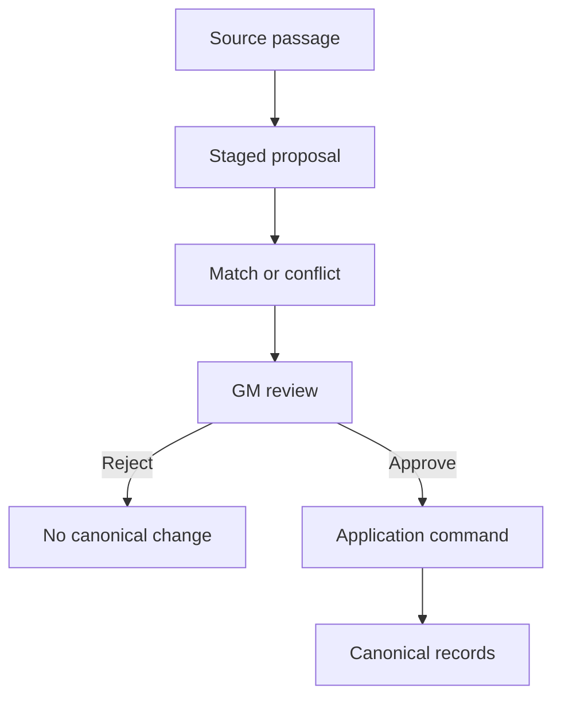
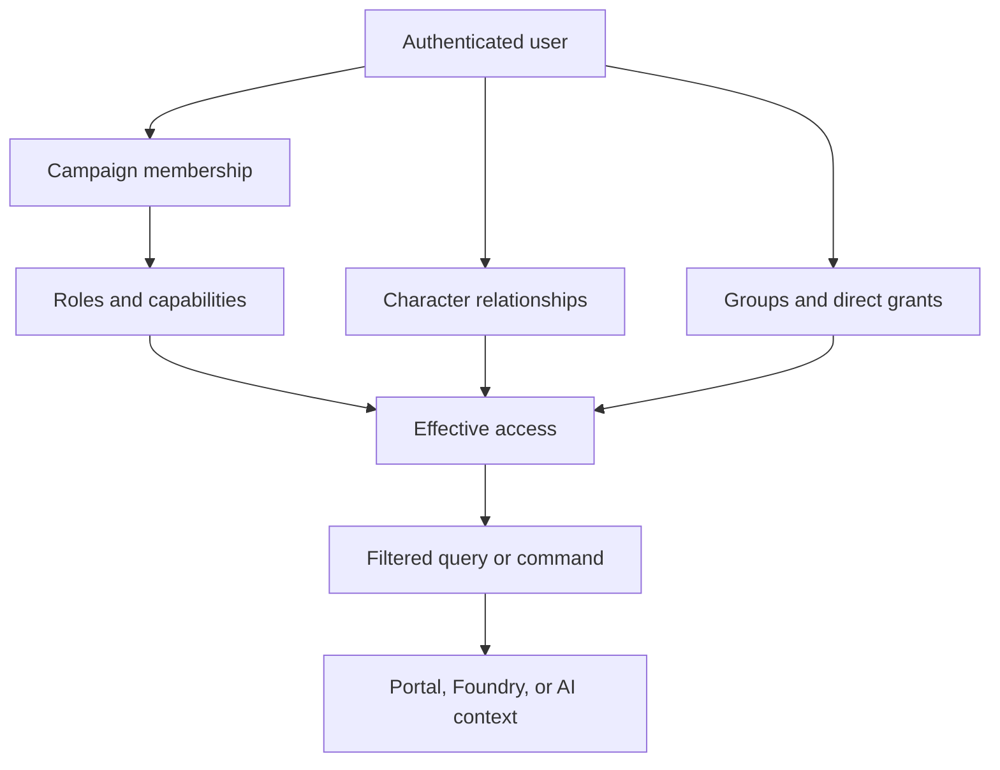

# Persistent World Web Portal UI Design

## 1. Purpose

This document defines the first-class web experience for the persistent tabletop roleplaying world platform. The portal is the primary out-of-session interface for players, GMs, assistant GMs, and observers. FoundryVTT remains the primary in-session tactical client. Discord is deferred until demonstrated demand justifies a later thin-client integration.

This document is the product-level authority for portal behavior, information architecture, authorization boundaries, and screen responsibilities. [`UI_STYLE_GUIDE.md`](UI_STYLE_GUIDE.md) defines the shared visual language, card and detail-page anatomy, responsive presentation, theme-token usage, and component-level presentation standards used to implement this design.

The portal must let an authorized user:

- understand the current campaign quickly;
- browse permitted world and campaign details;
- request summaries or ask questions on demand;
- work with one or more characters;
- see facts, beliefs, rumors, quests, sessions, and relationships from an explicit perspective;
- administer canon, users, roles, access, and import proposals when authorized.

The defining authorization rule is:

> Roles provide defaults, but users and details are many-to-many. A user may relate to many characters, facts, and other resources; each resource may relate to many users through roles, characters, parties, groups, knowledge, or direct grants.

## 2. Product principles

1. **Perspective is always visible in campaign work.** The active campaign, timeline, role, effective time, and optional character perspective appear in the campaign context area. The authenticated global shell remains available without a selected campaign; labels describe context and never grant capabilities.
2. **No hidden-data inference.** Unauthorized resources do not appear in pages, search suggestions, counts, links, relationship edges, identifiers, errors, caches, or AI context.
3. **Filter before synthesis.** The server resolves authorization before sending records to the UI or an AI provider. The system never creates a GM answer and redacts it into a player answer.
4. **Truth and awareness remain distinct.** Canonical truth, belief, rumor, knowledge possession, user visibility, and administrative permission are separately represented.
5. **Roles are not ownership.** Player, GM, and observer roles establish defaults; semantic character relationships and resource grants determine detailed access.
6. **Every important answer is traceable.** Summaries and answers identify perspective, effective time, source records, and rules citations when applicable.
7. **The MVP is useful, not encyclopedic.** Begin with concise collection cards, route-based detail pages, links, and focused GM tools. Interactive maps, graph explorers, and a generalized CMS are later enhancements.
8. **Progressive detail is addressable.** Collection cards summarize authorized records; opening a card navigates to a refreshable, bookmarkable detail route that performs its own current authorization check. A visual “expansion” never depends solely on cached list data.

## 3. Users and roles

| Role template | Primary needs | Default experience |
|---|---|---|
| Campaign owner | Administration and continuity | All campaign configuration plus GM tools |
| GM | Canon, secrets, preparation, approvals | Full authorized canon, hidden state, visibility preview |
| Assistant GM | Delegated preparation or portrayal | Only assigned GM capabilities and resources |
| Player | Character and party play | Associated characters, permitted knowledge, quests, recaps |
| Observer | Curated view | Explicitly published or granted resources only |
| Import reviewer | Campaign-data review | Import proposals and promotion decisions |
| Rules curator | Reference-source management | Rules sources, editions, rights, retrieval status |

A person may hold multiple roles in one campaign and different roles in other campaigns. Authorization checks capabilities, not role-name strings.

## 4. Information architecture

**Status: delivered** (Phase 13 navigation and settings redesign; revision `109_user_portal_preferences` and the portal commits recorded in [PLAN.md §23.6](README.md)). This section and §4.2–§4.7 describe the delivered *single-navigation and settings* design. The authoritative frontend is the React/TypeScript/Vite application under `portal/`.

History: before this redesign the header carried duplicate Home/Campaigns navigation and the theme selector, the campaign sidebar was owned by `CampaignLayout` (so it existed only on campaign routes), `/home` was a global dashboard, and the bootstrap's `selected_campaign_id` was only the first authorized campaign by name, with no persisted preference.

### One authenticated navigation system

The portal has exactly one primary navigation system for authenticated work — a persistent sidebar owned by the authenticated application shell — plus a minimal header.

- **Header** (`PortalHeader`): portal identity/branding, the narrow-screen navigation-drawer control where required, and the User Account/profile control (§4.3). Nothing else: no Home/Campaigns links, no other primary navigation, and no theme selector (theme selection moves to Settings, §4.7). For an authenticated user the brand links to `/home`, which is an authenticated landing resolver (§4.2), never a duplicate dashboard. For a signed-out visitor the brand is plain text.
- **Sidebar** (one `nav` landmark labeled "Main"): rendered by `AuthenticatedAppLayout`, not `CampaignLayout`, on every authenticated route — campaign pages, `/campaigns`, `/settings`, `/account`, `/platform/accounts`, and future authenticated global pages. It never appears on public pages: `/login`, `/activate`, `/reset-password`, `/campaign-invitations/accept` (logged-out onboarding and the authenticated manual fallback alike, since it is a public-layout route), and the public not-found state. An authenticated visitor on a public route keeps the header's brand link and profile menu as the way back.

Sidebar organization:

```text
Campaign  [▾]                        split control (P02-4): main control + separate "Show campaign menu" disclosure
  Campaign Home                       the resolved campaign's Home (a disabled entry when none resolves)
  Authorized Campaign A
  Authorized Campaign B
  Authorized Campaign C
  View all campaigns                  /campaigns
World  [▾]                            split control (P02-4); the single world group (Phase 14)
  All worlds                          /worlds — always enabled
  New world                           enabled by global capability world.create; otherwise a disabled non-link
  World overview                      enabled when the route or the retained selection names a server-confirmed world
  Timelines                           /worlds/{id}/timelines — the world's authorized timelines
  Timeline overview                   enabled only when a timeline is selected
  Campaign world                      enabled when a campaign resolves; /app/{campaignId}/world
Characters  [▾]                       split control (P02-4)
  Selected character                  the selected perspective's record shell (a disabled entry when none)
  All characters                      /app/{campaignId}/characters/all
Parties                             campaign.view; the campaign's party directory (/parties), independent of any selected character or membership
Quests
Sessions
Knowledge
Review queue, Items ▾                 canon.edit; Review queue and Definitions also need the world's private read (else the disabled entry "Needs a world role"); Items is a disclosure over Inventory (/items) and Definitions (/item-definitions)
Ask                                   server feature manifest
Access ▾                              disclosure; slot present if access.manage on any campaign
  Access Management
  Invitations
  Audit History
-------------------------------------
Collapse / expand navigation          always last
```

Rules:

- **One World group.** There is no separate singular "World" item beside the group; the campaign world page is the group's "Campaign world" child. World overview and Timelines are enabled only for a world the server has confirmed (`WorkspaceHierarchyProvider`: only once `GET /worlds/{id}` succeeds for the route's world, or for the authorized route campaign's world — campaign membership alone never enables World navigation, per ADR 0014; the campaign page's own context panel still uses the bootstrap names); otherwise they stay in place, disabled with "Select a world first". Timeline overview is enabled only when a timeline is selected — a timeline route whose ID is in that world's authorized timelines, or the route campaign's timeline, in both cases only if that world response lists it — otherwise it stays disabled with "Select a timeline first". **Timelines is world-scoped:** it opens the collection of every timeline the server returns for the world, never just a campaign's timeline. An unknown route ID adds nothing and is never echoed. Disabled entries are non-links with `aria-disabled="true"`, no `href`, no active styling, and the neutral reason as their description; they keep icon, label, and position in expanded, collapsed, and drawer modes. "New world" follows `global_capabilities`, never a display role: without `world.create` (held only by an active platform administrator or an effective built-in GM, ADR 0018) it stays visible as a disabled non-link. Timeline overview, like the Timelines collection and the timeline trees on the World overview, is a read destination and follows `world.view`, not `world.manage` (§4.8.12): a world Viewer, Reader, Reviewer, Editor and an Owner without system GM can all open it, and only the callers the server offers actions to see management controls. With a selected world whose `world.view` is not known its reason is "Not available for your account", not "Select a timeline first". For a world the server returns as view-only, World overview and Timelines open read-only pages. The group starts open on a `/worlds` or campaign world route.
- **Campaign choices** come only from the current authoritative session bootstrap (`campaigns`). The sidebar never invents, guesses, caches, or carries forward a campaign from a previous bootstrap, from browser storage, or from a stored preference. Selecting a different campaign only navigates to `/app/{campaignId}/home` (Infobox Campaign select or the sidebar list): nothing is selected, cleared, refreshed or reloaded beforehand, so the departure guard (§5.11) decides first and Stay changes nothing. The new campaign starts with its own character-perspective state because the session provider is keyed on the campaign scope (`RouteSessionProvider`); no pre-navigation `selectCharacter(…, null)` exists (CTX-2). **Changing character perspective** is an ordinary departure that starts a new task (§4.8.4, decision PD-6), not a same-page change and not a session reload (CTX-1): the Infobox asks the router for one destination, the chosen character's Characters details (`/app/:c/characters/:id`, or `/characters/all` for none), with a fresh Characters task and the context stamp that destination commits under; it carries nothing of the page left, so no old `character_id`/`party_id` query can turn the accepted change back. Only after the navigation is accepted does `CampaignLayout` commit the selection from the location, remount the page content (keyed on campaign and perspective, never `location.key`, so every perspective-dependent page reads again under the new perspective), and start the existing ticketed background `refresh()` that revalidates `character_perspectives`; the shell, sidebar and Infobox stay mounted and "Loading portal" is never shown. A perspective the refreshed bootstrap no longer lists is cleared at once and without a discard decision, as an **explicit choice of no perspective**: it never falls back to the server default (not even a sole remaining character, and not a different default that the same refresh names), and re-authorization alone never restores it or any other, so a refresh cannot remount away work entered since. **Ownership.** A revocation owns the selection only while that selection still reads none because of it. An accepted location takes ownership in one step: the layout stores the accepted perspective, records it as the committed one and (next) stamps the entry with it, so a revocation of the previous selection that is still outstanding, including one published in the same render as the accepted location, has nothing left to clear; an accepted explicit none is likewise not reported as a loss. A selection that is in place by any other route (an adopted URL character) supersedes the lost one in the same way, and a proposed selection the bootstrap does not authorize never wins. If nothing newer is in place, the revocation still clears to explicit none. The bootstrap's `selected_character_id` only **initializes** the selection: once a perspective is in use, however it was reached, the layout stores it as the selection (idempotently), and a later bootstrap default never replaces it; an uninitialized start still uses the authorized default. The content remounts (old private content is removed without asking to keep it), an address that still names the lost character is cleaned first (`character_id` and `party_id` removed by one replacement of the current entry, other parameters and the record's path kept) so no request is made as the lost character. Permission loss never waits for an answer and is not held by the page it removes: the replacement runs under a narrow exemption in `runPermissionLossCleanup` (only a same-path REPLACE of that exact entry, only for the duration of the call, nothing else), and a navigation question that was open is cancelled by its owner as the page goes away (the blocker's own reset on unmount; the held departure is never approved). A newer navigation takes ownership: the cleanup is dropped and the destination validates its own address. The explicit clear then re-stamps the history entry with no perspective, and a polite status says "Your selected character is no longer available." (no name, since it is no longer readable). Choosing a perspective afterwards is the ordinary guarded selection. The destination page is unchanged. Choosing the already-selected perspective does nothing. **View all campaigns** always links to `/campaigns`, the full campaign-selection route (§5.2).
- **Campaign, World and Characters are split controls** (P02-4, §4.8.3), never one control that is ambiguously both a link and a toggle: a main control and a separate disclosure button, siblings and never nested. The main control is a link to the selected context's default details where that is a destination worth going to, and otherwise a button that toggles the menu (rule table in §4.8.3). The disclosure ("Show campaign menu", "Show world menu", "Show characters menu"; `aria-expanded`, `aria-controls`) always toggles, so expanding the menu is directly usable in every state. The Campaign menu lists the selected campaign's Home (a disabled "Campaign Home" entry when none resolves, see "Stable structure"), every authorized campaign, and View all campaigns. It starts open on `/campaigns` and closed elsewhere. The active campaign's entry carries `aria-current="true"`.
- **Resolved campaign for campaign-specific links** (`resolveNavigationCampaign`), by precedence: (1) the route's `:campaignId` when it is in the current bootstrap's `campaigns` — a route that names a campaign the bootstrap does not contain resolves nothing (no saved campaign stands in for it); (2) when the route names a world instead (`/worlds/{id}/...`), the **selected campaign** (the explicit selection this tab retains, §4.8.2), and only when it belongs to that confirmed world — and to the named timeline, when the route names one; otherwise nothing resolves. An explicit destination that is not confirmed resolves nothing and is never replaced by a retained campaign: a world still loading, unknown, denied, or failing its read, or a timeline that is unknown or not among the world's authorized timelines, leaves the campaign-specific entries disabled; (3) otherwise (the route names no campaign and no world: `/campaigns`, `/settings`, `/worlds`, `/worlds/new`) the selected campaign if the bootstrap still lists it; otherwise none. **There is no fallback to `last_visited_campaign_id`, `startup_campaign_id` or a world's only campaign (PD-2, P02-3):** those remain inputs of the `/home` landing only (§4.2), which enters a campaign, which then becomes the selection. The route always wins over the selection, so the sidebar and the hierarchy panel always describe the same context. A route campaign ID that is not authorized is never used or echoed. With no resolved campaign (including a person who has not selected one yet), the Campaign and Characters main controls are buttons, the menu entries that need a campaign (Campaign Home, Campaign world, Selected character, All characters) and Quests/Sessions/Knowledge/Ask/Access are not rendered as links — they remain in place as disabled entries (see "Stable structure") — so no link ever contains a guessed ID.
- **Stable structure.** Route context never adds, removes, or reorders sidebar entries; a missing prerequisite switches an entry to disabled instead. A disabled entry is never an anchor: it is a non-focusable element with the normal icon and label, `aria-disabled="true"`, no `aria-current`, muted styling, no navigation, and the prerequisite as its accessible description (`aria-describedby`) and tooltip (collapsed tooltips are "Label: reason"). Reasons are neutral — "Select a campaign first", "Select a world first", "No timeline available", "Not available for your account", "Unavailable for this campaign", or the server-provided feature reason for Ask — and never carry a name, ID, capability, or count. Capability-gated slots follow the caller, not the route: "New world" follows `global_capabilities`; the Access slot exists only for a caller with `access.manage` on at least one authorized campaign, and is enabled only when the resolved campaign grants it. The Knowledge slot is a plain link, except that it becomes an expandable group with **Claims** and **Member preview** children when the resolved campaign grants `access.manage`; Claims stays active on the collection and on claim pages, Member preview on its own routes, and the group opens on load when either is current. The sidebar presents server-computed state and never grants access; the server remains the enforcement boundary.
- **Ask** follows the server feature manifest exactly as before: a link only when `features.ask` is true, otherwise a visibly disabled item that is not a link and makes no request.
- **Access** is a disclosure button (not a link) over **Access Management** (`/access`), **Invitations** (`/access/invitations`), and **Audit History** (`/access/audit`). The group is shown only when the resolved campaign's server-supplied `capabilities` include `access.manage` — the capability each of those routes' APIs already requires — and is never shown with no visible child. Hiding it is presentation only; each route and API re-authorizes. The Access page's own tab strip remains as page-local navigation.
- **Items** is a disclosure button (not a link) over **Inventory** (`/items`, which also holds an item's workspace and its edit form) and **Definitions** (`/item-definitions` and its forms), built on the same expandable group as Knowledge and Access. It is shown only on a campaign whose `capabilities` include `canon.edit` (the capability both areas' APIs require) and is otherwise absent; with no resolved campaign it is the usual disabled entry. There is no separate top-level Item definitions link. **The selection follows the address alone:** an item opened from the World page lies under the Worlds group (**Campaign world**), never under Items, and router state never selects a destination.
- **Collapse/expand** stays the last item. Collapsed, the sidebar is an icon rail: every item keeps an accessible name (visible label hidden, `title` shown), each split control (Campaign, World, Characters) keeps both of its controls as two stacked icon controls (the main control with its `title`, and the disclosure with its chevron), and the disclosure opens the menu as a bounded flyout; activating the Access, Knowledge or Items button in the rail opens its children the same way, with their labels shown, so they stay keyboard-reachable. The collapsed/expanded choice is a per-viewer convenience persisted in browser storage (never authentication data), so it survives the scope-keyed remount.
- **Loading and refresh:** every campaign-scope change remounts the session provider and refetches the bootstrap (§4.5). During that loading state the shell keeps the header, the sidebar frame, the collapse/expand control, the drawer control, and the static **View all campaigns** destination; bootstrap-derived entries are replaced by a busy placeholder until the fresh bootstrap arrives. The previous scope's campaign list is never shown in the meantime. A session-check error keeps the same frame with no bootstrap-derived entries. Authentication expiry removes the authenticated shell and follows §4.2.

Landmarks: the header `banner`, the sidebar `nav` ("Main"), and page-local navigation such as the Access tab strip ("Access"). There is no global Home page; Campaign Home (`/app/:campaignId/home`) is the only Home. Role and perspective labels are contextual display data, never locally derived authorization. Changing perspective obtains fresh server-authorized data rather than filtering previously downloaded records.

Component hierarchy:

```text
App
  PublicLayout                 header (identity; profile menu when authenticated), no sidebar
    /login, /campaign-invitations/accept, /activate, /reset-password, public not-found
  AuthenticatedAppLayout
    PortalHeader               identity, drawer control, profile menu   (outside the session boundary)
    PortalSidebar              persistent; reads session state directly (outside the session boundary)
    AuthenticatedSessionBoundary
      Route outlet
        /home                  LandingRedirect (no content)
        /campaigns             CampaignsPage
        /settings              SettingsPage
        /account               AccountPage
        /platform/accounts     AdminAccountsPage (platform-authorized only)
        /app/:campaignId       CampaignSessionBoundary -> CampaignLayout
                                 WorkspaceFrame: <main> + HierarchyContextPanel
                                 Campaign page outlet
        /worlds/*              WorldWorkspaceLayout
                                 WorkspaceFrame: <main> + HierarchyContextPanel
                                 World / Timelines / Timeline page outlet
    PortalFooter
```

`AuthenticatedSessionBoundary` remains the single authenticated session gate. `CampaignSessionBoundary`/`CampaignLayout` own campaign-specific context and authorization — the authorized-campaign lookup, perspective wiring, the campaign-not-found state, and the last-visited update (§4.7) — but no longer own navigation. `WorkspaceHierarchyProvider` (mounted in `AuthenticatedAppLayout`, shared by the sidebar and the context panel) derives the route's world and timeline from the route and confirms them against server data; it stores nothing. The person's explicit selection is held by a separate `SelectedContextProvider` mounted in `main.tsx` **above** `RouteSessionProvider`, so the scope-keyed remount does not lose it (§4.8.2).

### 4.1 Reusable presentation system

A small set of reusable `portal/src/components` primitives supports the screens below rather than each screen inventing its own layout. The exact component names may evolve, but their responsibilities remain separate:

- **`HierarchyContextPanel`** answers "where am I in World → Timeline → Campaign → Character, and which perspective am I using?" It is one compact, infobox-styled panel with four labelled sections — **World, Timeline, Campaign, Character**, in that order — rendered by `WorkspaceFrame` on every World and Campaign workspace page (`/worlds/*` through `WorldWorkspaceLayout`, `/app/:campaignId/*` through `CampaignLayout`), so it persists across All Worlds, World Overview, the Timelines collection, Timeline Overview, and Campaign pages. What a page reads is route-derived and the panel never stores anything; a campaign page always shows its own route campaign, and a World or Timeline page may additionally show the campaign this tab retained, labeled **Selected campaign**, only while it belongs to the confirmed world and timeline (§4.8.2). Per page: All Worlds selects nothing; World Overview and the Timelines collection select the world; Timeline Overview selects world and timeline; a campaign page selects world, timeline, and campaign, with an optional authorized character perspective. Each level is a labelled `<select>` whose options come only from authoritative data — the same deduplicated world choices All Worlds shows (`GET /worlds` merged with the bootstrap campaigns' worlds by `buildWorldChoices`, [ADR 0019](adr/0019-world-visibility-and-viewer-role.md); the list is identical on every page, and choosing a campaign-visible world opens that campaign's World Explorer), the selected world's timelines (`GET /worlds/{id}`), and the session's authorized campaigns for that world and timeline. A level with no actionable destination stays visible and disabled (`disabled` is exposed to assistive technology) with a visible reason it is described by; the empty "No selection" placeholder is never a choice. The options are built by one pure model (`navigation/contextOptions.ts`, §4.8.12): the Timeline level follows `world.view` and, for a caller without it, offers the timelines of their authorized campaigns (CN-1, with an inline campaign chooser where several campaigns share a timeline); every level follows the meaningful-choice rule with visible reasons and read-only retries (CN-2); explicit World entries are reconciled against newer world reads by when each read started. Choosing an option is an ordinary departure that starts a new task (§4.8.4: the existing guard decides first, nothing is committed ahead of the accepted navigation, and choosing a character perspective opens that character's Characters details), so lower levels clear because their routes unmount: changing the world clears timeline, campaign, and character; changing the timeline clears campaign and character; changing the campaign makes the new route campaign the selected campaign and uses only that campaign's server-authorized default (the previous campaign's perspective is replaced when the route's campaign is adopted, §4.8.2). While a newly chosen world is unconfirmed the panel shows no selection and no previous options. **Character perspectives are Campaign-membership and relationship scoped** — they come from the route campaign's bootstrap entry, never from World-scoped characters, and are not selectable outside a campaign. **Party memberships.** With a character selected, a native collapsed **Parties (N)** disclosure sits directly beneath the selector (nothing is shown without a character, as for the other character details). It lists, in a stable case-insensitive name order, every party the character currently belongs to in this campaign and timeline, from `GET /campaigns/{id}/characters/{character_id}/parties`: the complete membership (never paged), by the same rule as the bootstrap's `authorized_parties` and `resolve_party_perspective` (current membership, party attached to the campaign), with archived parties shown only to people who can edit canon. The request is made only for a character the caller holds `character.view_knowledge` for, in the campaign's own world; any other character, a revoked relationship, a denied character or a campaign the caller is not in is the same fixed not-found, which the panel shows as "Parties unavailable." with no count, name or identifier. Loading ("Loading parties…"), a failed load (with *Try again*), a loaded empty list ("Parties (0)" with "No party memberships.") and an unset campaign clock (no count and no empty message: "Party membership cannot be determined because the campaign time has not been set", with a Campaign Home link only for `canon.edit`) are distinct, the count is exactly the list shown, and the list is requested per campaign and character, so one character's parties never appear under another's and each character's disclosure starts collapsed. A party name is a link to the existing party page only when the server says the caller may open it (`can_open`, today editors); otherwise it is plain text. It is an affiliation list only: expanding it or opening a party never changes the Knowledge filters, the selected party or what any character knows. A route world or timeline the server does not authorize selects nothing and its ID is never rendered. It collapses behind a native disclosure control on narrow screens and sits in the right-hand column from 64rem.
- **`InfoBox`** answers "what are the important facts about the entity on this page?" It is a generic, Wiki-style label/value panel (title, optional subtitle/image/status, label/value sections, related links) with no built-in knowledge of any entity type; per-entity wrappers (e.g. `CampaignInfoBox`) translate an authorized domain record into the generic model and are responsible for authorization-safe field selection.
- **Collection-card primitives** answer "which authorized record should I open?" A responsive card grid presents concise, domain-mapped cards for world entities, knowledge, quests, campaigns, and other browsable collections. Cards use real links, expose only fields present in the audience-safe list contract, and do not fetch or imply inaccessible detail records.
- **Detail-panel primitives** answer "how is this authorized record organized?" A full-page detail layout composes stat cards, semantic fact groups, compact lists or tables, and bounded panels under one page heading. Domain-specific wrappers decide which authorized fields belong in each panel; a generic primitive never reflects over an arbitrary API object.

These concepts stay distinct: context describes the viewer's current vantage point; an infobox describes compact facts about a subject; a collection card supports discovery and navigation; and a detail surface organizes the complete authorized view. `InfoBox` remains available for compact subject summaries and the context panel retains its specialized structure. None infers access, filters hidden records, reflects over arbitrary fields, or exposes internal identifiers or authorization metadata — that remains the server's responsibility.

Activating a navigable card changes route and loads the detail contract for that campaign and perspective. The detail page may visually continue the selected card's category, title, status, and surface treatment so that it feels expanded, but correctness, deep linking, refresh, browser Back/Forward behavior, and authorization do not depend on animation.

### 4.2 Root, authentication, landing, and deep links

- `/` uses replacement navigation to `/login`. With a valid session, the login boundary replaces `/login` with the post-login destination below.
- **`/home` is an authenticated landing resolver, not a content page.** It renders no dashboard; once the bootstrap is authenticated it replaces itself (`<Navigate replace>`) with the landing destination, so Back never returns to `/home`. It stays a valid route for old bookmarks, the brand link, and the ordinary login default.
- **Post-login landing precedence**, evaluated after sign-in or on an authenticated visit to `/login`:
  1. An explicit security/onboarding continuation wins. A live campaign-invitation onboarding continuation keeps its existing explicit **Resume invitation** / **Continue** choice on the login page ([PHASE13E_ACCESS_CONTRACT.md §3n](api/ACCESS_CONTROL.md#3n-single-link-invitation-onboarding-delivered-checkpoints-8a-8d)); a validated protected-route return path (below) is the other explicit continuation. **Continue**, and every login without a continuation, goes to `/home`.
  2. `/home` then resolves: no authorized campaigns → `/campaigns`.
  3. Exactly one authorized campaign → its Campaign Home.
  4. Startup mode **Always open this campaign** with the preferred campaign still authorized → its Campaign Home.
  5. Otherwise, the last-visited campaign if still authorized → its Campaign Home.
  6. Otherwise → `/campaigns`.

  Steps 2–6 are computed by the server into the bootstrap's `startup_campaign_id` (§4.7) so the rule lives in one place; the client navigates to `/app/{startup_campaign_id}/home` when that ID is in the current `campaigns` list, and to `/campaigns` otherwise. The client never picks the first or alphabetically first campaign when several exist and no valid preference resolves. A stored campaign that is inaccessible, revoked, ended, archived, or deleted is never disclosed or navigated to.
- Successful logout revokes the server session, clears protected client context, and routes to `/login` with no continuation state. A failed logout shows a safe recoverable error and retry; it must not claim sign-out succeeded.
- **Delivered.** Known protected deep links without a valid session route to login using replacement navigation, carrying the intended destination in router history state (never the URL). `AuthenticatedSessionBoundary` sets `state={{from: pathname+search}}` (the hash is never carried); `LoginPage` resolves it through `utils/postLoginDestination.ts`'s same-origin, allowlisted-path check before navigating, and rejects anything else (including `/login` itself and other public routes) back to `/home`. `/settings` is on that allowlist. The destination still fully reauthorizes on arrival — this allowlist is a UX convenience, not a security boundary.
- `/campaign-invitations/accept` retains its public single-link onboarding and authenticated manual-token fallback. Inline sign-in/registration and the server-side onboarding session continue under [PHASE13E_ACCESS_CONTRACT.md §3n](api/ACCESS_CONTROL.md#3n-single-link-invitation-onboarding-delivered-checkpoints-8a-8d); the ordinary landing rule must not interrupt invitation completion, and its completion link to `/campaigns` is unchanged. Do not retain invitation secrets in a return path.
- Unknown routes display a proper not-found state, including unknown campaign sections; do not turn a wildcard into a login redirect. A known protected route still checks its session and authorization. Missing and unauthorized resources remain indistinguishable.

### 4.3 Profile (User Account) menu

One profile button in the header. Display the user's server-provided display name where space allows and initials in the avatar position by default. The fallback order is a future configured profile image, initials, the first usable account identifier already authorized for this viewer, then a generic account icon. Initials remain the default without a configured image. The current bootstrap supplies `user.display_name` and an opaque `user_id`, not a profile image or displayable login identifier; never show the UUID or fetch another account's identifier to fill an avatar. The generic icon covers an unusable display name until an authorized identifier is available.

Menu order:

1. Identity summary for the signed-in user.
2. **Settings** linking to `/settings` (§4.7).
3. **Account & Security** linking to `/account` — the existing self-service password-change and own-session page, renamed in the menu only.
4. **Platform Accounts** linking to `/platform/accounts`, only when the bootstrap's `global_capabilities` contains `accounts.manage` (§4.4), kept under its **Administration** group label; omit the group otherwise.
5. **Log out**, separated from navigation as an action.

Allow future account destinations without designing profile-image upload or extending profile contracts. The button needs an accessible name even when the display name is visually hidden; decorative avatar content must not duplicate that name.

Keep the delivered disclosure pattern (deliberately not an ARIA `menu`): a real button with `aria-expanded` and `aria-controls`; Enter/Space opens it and moves focus to the first item; Tab moves through native links/buttons and leaving the popup closes it; Escape closes and returns focus to the profile button. Outside-click and focus leaving the menu close it; dismissal must not steal focus from an outside control the user activated. Close on navigation or logout. Hidden menu content is absent from keyboard and screen-reader navigation. Every action remains usable by keyboard and touch, with visible focus and no hover-only controls.

### 4.3a Scoped roles in the portal ([ADR 0020](adr/0020-scoped-system-world-and-campaign-roles.md))

Every gate reads server data (`global_capabilities`, a campaign's `world_capabilities`, a world's own `capabilities`) and never a role label.

- **Accounts with no campaigns** (`/campaigns`): a game master (`world.create`/`campaign.host`) sees "You are not in any campaigns yet." with **Create a world**, **Create campaign** and **Accept a campaign invitation**; anyone else sees "Ask a GM to invite you" and **Accept a campaign invitation**. An Administrator who is not a GM is offered neither creation link. The sidebar keeps its stable structure; campaign entries stay disabled with "Select a campaign first".
- **Worlds list:** each world shows the caller's roles ("Owner", "Editor · Reviewer", "Reader", "Can host campaigns").
- **World overview:** an Owner with the game master role sees the full overview plus **Sharing** and **Published canon**. Every other role (and an Owner whose system GM was revoked, with an explanation) sees the limited overview: their role, and only the links their capabilities allow (**Published canon**, **New timeline** for an Editor, **Host a campaign here** for a use-grant holder).
- **Sharing** (`/worlds/:worldId/sharing`, `world.share`): role holders and use grants with add, end and revoke, and ownership transfer (`world.transfer`) behind confirmation dialogs whose focus returns to the trigger. Non-Owners get a disabled sidebar entry, not a link.
- **Published canon** (`/worlds/:worldId/canon`, `world.canon.read`): the World Reader surface. Published definitions as cards; no drafts, GM-only fields, revisions, provenance or campaign data.
- **Campaign setup** (`/campaigns/new`): the world picker lists only worlds with `campaign.create`; the timeline step lists only the timelines the server marks eligible and explains the others ("already hosts a campaign. Ask a world owner or editor to branch a timeline for you.").
- **Authoring screens:** when the campaign's `world_capabilities` lack `world.canon.edit`, the create screens and the world page's creation links show "Editing shared world content requires the world Editor role. Ask the world owner." instead. World-time points, item instances and player-character identity are unaffected.
- **Per-record eligibility** (integration, CP-4c). A record's own read (the World Explorer location, religion, organization and item details, the character, knowledge and quest details, and the lifecycle read) carries `authoring: {campaign_originated, can_read_private, can_edit, can_review}`, resolved by the server with the resolver the commands use. The Edit link, the character Manage links, the lifecycle panel and the workspaces read these fields and nothing else; the portal never infers eligibility from a role name or a category. The lifecycle read offers only the actions the caller holds (submit, return to draft and delete a draft are editing; approve, reject, publish, supersede, archive and restore are reviewing; a Reviewer is never offered Edit and an Editor is never offered Approve). A response with no `authoring` grants nothing. The authoring option catalogs report `can_create` for the world Editor only.
- **Workspaces keep their structure** (World record, Knowledge claim, Quest, item). A campaign GM with no world role gets the published record, its GM-only fields, and the campaign's own operations (organization status, running an NPC, who knows a claim, quest progress, item instances, a player character's identity and lifecycle). The preparation, review and publication sections are listed as unavailable text with the reason, never as links, and their content is never mounted or requested: no lifecycle, provenance, revision, source or authoring read is sent, so a denied preparation section cannot blank an otherwise permitted record. An address that names an unavailable section falls back to the first usable one. A quest for a GM without a world role shows the published quest and its progress panel instead of the workspace. A player character's own lifecycle follows the campaign; its sources and relationships are shared world canon and follow the world. **Area now** (a dungeon area's runtime panel) is the campaign's: it reads `GET /campaigns/{id}/dungeon-areas/{area_id}/runtime`, a projection of only what recording state needs (the dungeon's name, the area's recorded state, the parts and connections with their recorded statuses and last-event tokens, the status choices and limits, and whether state may be recorded), authorized like the audience-safe area read (campaign `canon.edit`; an unpublished area or dungeon, a per-area `campaign.view` deny and a foreign campaign are the same 404 for a caller without the private-read capability; a connection to an area the caller cannot see is not listed). It returns none of the authoring read's descriptions, hidden flags, severities, dimensions, revisions or actions, and it grants no edit; recording state is its own command with its own authorization. The panel makes no private-authoring request; a failed optional read leaves the rest of the record usable with a read-only retry, and an unavailable answer says so. Contents (the area's structure) still reads the authoring view and needs the world's private side.
- **Losing permission while editing.** A save refused with `world_authority_required` (or a record that has become unavailable) stops all further writes, drops the form and everything the server's private read had filled it with, and shows back, read-only, only what the person changed (the fields that differ from what they were given, and the change note) so they can copy it. A plain 403 is not treated as loss: it is also what a stale CSRF token answers, and keeps the form with the session check. A network or server failure keeps the draft and its version as before.

### 4.4 Platform Accounts authorization

Platform Accounts is global platform administration, independent of campaign selection or campaign administration. Visibility derives exclusively from authoritative server-provided platform permission, such as an `accounts.manage` capability. Never infer it from GM, campaign owner, system-role labels, campaign roles, or campaign `access.manage`.

**Delivered contract ([ADR 0020](adr/0020-scoped-system-world-and-campaign-roles.md)):** the bootstrap carries the server-computed `global_capabilities` (`accounts.manage`, `system_roles.manage`, `system_roles.grant_admin` while the deployment enables the in-app Administrator grant, `world.create`, `campaign.host`, `world.administer`) and a display-only `system_roles` list; `is_platform_administrator` is gone. The menu item and the `/platform/accounts` route adapter gate on `accounts.manage` only. The page lists each account's system roles, offers a System roles editor (GM, Player and Observer checkboxes; the Administrator checkbox is disabled with "Granting Administrator is done by the operator script on this deployment" unless `system_roles.grant_admin` is present), a create-account form with the same role choice (default Player), and a notice on an account that owns worlds no one can currently manage.

Hiding a menu item is presentation only. The direct page route must enforce platform eligibility, and every list/mutation request must independently enforce backend authorization. Preserve the fixed non-disclosing not-found/unavailable behavior for unauthorized callers (currently server 404), without leaking account names, counts, identifiers, or diagnostics. **Delivered:** `/platform/accounts` is the browser route (its route adapter itself is the gate, so a non-administrator never mounts the page and triggers no list request), with `/admin/accounts` kept only as a redirect for existing bookmarks. The backend account APIs are unchanged and still live at `/api/admin/accounts*`.

### 4.5 Campaign discovery and switching

The full `/campaigns` page provides complete authorized campaign browsing and selection with the fuller audience-safe information available for each campaign (§5.2). The sidebar's Campaign Home campaign list is the quick switcher during campaign work and always ends with **View all campaigns** (`/campaigns`); the sidebar is present on every authenticated route, so it is never the only way out of a selected campaign. The former campaign-only context panel's switcher and its **Browse all campaigns** link are retired (§4); the hierarchy panel's Campaign selector lists only the authorized campaigns of the selected timeline.

Preserve these authoritative behaviors:

- Choices come only from authorized bootstrap/session data, never guessed IDs, stored preferences, or locally filtered role lists.
- Revalidate campaign authorization through fresh bootstrap and server checks when campaign scope changes, including browser Back/Forward. A missing, revoked, or unauthorized campaign is not disclosed.
- Reset or refresh campaign-scoped timeline, provider, perspective, character, party, detail, and preview context according to existing contracts. Do not carry one campaign's data under another campaign's URL. `RouteSessionProvider` remounts `SessionProvider` (and the application subtree beneath it) when its campaign route scope changes. The retained selection lives above that remount (§4.8.2), but it never crosses campaigns: arriving on a campaign route replaces any retained selection of another campaign before a page reads under it, so the target campaign starts at its own server default. Shell persistence must preserve those security behaviors: the sidebar's persistent state is limited to its collapsed/expanded presentation.
- **Delivered.** Switching always enters `/app/:campaignId/home`; section/detail preservation is not offered.
- Roles remain display information, not locally derived capabilities.

### 4.6 Route model

| Browser route | Boundary and purpose | Status |
|---|---|---|
| `/` | Replacement redirect to `/login` | Delivered |
| `/login` | Public login; valid session follows §4.2's landing precedence | Delivered |
| `/campaign-invitations/accept` | Public onboarding/manual authenticated acceptance under the existing contract | Delivered |
| `/activate`, `/reset-password` | Public one-time-link pages (fragment tokens) | Delivered |
| `/home` | Authenticated landing resolver; renders no content (§4.2) | Delivered |
| `/settings` | Authenticated user settings: appearance and campaign startup (§4.7) | Delivered |
| `/campaigns` | Authenticated full campaign browsing/selection | Delivered |
| `/account` | Authenticated Account & Security: own password and sessions | Delivered |
| `/platform/accounts` | Authenticated, platform-authorized Platform Accounts | Delivered |
| `/admin/accounts` | Redirect to `/platform/accounts` for old bookmarks | Delivered |
| `/app/:campaignId/home` | Campaign-authorized Campaign Home | Delivered |
| `/app/:campaignId/{world,characters,quests,sessions,knowledge}` | Campaign pages | Delivered |
| `/app/:campaignId/access` | Access Management, gated by `access.manage` | Delivered |
| `/app/:campaignId/access/invitations` | Invitations, gated by `access.manage` | Delivered |
| `/app/:campaignId/access/audit` | Audit History, gated by `access.manage` | Delivered |
| `/app/:campaignId/ask` | Ask, under its existing feature-readiness rules | Placeholder |
| `/worlds` | Every world the caller can see (Active/Archived filter), from `buildWorldChoices`: worlds from `GET /worlds` link by their own `capabilities` (`world.manage` opens the authoring overview; `world.view` only, e.g. `world_viewer`, opens the read-only overview marked "View only"); a world visible only through an authorized campaign is listed under Active, marked "View only" with "Through campaign …", and opens `/app/{campaignId}/world`, never a `/worlds` route. One entry per world; explicit world authority wins; a world with neither is not listed. "Create world" appears only with the bootstrap's `world.create` | Delivered (Phase 14; access-aware links ADR 0018; campaign-derived entries ADR 0019) |
| `/worlds/new` | Create a world (rulesets, primary timeline); `?returnTo=/campaigns/new` resumes campaign setup. Route-guarded: without `world.create` an explicit **Access denied** renders and the form never mounts (no `GET /rulesets`) | Delivered (Phase 14; guard ADR 0018) |
| `/worlds/:worldId` | World overview: details, rulesets, timeline lineage, managed campaigns, server-computed actions. A world without `world.manage` renders read-only: no create, edit, archive, restore, timeline-authoring, or campaign-creation controls, and timelines as plain names | Delivered (Phase 14) |
| `/worlds/:worldId/edit` | Edit world name and description. Route-guarded: the world read model must list `update` in `available_actions`; otherwise the form never mounts and the page says why (**Editing unavailable**: the world's blocked reason, its archived status, or the role; a missing or hidden world is the neutral **World not available**; a failed read offers **Try again**) | Delivered (Phase 14; guard ADR 0018) |
| `/worlds/:worldId/timelines` | World-scoped Timelines collection: every timeline the server returns for the world as a lineage, each linking to its detail route; loading, empty, denied/unavailable (non-disclosing), and retryable-error states | Delivered (Phase 14 navigation correction) |
| `/worlds/:worldId/timelines/new`, `/worlds/:worldId/timelines/:timelineId`, `…/edit`, `…/branch` | Timeline management and branching; the branch form offers a labeled "latest" point or a moment from the server-provided branch-point list, and explains when only "latest" exists | Delivered (Phase 14) |
| `/campaigns/new?worldId&timelineId` | Three-step campaign setup | Delivered (Phase 14) |
| `/app/:campaignId/world/:category/:entityId[?section=…]` for `location`, `organization`, `religion` and `character`, and the edit pages `…/world/location/:id/edit`, `…/world/organization/:id/edit`, `…/world/religion/:id/edit`, `…/world/dungeon/:id/edit`, `…/world/dungeon/:id/areas/:id/edit` and `…/characters/:id/edit` | For editors (a campaign that grants `canon.edit`), the page of a place (settlement, region, building and the other place types), a dungeon, a dungeon area, an organization, a religion, an NPC or a player character is the **World record workspace**, a Guided workspace like the item workspace and the Knowledge claim. Everyone else gets the read-only reader (Overview, Containment, Current State and the other panels the World API allows; an organization's reader adds its founding and dissolution, a government's form of government, a political faction's **Ideology** panel, and a read-only **Members and offices** section), which sends no authoring, lifecycle, sources, relationship or revision request. An item keeps the item workspace (`/world/item/:id`); an event stays a plain record, because it has its own recorded, voided and corrected status machine (editors get an **Open the event record** link to `/events/:id`); a relationship stays a section of the records it joins. **Layout:** the header (**Back to World** with the browser's category, search and page, or **Back to Review queue** with its filters when the record was opened from the queue; the type; the name; the record's real status badge from the lifecycle read, never guessed; the summary; one **Next** link), then the stages **1. Prepare** (Details, **Areas** and **Connections** for a dungeon, **Contents** for an area, Sources, Relationships), **2. Review & publish** (Review, Publication) and, only for the records the server lets a published record be run, **3. Use in play** (an area: Area now, with the controls that record its state; an organization: Members and offices; an NPC: Run this NPC and Inventory; a player character: Player and Inventory; a character whose kind could not be read: Inventory). Stages and sections are links in `?section=…` (other parameters and the return state kept; a missing or unknown value is replaced, not pushed; focus moves to the section heading), never call the API and never imply or change a status. All sections stay mounted, so a half-typed source survives switching, and each keeps its own saves, confirmations, required reasons and stale-write handling. The default section follows the server's lifecycle (in review or approved: Review; archived or replaced: Publication; otherwise Details) and **Next** is derived only from `available_actions` (Submit for review, Approve it, Publish it, Return it to draft to rework it, Restore it). **Details** shows the reader's own panels and an Edit link only when the server offers `update` (a draft or a published record; an in-review, approved, rejected, replaced or archived record says why editing is unavailable); the edit pages return to the section they were opened from. **Review** says what a reviewer decides on (the status in words, the latest revision and who made it, links to compare it with the previous version and with the version published as canon, and whatever must happen first) and offers the next forward step (**Submit for review**, **Approve** or **Publish as canon**) only when the server offers that step, so a draft is submitted from Review itself with no extra click; it infers nothing from the stage. **Publication** is the one lifecycle rule (next step plus More, actionable reasons inline, the rest under **Why other actions are unavailable**) and a **Revision history and comparison** link. **Sources** and **Relationships** are the existing panels, embedded. **Areas** (dungeon) is a compact ruled list of the dungeon's areas in the server's order (by name; areas do not nest and have no stored order): each row has the area's name (a link to its own workspace, keeping the return state), its kind, **its own** status badge, what it holds in words (the editor's definition counts, concealed children included) and how many connections touch it, and **Edit** when the server lists `update` for that area. **Add area** (only with the dungeon's `add_area`) reveals one small form above the list, stays on the list, clears and keeps focus in the name, and announces "Area X added as a draft"; without it a line says why. **Connections** (dungeon) lists each passage in words with **Edit** (one editor under its row at a time), **Remove** (confirmed, offered only while the dungeon is a draft, with a line saying so otherwise) and an **Add connection** form revealed above the list (needs two areas, else a line and a link to Areas). **Contents** (area) shows the features, hazards and interactables as three compact groups with on-demand add and edit forms and confirmed removal, and the area's connections linking to the dungeon's Connections; whether a part is triggered or destroyed is Area now's, never Contents'. The dungeon and each area are **separate records with their own status**: publishing, archiving or replacing the dungeon changes no area, so Review says where the areas stand ("N areas: X published, Y draft…") and that publishing the dungeon does not publish them. An area header names its dungeon (**In Crypt**, a link to its Areas). An editor that stays mounted while the dungeon is read again follows its saved row while untouched, pauses a dirty draft whose row changed elsewhere (**Load the latest saved version** or **Keep my changes and save over it**), and closes only when the server accepted the save; a structural command reads the dungeon, its lifecycle and its revisions again so a publish right after it is not stale. The old `?section=structure` address is replaced by `?section=areas`. **Use in play** needs a published, active record: otherwise the section says why (a draft or in-review area, organization or NPC, an archived one, a replaced one) and withholds the commands: an NPC's Run controls, an organization's **Set status** and **Add a member** (the roster, hit points and inventory stay readable, and an organization's roster reporting that an editor may edit is permission, not eligibility). A lifecycle read that failed is not eligibility either: the organization's commands are withheld and the NPC's own status read decides. The server still decides; an area's timeline state is shown and recorded in the area's **Area now** (a **Change** control per part opens one small editor that sends the event it was opened from, and pauses if that state moved on), never on the area's definition; it needs the area and its dungeon both published (`can_set_state`), else a line says to publish the dungeon first. A lifecycle step or a save refreshes the record in place, and the panels that read the record themselves (Run, Members and offices) read it again without being remounted, so publishing unlocks them and a recorded hit point or status shows in Details (a recoverably failed read keeps what those panels hold and what was typed in them, says in the panel that what is shown may be out of date, and offers **Try again**, which only reads and never repeats a command; the page's own successful read of the record's status decides whether Run's commands are offered, so a retained NPC status cannot override it): a recoverable refresh failure keeps the last read with a warning and **Try again**, a denied or unavailable answer fails closed, and nothing typed in a section is lost. A record the server reports as not lifecycle-managed (a bare character) shows only its details, with no stages and no publication; a lifecycle read that failed is told apart, keeps the stages and offers **Try again** | Delivered (World guided workflows); automated tests, and a scripted real-browser pass recorded in [PHASE15_VERIFICATION.md](PHASE15_VERIFICATION.md); the manual screen-reader pass is pending |
| `/app/:campaignId/review[?status=&type=]` and `/app/:campaignId/world/:category/:entityId/history[?from=&to=]` | For editors, with a **Review queue** sidebar link shown only on a campaign that grants `canon.edit`: the queue of the world's definitions that are not yet published. It opens on **In review**; **Approved, not yet published**, **Needs attention** (every active record that is not yet published), Drafts, Rejected and Archived are in the **Show** filter, beside a **Kind of record** filter. Both live in the address, so Back from a record returns to the same list; an unknown value is replaced, a choice adds a history entry, and the page of results being read never enters the address. The counts beside each status are shown only while no kind is chosen (the server counts every kind of record), and "needs attention" is their sum. Each row shows the name (a link), the kind, the status badge, and when and by whom the record was last changed ("(you)" when it was the viewer: approving one's own work is allowed and audited; the server records no "submitted by", so the queue does not say so), with the actions **Review** (a record waiting for a decision) or **Open**, and **History**. The link is the record's own workspace at the section where it is decided: a World record `/world/:category/:id?section=review` (a draft opens Details, a rejected, replaced or archived record Publication), an item `/items/:id?section=publication`, a knowledge claim `/knowledge/:id?section=review` (`claim` for a draft), a quest `/quests/:id?section=review` (`details` for a draft, `publication` for a rejected, replaced or archived one), carrying the same return state so the quest leads **Back to Review queue**; a record with no page shows its name and History only. The queue takes no review decision itself, and a World record opened from it leads **Back to Review queue** with the same filters. Loading, a failed load (with **Try again**), a per-filter empty state, **Show all kinds** for an empty kind filter, and **Load more** are explicit; a member without `canon.edit` sees the permission message and sends no request, and a campaign `canon.edit` holder with no `world.canon.read_private` on the campaign's world (a campaign-only GM) sees a world-role explanation instead, the sidebar entry is the disabled "Needs a world role" entry, and no request is sent (the revision history page behaves the same way). The history page lists every revision (created, edited, or a status change) with who made it and when, and **Compare versions** picks any two and shows a table of the authored fields that differ (field, change, the two values), or says there are none; the two versions are in the address (`?from=&to=`, ignored unless both are versions of the record), so a comparison can be linked to (the workspace's Review section does). Its breadcrumb is **Review queue** (with the filters it was opened from, kept through a comparison and into the record; every queue **History** link carries them, whatever kind of record the row is) and the record, including a quest (its workspace) and a knowledge claim, which have no World page and so use `/world/record/:id/history`; the table scrolls sideways on a narrow screen | Delivered (Phase 15 checkpoint 15.3C-2; renamed, filtered in the address and linked to review sections in the World guided workflows); automated tests, and a scripted real-browser pass recorded in [PHASE15_VERIFICATION.md](PHASE15_VERIFICATION.md); the manual screen-reader pass is pending |
| A **Sources** section under a record's lifecycle panel, and `/app/:campaignId/world/:category/:entityId/provenance` | For editors: under the lifecycle panel of every lifecycle-managed record, a **Sources** section says what the record was created from and by whom, lists the sources attached now (with their GM-only reference text) each with a **Detach** button, offers, behind an **Add source** button that reveals the forms in place (what was typed is kept while they are closed), **Attach source** for an existing source of the world and **Write and attach source** (type, title, reference), and links to **View provenance**. Sources is its own panel on a page of its own, and renders content only inside a staged section that already supplies the panel and heading. The provenance page lists the creator and creation source, the sources attached now, the sources detached (who attached and detached them and when), the lifecycle history with actors and times, and what the record supersedes or was superseded by. Players see none of it | Delivered (Phase 15 checkpoint 15.3C-1); automated tests only, manual browser/accessibility verification pending (the provenance page at narrow width) |
| The encounter page, once prepared (`/sessions/:sessionId/encounters/:encounterId`) | A prepared encounter gets **Start encounter** and **Discard encounter** (behind a confirmation). An active one shows the round, each participant's side, hit points and outcome, a **Record a turn** form (who acts, action, optional target, result, damage and round; an empty round is the current one), the turn log by round, and an **End the encounter** form (an outcome per participant, how it ended) with **Abort encounter** behind a confirmation. A completed or aborted encounter is a read-only record with outcomes and turns. Hit points change through the turn (a hit with damage on a tracked character) or the character controls; they are never typed here | Delivered (Phase 15 checkpoint 15.3B-2b); automated tests only, manual browser/accessibility verification pending (turn entry with keyboard only, reduced motion) |
| `/app/:campaignId/sessions/:sessionId/encounters/new`, `/sessions/:sessionId/encounters/:encounterId`, and the **Encounter preparation** (Prepare stage) and **Encounters** (Run session stage) sections of the session run page | For editors: the run page lists the session's encounters (summary, status, place, participant count), prepared ones under Encounter preparation and started or finished ones under Encounters, with a **Prepare an encounter** link; each encounter page carries the shared task breadcrumb **Sessions › [session title] › Run session › Encounter** (or **Prepare an encounter**; §4.8.6), and its "Run session" crumb returns to the section that lists it (`?section=encounter-prep` for a pending encounter, `?section=encounters` otherwise); the prepare page takes an optional place and summary and saves a pending encounter; the encounter page edits its place and summary and lists the participants as a **compact roster** under one compact add form on one row from 40rem (character search, side, **Add participant**). Each roster row shows the character's name with its type as secondary text, a side selector (party, ally, enemy, neutral), and a compact **✕** remove button whose accessible name is "Remove [participant]"; **Save** (also named for the participant) and an "Unsaved" marker appear only while the chosen side differs from the saved one, and a failed save keeps the draft with the error shown in that row. Rows are aligned under column headings from 40rem and reflow into grouped blocks below it. Initiative is not entered or shown here and is never required to add participants or to start or end an encounter; a stored initiative is left untouched by a side change (the update omits it). Once the encounter has started the page is read-only and says preparation is over (running it is 15.3B-2b) | Delivered (Phase 15 checkpoint 15.3B-2a); automated tests only, manual browser/accessibility verification pending (the participant forms with keyboard only) |
| `/app/:campaignId/items`, `/items/new`, `/items/:itemId` (the **item workspace**), `/items/:itemId/edit`, and, for editors, an item's World page `/world/item/:itemId` | For editors (**Items › Inventory** in the sidebar, shown only on a campaign that grants `canon.edit`): **Item inventory**, the list of the world's item instances (carrier, draft or published, destroyed; each opens at `/items/:itemId`), a create/edit form (name, kind of item chosen from published definitions and fixed afterwards, summary, origin notes) saved as a draft like any definition, and the **item workspace**. The workspace is the same page from two origins. Opened from the inventory (`/items/:itemId`) its breadcrumb reads **Item inventory › [item]** and the sidebar selects Items › Inventory; opened from the World page (`/world/item/:itemId`) it keeps **Back to World** with the browser's category, search and page, and the sidebar stays on Worlds. Selection follows the address alone. The collection's query (and the World browser's) rides along as router state through every stage, section, Next and Edit link and back from the edit page, so Back/Forward, a reload and a direct link behave; a direct link returns to the plain collection. Anyone without `canon.edit` gets the World reader (Overview and **In play**, only the fields the World API allows) on the World page and the permission message on `/items/:itemId`, and sends no authoring, lifecycle or sources request. **Workspace layout** (a Guided workspace like the Knowledge claim): the header (breadcrumb or Back to World, the item name, the record's real status badge plus a **Destroyed** mark, summary, the kind of item, and one **Next** link), then one **In play** summary, then three **presentation stages**: **1. Prepare** (Details, Sources), **2. Review & publish** (Publication) and **3. Use in play** (Give or place, Equip & attune, Use & condition). Stages and sections are links in `?section=details|sources|publication|move|equipment|condition` (other query parameters kept; a missing or unknown value is replaced, not pushed; each stage reopens on its last section; focus moves to the section heading), never call the API and never imply or change a status; all six sections stay mounted, so unsent input survives switching. The default section follows the server's lifecycle (draft or rejected: Details; in review, approved, superseded or archived: Publication; published: Give or place) and **Next** is derived only from `available_actions` (Submit for review, Approve it, Publish it, Return it to draft to rework it, Restore it, and for a published, unplaced item Give it to someone or place it). **Details** is read-only with an **Edit item** link when the server offers `update` (draft or published; a published edit keeps its change note and confirmation), otherwise "Editing unavailable: <reason>"; the kind of item is fixed. **Publication** is the one lifecycle rule (next step plus More, actionable reasons inline, the rest under **Why other actions are unavailable**). **Use in play** needs a published, active item: otherwise each section says why and links to the step that unlocks it, a destroyed item takes nothing, and one **When this happens (in-world)** time control (empty means the campaign time) applies to every command. **In play** is the only state summary, outside every command form, read from the editor read model the page refetches after every command, so it shows what the server holds: Where (Carried by / Inside / Lying at / Not placed), Owner ("No owner recorded" when there is none), Quantity, Condition, Equipped (carried items), Attuned to (where the kind needs attunement) and Destroyed. It says it is the campaign timeline's state after the item's latest recorded change, whatever world time that change was recorded at. Nothing is invented: a condition that no damage or repair has set reads **No damage recorded** (never "Undamaged" or 100%); an item with no last event and no place, owner, condition or other recorded fact reads "Not in play yet" and shows no quantity or condition (a recorded last event counts as activity, so an item released to no place still shows its quantity and "Not placed", and seeded custody without an event still counts); charges appear only when something recorded them. The reader's **In play** uses the same wording over the fields it is allowed. **Give or place:** one choice, **What happened?**, with **Give to a character** and **Place at a location**; choosing one only reveals its inputs and sends nothing, each option keeps its own draft and only the chosen option's values are sent. Giving takes the character (the current carrier is not offered), a quantity only for an item that has no place yet (that is an award), and a required **Ownership afterwards** choice with no default (keep the current owner or none, or make the recipient the owner); it replaces the previous place, so the previous location or container is cleared, and ownership changes only when chosen. Placing takes a location, clears the previous carrier, never touches ownership (the form says who carried it and that the owner stays) and for an unplaced item records no quantity. An equipped or attuned carried item cannot be given or placed until unequipped or unattuned, and the section links to Equip & attune. Equip or unequip, attune or end an attunement, and use, damage or repair by an amount (destroy behind a confirmation, refused while attuned) are separate commands. Every command names the last event the page saw, so a stale write is reported with **Load latest** and typed input is kept; every refusal appears in the section that sent it; success announces and refetches, and clears only what that command consumed, including the chosen world time (the next command uses the campaign clock unless another time is chosen; a refused, stale or failed command keeps it). A command's complete request (operation, body, time and token) is captured when it is submitted, so **Retry** replays exactly that request with its idempotency key whatever the picker or the item now say, while a new submission with different data gets a new key. A recoverable failure of the refresh that follows a command or lifecycle step (a network or server error) keeps the workspace on the last item read with a warning and **Try again**, so unsent input in every section survives; a denied or unavailable answer, or another item or campaign, discards it and fails closed. One guard names unsent input (a hand-over, a place, an amount, a source) on leaving the page. A character's inventory is the **Inventory** section of the character record row on both its Characters page and its World page, offered when the server allows that caller (its item links keep the World return state), a party's members page a **Party inventory** (editors), and the session run page an **Award an item** section | Delivered (Phase 15 checkpoint 15.3B-1b; item workspace added in the Items workflow redesign); automated tests and a scripted real-browser pass recorded in [PHASE15_VERIFICATION.md](PHASE15_VERIFICATION.md); the manual screen-reader pass is pending |
| `/app/:campaignId/item-definitions`, `/item-definitions/new`, `/item-definitions/:definitionId` | For editors, under the **Items › Definitions** sidebar child (shown only on a campaign that grants `canon.edit`): a list of the ruleset's generic definitions and this world's homebrew (filter by category, or by this world's only; the filters live in the address as `?category=&homebrew=1`, so Back, a reload and a shared link keep them, and the form's **Item definitions › name** breadcrumb and its save return to the list with them; generic ones are marked and have no edit link), and one form for new and edit (name, category, rarity, requires attunement, weight, value in gold, description, draft or canon status) that saves against the version it loaded. **Saving an existing definition (B1-2):** the form is keyed by the definition, not its version, so a save and its re-read update it in place (same inputs, focus and scroll). Edits are held as overrides over the loaded definition; a confirmed save forgets only the values it sent, and anything typed during the save stays and is marked "Your newer changes are not saved yet." A visible, non-live "Item definition saved." appears above Save (the shared announcer speaks once). A confirmed save whose re-read fails keeps the form on the last good read with the stale-read notice and a "saved, but the latest could not be loaded" notice; Save is held (aria-disabled, with the reason "Load the latest version before saving again.") until a read works, and the read never repeats the save. An unknown outcome offers Retry with the same body, key and version; a conflict lists the changed fields and keeps them after "Load latest"; a refused or missing re-read removes the form. **Follow-up:** invalid input shows the shared error summary (focused, one link per invalid field, "Name: Enter a name.") beside the inline messages and sends nothing; a re-read older than the confirmed save does not count as recovery (the form keeps the stale-read notice and the Save hold until a read reaches the saved version). *Clarification, not a contract change:* after an unknown outcome, Retry (or Save with unchanged values) re-sends the same body, key and version; Save with edited values is a new request against the version the form was loaded at, which the server's version check refuses if the earlier attempt was applied. The broader standard asks for reconciliation "before offering a repeat submission"; this page does not enable `holdUnresolved`, as the approved B1-2 outcome contract keeps the existing edited-body behavior | Delivered (Phase 15 checkpoint 15.3B-1a); save feedback changed in Batch 1 B1-2 (automated tests only; M01 stays open pending owner retest); manual browser/accessibility verification pending (the form with keyboard only, a screen reader, narrow width and zoom) |
| `/app/:campaignId/characters/:characterId/portrayal` and the **Run this NPC** panel | For editors: a portrayal page for an NPC (detail level, the nine profile fields as one form that saves a new version against the version it saw, a change note, the version history with each version viewable and usable as a starting point; nothing here is shown to players or used by the AI), and, beneath a published NPC's detail page, a **Run this NPC** panel: one time chooser, then hit points (a signed change), conditions (add with a source, remove), resources (a signed change) and a move to a place, each one command that records an event at that time | Delivered (Phase 15 checkpoint 15.3A-3); automated tests only, manual browser/accessibility verification pending (the long form and the panel at narrow width) |
| `/app/:campaignId/sessions/:sessionId/run?section=travel` (Travel) | In the **Travel** section of the Run session stage, for a session in progress: a **Record travel** form: the effective campaign time ("Uses the campaign time: …"), a destination found by search, **Who is travelling** (the participants, plus **Add a party**: ticked characters and the party's members with no recorded leave time travel together, whether or not they are current members at the campaign time), a **Travel candidates** list (the ticked characters and the party's open-ended memberships, which the unchanged travel command considers; members outside the session are marked "(not in this session)"; a party member whose membership has not started yet is marked "(party membership starts later)"; it is not a definitive mover list: the server validates travelers and skips anyone already at the destination, and the expansion is not evaluated at the campaign time or the travel time, so it can differ from the party's current members), an optional route offered once the destination is chosen, an optional **In-world time** (choosing one does not change the campaign time) and optional **GM notes** (editors only). One event covers the journey and is linked to this session; **Travel in this session** beneath the form lists the session's travel (in-world time, one line per distinct origin and destination, GM note), and stays readable, without the form, once the session has ended. A save is announced after the session is refreshed; if the refresh fails the page keeps its drafts, warns, and says not to record the journey again. Travel also appears in the Session log, the Wrap-up review (**Travel (N)**) and Session detail's Events table (with an **In-world time** column); the event page names the places and links its session. Names pass the viewer's entity discoverability (a traveler you cannot discover is omitted; a place you cannot discover reads "A place you cannot see"); GM notes are editor-only. Travel recorded before this change is not listed in a session Routes themselves are authored in the Relationships panel on a location (kind Route: where it starts and ends, distance, travel time, mode, and whether it is concealed from players) | Delivered (Phase 15 checkpoint 15.3A-2c; session link, history, time and notes added in the session travel fix); automated tests only, manual browser/accessibility verification see docs/PHASE15_MANUAL_ACCEPTANCE.md |
| `/app/:campaignId/world/organization/:entityId` (Members and offices) | A compact **roster** under *Use in play*: each row shows the member and type, office and rank, who can see it (editors only), and the period (`Since …`, `… to …`, archived). Everyone else gets a read-only **Members and offices** section inside the organization's page (`OrganizationMembersReader`), from the same roster read: active public stints, current and ended, of members they can independently discover, with member, office and rank, and the period; an **Ended** or **Not started** text badge against their timeline's clock (shown as *As of …*); a member's name links only where the server's `can_open` says that page opens for them (a discover-only character is plain text). It has no controls or visibility column and sends no other request; it says *Loading members…*, *Members could not be loaded.* (with **Try again** when retryable) or *No members are known.*; and it never counts, hints at or labels a withheld membership, so an office whose holder is withheld is simply absent, never shown as vacant. The organization's type or name grants nothing. Editors also see private, ended and archived stints and get, per active row, an **Edit** button that opens one focused editor (it reads the membership itself, so the version, start and offered actions are the server's) with three distinct operations: **Correct details** (fix office, rank, visibility or the join time in place; the member and organization never change), **Change office or rank** (an in-world change: the stint ends at the chosen effective time and a successor starts there, in one transaction, so the earlier office stays in history) and **End membership** (a time after the join; nothing is deleted). Ended rows offer Correct only; archived rows point to Relationships to restore. **This roster is the one place a membership is added, corrected, changed and ended.** The organization's and the member's Relationships section list the same record read-only (office, rank, visibility) with **Manage in Members and offices** (on the organization) or **Open organization members** (on the member), and keep only what exists nowhere else: Archive/Restore and **How each participant sees it**. **Add a member** is a button in the roster bar that reveals its form locally (a character or another organization found by search, office, rank, public or not, when they joined) and closes on save or Cancel. The **Operational status** form (the status it was seen in, the new one and when) is a separate section; the membership and status forms save independently and never reset each other. Closing an editor returns focus to its Edit button. The picker's inline *Record a new time* is a group, not a nested form, wherever the picker sits inside a form | Delivered (Phase 15 checkpoint 15.3A-2b; roster and row editor added after); verified in a real browser (wide and 390px layouts, keyboard open/close, read-only player view) |
| `/app/:campaignId/world/:category/:entityId` (Relationships panel) | For editors only, beneath the location, organization, religion and character detail pages: a compact roster of every relationship the record takes part in (private and archived ones included; an **Include archived** checkbox in the roster bar, beside the count). Each row names the counterpart(s) and states labelled **Type**, **Roles** (every participant's role, so it reads the same from either side), **Period** (the recorded dates with a server-derived status: in effect now, not started yet, ended, or campaign time not set; an undated record claims none), **In force** (political only), **Timeline status** (only when the timeline has one) and **Visibility** (by kind: Known to the public, Editors only, Concealed, Not concealed, Not recorded, or No visibility setting; never Public by default), plus text badges for **Archived** and **Doesn't fit current rules**. These axes are never merged or inferred from one another. **Open** expands one editor under its row with three sections that keep their input when switched: **Details** (description, start and the kind's own fields; Save relationship), **Perspectives** (one form per participant, switched by buttons that show an unsaved marker) and **End or archive** (End, Archive, Restore, each with its own explanation). Each form keeps its own draft and its own save, so saving or failing in one never changes another's input; there is no Save-all. A changed-elsewhere draft pauses its form until the person loads the latest or keeps their text; a stale write keeps the draft; a save whose re-read fails keeps the editor, says the save went through and never invites a repeat. Closing, opening another row, cancelling Add and archiving over unsaved details ask first (**Discard unsaved input?**, Keep editing / Discard); leaving the page reports to the workspace guard. An **Add relationship** button in the bar reveals the **Add a relationship** form above the roster, which closes on success (the list is read again and the new row's Open takes focus) or on **Cancel** (asking only when something was entered), and states the completed sentence once both roles and the counterpart are chosen (one **Type** choice, grouped by kind, from which the kind is derived and submitted: there is no separate Kind selector because every type belongs to exactly one kind and the kind only classifies; a single available type is chosen for you and shown as a labelled read-only value, no available type gives an explanation and no submit button; changing to a type of another kind clears the roles and kind fields; this record's role, the other participant found by search, their role, description, start and the kind's fields). **The panel says what it is for**: in-world connections between people, places, organizations and faiths; they never decide who can see or play a character (that is **Character access**, on Access). **What the Add form offers comes from the server's pairings for this record** (`GET …/authoring/relationships/options?entity_id=`, one policy for the form and for creation, [DOMAIN_MODEL.md §11.5](DOMAIN_MODEL.md)): the Types are those the record can take part in (an NPC or a player character is never offered Adjacency, Capital Of, Parent Of or Route; a settlement can be the capital but not the governed place, and a nation the reverse), and never **Membership**, which is replaced by a pointer to the organization's Members and offices (a membership needs an office, a rank and a start that this form does not have). Roles read in the direction of the relationship (Worshipper, Worshipped, Controller, Controlled place, Capital, Governed place) and follow the chosen Type and the other role; a role that is the only one left is shown read-only, like a single Type. The counterpart search is narrowed on the server to the entity types the pairing allows (`entity_type`), so it never lists a record the role cannot take. Changing the Type clears a role it no longer offers, and a role change clears a chosen counterpart that cannot take the new role, saying so; a search begun before such a change is discarded. A relationship the current rules would not accept (made earlier) shows the reasons and stays correctable, endable and archivable. A membership row is read-only here (office, rank, visibility) with a link to Members and offices, which stays the only place to correct, change the office of, or end it; its Archive/Restore and the participants' views stay. The Parent Of type says to use the place's parent for containment and the organization's Parent organization field for a parent body. Players and observers see nothing and send no request | Delivered (Phase 15 checkpoint 15.3A-2a); automated tests; compact roster redesigned and browser-checked (see PHASE15_VERIFICATION, Relationships compact roster); screen-reader verification pending |
| `/app/:campaignId/world/dungeon/new`, `…/world/dungeon/:dungeonId/edit`, `…/world/dungeon/:dungeonId/areas/:areaId/edit` | Dungeon authoring for editors. The two edit pages are **details-only**: the dungeon form (name, summary, danger level (editors only; the location read sends it to nobody else), the place it lies in) and the area form (name, summary, kind, size, environment), each with links to the matching workspace sections and, for an area, a client-side link back to its dungeon that keeps the return state. Areas, connections, contents, recorded state and the lifecycle live in the World record workspace (the row above). Creating a dungeon opens its **Areas**. Edit links appear on a dungeon or area detail page; "New dungeon" is offered with the other create links on World | Delivered (Phase 15 checkpoint 15.3A-1; reorganised into the guided workspace); automated tests and a scripted real-browser pass recorded in [PHASE15_VERIFICATION.md](PHASE15_VERIFICATION.md); the manual screen-reader pass is pending |
| `/app/:campaignId/world/location/new`, `…/world/location/:entityId/edit` | Location authoring: category, name, summary, "Contained in" combobox (`ReferenceCombobox`), category-specific fields from the server catalog; canon-edit confirmation; stale-write recovery that keeps the user's values; unsaved-change guard; `replace` navigation after create; `canon.edit` only. The World page offers "New location" and the location detail page "Edit location" to editors only | Delivered (Phase 15.1, CP2); automated tests only, manual browser/accessibility verification pending |
| `/app/:campaignId/world/{organization,religion}/new`, `…/:entityId`, `…/:entityId/edit` | Organization (six kinds, catalog-driven fields, "Part of" / "Headquarters" / "Religion" comboboxes, GM notes) and religion authoring, plus a new audience-safe organization detail that names a parent, headquarters, or religion only if the caller may see it | Delivered (Phase 15.1, CP4); automated tests only, manual browser/accessibility verification pending |
| `/app/:campaignId/characters/npc/new`, `/app/:campaignId/characters/:characterId/edit` | NPC identity authoring (server species and size catalogs, origin combobox, GM notes). A character's World detail gives editors an Edit link, an **Open character sheet** link and the lifecycle panel. **New NPC** is offered on World's People category and opens this form directly | Delivered (Phase 15.1, CP5); automated tests only, manual browser/accessibility verification pending |
| `/app/:campaignId/characters/pc/new`, `/app/:campaignId/characters/new` (the chooser, linked from **New character**), `…/characters/:characterId/edit` | **Where characters are created.** **New NPC** is offered only on World while the People category is selected (no other World category shows it) and opens `…/characters/npc/new` directly, carrying the World search: the breadcrumb and Cancel return to People with its search and page, and the new NPC's **Back to World** lands there too. **New character** (PD-8, owner-approved; it replaces the former **New PC** link) is the one create action of the Characters workspace: the header of `/characters/all` and the selected character's record reached from `/characters`, also with no character perspective selected, so creating never requires an existing character. It opens the chooser `…/characters/new`, carrying the Characters view it was opened from (the browser with its filters and paging, or the record on the section it shows); the chooser is a step, not an origin, and passes the validated task to **New NPC** and **New player character**, whose breadcrumb reads **Characters** and whose Cancel returns to that view. Each form keeps its own destination and its own server-checked options answer; the chooser itself grants nothing and the Navbar gains no create control. Opened with no task, a malformed or foreign task, or a crafted older key, either form falls back to World. Both are offered to `canon.edit` holders only (the server re-checks every request and the creation pages answer with the server's permission, so a typed address cannot bypass it); opened without either context the breadcrumb is **World** and Cancel returns to `/world`. The new record opens in its World workspace, where Review & publish lives. `…/characters/new` is the NPC / player-character chooser, linked from **New character**; it has a **Characters** breadcrumb that returns to the validated `charactersReturn` (the address is resolved as the browser resolves it, so encoded dot segments are collapsed first, and only the canonical path and query are kept and used; the path must be exactly this campaign's Characters browser, `/characters/all`, or a character's sheet or inventory, where a character is a UUID taken literally and never decoded, and `all` and `inventory` are the lowercase literals; creation, edit and build routes in any casing, encoded or double-encoded separators and dot segments, other ids, backslashes, fragments and trailing slashes are all refused; otherwise `/characters/all`) and forwards only that validated value to the NPC and player-character pages, where the breadcrumb and Cancel then read **Characters** and return to the same view (P02-0b; no World origin applies to the chooser, and a New NPC opened from World still reads **World**). From P02-2, when the arrival names an origin the three pages show the shared task breadcrumb with the same destinations (§4.8.1); after a direct entry the New NPC and New PC pages keep the single **World** back link described above. One edit route serves both kinds (the NPC read decides, otherwise the player-character editor). Player-character identity authoring uses the same form as an NPC. A published player character's World detail gives people with `access.manage` a **Link a player** link to Access with that character preselected; a draft says to publish it first | Delivered (Phase 15 checkpoint 15.2B-1; direct entry points added after); automated tests, and a real-browser pass recorded in [PHASE15_VERIFICATION.md](PHASE15_VERIFICATION.md) |
| `/app/:campaignId/characters` and `…/characters/all[?type=npc\|player_character&q=…&cursor=…]` | **Viewing characters.** `/characters` shows the **selected perspective's sheet**, exactly as before; with no perspective (typically a GM, or a player who can only view characters) it shows the **character browser** instead of an empty placeholder. The page header holds local navigation (**Selected character**, only when a perspective exists, and **All characters**) and **New character**. The browser (`/characters/all`, always available) searches the characters the person may discover, filters **All / Player characters / NPCs**, shows a text type label on each row (**Player character**, **NPC**, **Character** for a bare row), labels a draft or archived row in text for editors who choose **Show drafts and archived**, and pages forward and back. Type, search, draft preview and page trail live in the address, so Back, Forward, reload and shared links keep the view. The filter is applied by the server before paging (`character_type` on the World search), and it is the World search's own authorized set, so it never lists more than World's People category does. Opening a row never changes the selected perspective | Delivered (characters, NPCs and relationships work); automated tests, and a real-browser pass recorded in [PHASE15_VERIFICATION.md](PHASE15_VERIFICATION.md) |
| `/app/:campaignId/characters/:characterId` | **One character's sheet, by address, independent of the perspective.** Anyone who may view the character gets the sheet their access allows: the full sheet at the full tier (the same `CharacterSheetPage`), or, at the summary tier (the sheet answers the same non-disclosing 404 as a missing sheet), the summary panels with the note **The full sheet is not available to you.** and no retry, and **Character unavailable** for a character the person cannot see (it never says whether one exists). The page's breadcrumb (P02-6, §4.8.5) is the shared `TaskBreadcrumb` of the task the record was opened in; its Characters root returns to the browser view the row was opened from (with its filters) and to `/characters/all` after a direct entry, and a return address that is not a path inside this campaign's Characters area is ignored. Opening a character here never selects it, never adds it to the perspective selector and never grants control. People with `canon.edit` also get a **Manage** row of links, each to a page that keeps its own rules and saves: **Open in World**, **Edit**, **Builds and starting state**, and for an NPC **Run this NPC** (the World workspace's Use in play section, published and active NPCs only) and **How this NPC is played** (the portrayal page). Static routes (`all`, `new`, `npc/new`, `pc/new`) outrank this one. **Character record navigation (CP-5).** The same record is reached from Characters (this page) and from World (`/world/character/:id`, the reader), and both show one **Character sections** row (a `SectionNav` of links in `?section=…`, history entries pushed on a change, an unknown or withheld value replaced by the page's main section, focus moved to the content on a change after arrival): **Details** (the World reader; from this page a link out), **Sheet** (this page's main section; from the World reader a link out; **Summary** in its place, with the note above, for a caller without the full tier), **Relationships**, **Inventory** and **Parties**. Each entry is listed only when the character read's `sections` says the caller may open it, and a section is mounted, and requested, only while it is shown: a summary-tier reader never causes a sheet or inventory request, and a deep link to `?section=inventory` they cannot open falls back to the main section. The validated task (with the legacy return keys `charactersReturn`, `worldSearch` and `reviewSearch` beside it while their readers remain) rides along every section link, including the link to the other route, so the breadcrumb keeps its root, trail and list filters across sections and across the two routes (§4.8.5). One identity: the name is the page's only `h1` (the sheet's own, or the record heading shown over Relationships, Inventory and Parties). **Inventory** is the existing `CharacterInventoryPanel` in reader mode (no mutation request): empty (**Nothing carried.**), refused (no access, no retry), failed (**Try again**, which only reads) and loading are distinct, item properties follow the holder's identification, and a hidden item of another campaign stays hidden by the server. A reader who holds only `character.view_inventory` (CP-6) is offered Inventory (and Summary, Details, Relationships) but no Sheet, and the same panel shows the restricted rows: name, quantity, equipped, attuned, destroyed, with no condition. A reader whose only access is a direct `character.view_inventory` grant (the character itself is refused to them) uses `/app/:campaignId/characters/:characterId/inventory`, which reads the inventory endpoint only; a revoke or deny shows the plain not-available notice. Editors (`canon.edit`) keep the **Manage** row and their World workspace (their relationships are the workspace's **Relationships**), so their row here is Sheet, Inventory and Parties only. A character answer that carries no `sections` at all (a server that predates them) is read as before: the sheet is still tried and falls back to the summary panels, the relationships show when their read is allowed, and **no Inventory or Parties entry is offered and none is requested**; missing data is never eligibility, and an answer that does carry `sections` is the server's decision (a flag that is false or absent from it is not offered). Visiting any section never selects a perspective, sends a write or touches the selector. People **without** `canon.edit` also get a read-only **Relationships** section (the Relationships entry of that row), from `GET …/characters/{id}/relationships`: one row per relationship the person may see, with the counterpart's name (a link only when the server says that record opens for them), the type, the direction in words from this character's side ("Aria is Child · Ser Bran is Parent", "Both are Ally"), an **Ended** or **Not started** text badge, and a **Details** toggle (`aria-expanded`) that shows the period against campaign time, the timeline status, the campaign-visible fields of its kind (family, job title, share, office and rank, in force, route facts) and every participant with its role, without sending a request. It never shows a description, treaty terms, notes, perspectives, tone or interpretation, visibility or lifecycle: those are never sent. Loading, "Relationships could not be loaded." (with **Try again** for a failed request) and **No visible relationships.** are distinct, and the list is "visible" rather than complete: a hidden relationship leaves no count or placeholder. No party or perspective is needed. Editors get no section here (their roster is the World workspace's **Relationships**, linked from **Manage** as **Relationships**) and no request is made | Delivered (player-facing character relationships); automated tests; manual browser pass not yet performed, see [PHASE15_VERIFICATION.md](PHASE15_VERIFICATION.md) |
| `/app/:campaignId/characters/:characterId/builds`, `…/builds/new` | A character's starting state (hit points, set once), its builds (counts, the active one marked) and **Activate** (confirmation; explains an unpublished character or an unset campaign time), and a build form: ability scores, classes with optional subclass and level, skill and saving-throw proficiencies, free-text weapon/armor/tool proficiencies, features, and spellcasting rows with known and prepared spells. Builds cannot be edited after they are created. Reached from a character's World detail ("Builds and starting state") by editors | Delivered (Phase 15 checkpoint 15.2B-2); automated tests only, manual browser/accessibility verification pending |
| `/app/:campaignId/quests` and the Knowledge list: party selectors | Both party selectors list only the selected character's `authorized_parties`. When the route campaign's own bootstrap entry says `current_time_set: false` and a character is selected, an empty list is shown as **Party membership undetermined** with a notice that it cannot be determined because the campaign time has not been set (a Campaign Home link only for `canon.edit`), never as "No party available". A clock that is set keeps "No party available" for a genuinely empty list; a payload without the field is unknown and is treated as set. Campaign-wide quests, public and character knowledge and every other filter are unchanged. The Knowledge **Public only** view shows no membership warning (no party participates in it); the notice returns in any other view. **Stale party recovery (DEF7c).** Eligibility is re-read in the background (the existing session refresh; concurrent calls share one request; nothing remounts and no draft is discarded) after a *confirmed* clock advance or correction, membership add or end, or party archive or restore; a failed refresh is silent and never turns a confirmed write into a failure, and no command is ever resent. An external change (another client, another tab) is found only when a read fails: a Quest list or detail, or a Knowledge list or detail, that sends an explicit party perspective and gets the standard not-found refreshes eligibility **once for that request episode** (campaign, character, party, record or view, request version; "Try again" and any different party, record or view start a new episode). While it runs nothing of that party's is shown or kept. If the party is then no longer authorized, the selection is dropped from the address (replacing history; the character stays) and the permitted no-party view is read once (a single remaining authorized party is selected as usual); if it is still authorized the page shows the ordinary unavailable message and the selection stays, so a missing record is never broadened; if the refresh fails the page offers **Try again** and neither clears nor retains the party as proven invalid. 401, 403, other failures and a not-found without a party perspective are not treated as a stale party. **Session read ownership.** Every session read (initial load, reload, refresh) takes a ticket in start order and may publish only if no reload, expiry, sign-out or unmount has invalidated it and nothing that started after it has already published; an older read finishing late, authenticated or unauthenticated, successful or failed, publishes nothing and resolves `refresh` as `false` ("not applied", the same value the sign-in boundary already used), and a failed obsolete read is ignored rather than thrown. Concurrent argument-free refreshes share one request only while it still owns its result; a refresh after an invalidation starts its own, and a settling old request clears only its own entry. A refresh that is not applied is uncertainty for party recovery (the retry error), never a verdict on the party. The idle-expiry check is a session read under the same policy: it takes a ticket, and an obsolete check (a newer read published, or a reload or expiry invalidated it) neither expires the session, nor renews the deadline, nor retries; only a current authoritative expiry (a 401 to a current check, the absolute deadline, or the session-expired event) invalidates older reads. **Abort contract.** `refresh` resolves `true` when applied and `false` when not applied (unauthenticated, superseded, or a fetch that resolved after its own signal was aborted); a request that is still current rejects, including with the `AbortError` of its own aborted signal, so callers that abort on cleanup already ignore it; a superseded request whose rejection (abort or otherwise) arrives late resolves `false`. Callers never read `false` as a refusal, an unsaved write or a confirmed revocation. There is no polling and no cross-client push: another client's change is seen on the next read. Member preview uses the preview subject's own endpoints and is unaffected. | Delivered (B1-DEF7b review correction; DEF7c); automated tests only |
| `/app/:campaignId/parties`, `…/parties/new`, `…/parties/:partyId/edit` | Parties of the campaign, reached from the **Parties** sidebar link (shown for `campaign.view`, so a user with no character selected and no party membership can browse the whole directory) and from Campaign Home's tools card. The list is the **Parties root** (a top-level destination, not a task rooted at Campaign Home), so it has no breadcrumb; the new, edit, members and roster pages show the shared task breadcrumb (`Parties › …`, §4.8.1) and still return to **Parties** (P02-0b, P02-2). Every member sees all the active parties, each with a **View** link to the read-only roster; editors also see **New party**, **Edit**, **Archive** and **Restore** (confirmations; a reason is required to restore) and can show archived parties. The edit form keeps the user's values and offers the latest version on a stale save. Membership is added in checkpoint 15.2C-2 | Delivered (Phase 15 checkpoint 15.2C-1); automated tests only, manual browser/accessibility verification pending |
| `/app/:campaignId/parties/:partyId` | A party's **Current members**, **Upcoming members** (shown only when there are any) and **History** (character, joined, and the stored end under **Membership end** for Current, Upcoming and undetermined groups, **Left** only in History, since a current finite membership has a future end), grouped by the server's membership `period_status` against the campaign clock (the portal does no date arithmetic); with no campaign clock a notice says current membership cannot be determined because campaign time has not been set (with a link to Campaign Home for `canon.edit`; recording an in-world time does not set it) and every membership is listed under **Members (current status unknown)**, never as History or Upcoming. **End membership** follows its command (a membership with no recorded end, including an upcoming or undetermined one), not the temporal label. **Add a member** (character search of published characters, a `WorldTimePicker` for when the character joins, an optional reason) and **End membership** (confirmation with the end time). An archived party shows no add form. Editors only (`canon.edit`; the page is chosen from the bootstrap capability and each endpoint re-checks); reached from the party list ("Members of …"). **Read-only roster.** Anyone with `campaign.view` who opens the same address gets a read-only page instead: the party name and description and **Current members (N)** (with the campaign time it is read at; with no clock, **Current members** and a "cannot be determined" notice instead of a count), from `GET /campaigns/{id}/parties/{party_id}/roster`, with no history, no join/leave reasons or times, no add/end controls and no inventory. The roster lists only current members on the campaign's own timeline, and `N` counts exactly what is listed: a reader who currently controls a character that is a current member of the party sees every current member (decision D4-C), and any other reader sees the current members they can discover (shared discovery, including a revelation); a member hidden as an unpublished definition, or under a whole-character `campaign.view` or a `character.discover` deny, is left out; an archived party is the same not-found as a missing one for a non-editor. Browsing writes nothing and grants no party membership, perspective or Knowledge, and the Info Box's **Parties (N)** disclosure remains the selected character's memberships only, not the entry to the directory. A controller of a party member is shown the other members' names on that membership alone, and gets nothing else (the character's page, sheet and builds keep their own permissions, and the roster grants no access, ownership, control or Knowledge) | Delivered (Phase 15 checkpoint 15.2C-2); automated tests only, manual browser/accessibility verification pending |
| `/app/:campaignId/sessions/new`, `…/sessions/:sessionId` (`…/sessions/:sessionId/edit` redirects here, replacing history) | The session list gains a derived **Status** column (not scheduled, scheduled, in progress, completed; archived marked) and a **Planned start** column; editors also get **Schedule a session** and a **Run** link where a session can be run. Session titles open the unified detail page for every authorized viewer, whose breadcrumb (**Sessions › [title]**, §4.8.6) replaces the former **Back to sessions** link. That page shows the same labeled **Title**, **Planned start** and **Summary** fields to everyone: they are editable in place (no Edit button or mode) only for a member with `canon.edit` whose server-provided `available_actions` include `update`; otherwise they are native read-only with a short explanation (no permission, archived, or action unavailable). The planned start is also read-only once the session has started (its unchanged value is echoed back on save). Changed fields show explicit **Save** and **Discard changes** buttons; Save stays on the page, announces success and refreshes the values and row version, and unsaved navigation is guarded. **Archive** (not while in progress, not with unsaved changes) and **Restore** (reason required) keep their confirmations. Archived sessions are hidden from players. For members with `canon.edit` the page also lists the session **Participants** with the shared read-only **session roster** (see the Run entry below) and, where the server offers a play action (`start`, `log` or `end`, the same test as the list's Run link), a **Change participants in Run session** link to `…/run?section=participants`; it has no add or remove control. Members without `canon.edit` see the same section with the **member-safe roster** (CP-8): every stint (present or **Left**, a rejoin being two rows, each with its real-world times) of only those participants whom the member may discover (the World Explorer's character-discovery rule, entity denies included), each with name, kind and session role and no management control. A name is a link only where the character page would open for that member (`can_open_character`); discovery alone does not imply it. Anyone not discoverable is absent without a trace: no placeholder, no "N hidden" and no count that includes them. A member with nothing visible sees **No participants in this session are visible to you.** Presence on a roster grants no access to the character and no session permission. The Run session stages stay editor-only | Delivered (Phase 15 checkpoint 15.2D-1, unified in the session detail/edit consolidation; roster added in Phase 14/15 CP-3; member-safe roster in CP-8); automated tests only, manual browser/accessibility verification pending |
| `/app/:campaignId/sessions/:sessionId/run[?section=…]` | Run a session in three **stages** with a local menu of **sections** each; one section is shown at a time. **Prepare:** *Participants* (the **session roster**: one row per participant record, present first and then those who left, each with the character name (a link to the character page), the structured kind (Player character, NPC or Character, from the character itself, never the role), the session role, **Present** or **Left**, and the real-world **Added** and **Removed** times; a character removed and added again keeps both rows. **Remove** appears on present rows only, only here and only while the server offers `manage_participants` (scheduled or in progress, session active), and is held while the latest session read has failed. Below it, character search and a role to **Add** (the role list shows only what fits the chosen character, from the server's catalog: Player character or NPC to match, and Guest; the matching role is chosen when the character changes, Guest stays if you chose it, and a refusal keeps your choices with a message that says whether the role or the character was the problem)) and *Encounter preparation* (prepared encounters waiting to start and a **Prepare an encounter** link; available while the session is active and not completed). **Run session:** *Session log* (campaign-visible entries, GM notes shown to editors, a composer with "What happened" (visible to the campaign), "GM notes" (visible only to people who can edit canon) and an optional time), *Travel*, *Award item* and *Encounters* (started or finished encounters); the **Start** panel (optional time, defaults to the campaign time) sits at the top of this stage and is shown only while the session can be started, and Advance/Correct time appear here only. **Wrap up:** *Session review* (read-only: real-world times, recap, the same roster without controls, log entries, **Travel (N)**, encounters, each with a link to the section that changes it or a reason when nothing can be changed) and *End session* (a button that opens a confirmation with an optional recap and time). **Stages are navigation only, not lifecycle states:** choosing one never starts, ends or changes the session; a section a session cannot use now explains why instead of showing a form. The section is held in the address (`?section=participants`, `encounter-prep`, `log`, `travel`, `award-item`, `encounters`, `review`, `end`); the stage follows from it. A missing or unknown value is replaced (no extra Back step) by the default for the session: Participants before it starts, Session log while in progress, Session review once completed or archived. Choosing a stage or section adds a history entry, so Back and Forward walk through them; a stage opens on the section last used in it. Every section stays mounted, so unfinished input (log entry, GM notes, travel and award choices, a participant choice, a half-entered time) survives switching sections and stages. After Start or End the page stays where it is and links to the log or the review. The page breadcrumb is the shared task breadcrumb (§4.8.6): **Sessions › [session title] › Run session** from the session, the list or a direct entry (Sessions and the title are links; the current page is not; the title is the registered one or the noun **Session**, never an identifier), separate from the campaign context panel; the stage and section links keep the task the page was opened in. A compact **Campaign time (in-world)** bar shows the current in-world time in every stage; real-world timestamps are labelled "Real-world start/end". Every write announces its result and refetches the session; each refusal (another session in progress, no campaign time, a stale version, an ended session) has its own plain message. Editors only; reached from the session list ("Run …") | Delivered (Phase 15 checkpoint 15.2D-2; staged layout added in the Run Session redesign); automated tests only, manual browser/accessibility verification pending (all widths, keyboard use of the stage and section menus, Back/Forward, live-region announcements) |
| `/app/:campaignId/knowledge/:knowledgeItemId` (the **Knowledge claim** page; `/edit` and `/audience` redirect to it) | One page for a claim, spanning the whole main-content width (between the navigation and the context panel), organised as a **Guided workspace**. The always-visible **header** holds the breadcrumb **Knowledge › Claim** (the Knowledge crumb carries `character_id` and `party_id`), the claim itself as the page heading (a very long claim is cut at 200 characters, in full under Claim), the record's actual **status badge** (canon status, plus **Archived**), the prominent **About this World entry** block (the subject's name and type; an editor gets a separate **Open World entry** button, a reader the name as a link; absent when the server returned no subject), a **Replaced by X** line linking to the replacement when superseded, the kind and one **Next** link. There is no per-claim preview control: previewing a member is its own workspace (**Knowledge › Member preview**, next row). The **Next** link is navigation only (never an action) and is derived from the server's `available_actions` and `blocked_actions`: Restore it to use it in play / Restore it, then continue review (archived), Replaced by X (superseded), Publish as canon, Publish its subject first (an approved claim whose subject is not published; it links to the subject), Approve, Submit for review, Return it to draft to rework it (rejected), Record who knows it (published); it is absent when the person has no step. People who can edit canon (`canon.edit`) then get three **presentation stages**, each with its own section menu and one visible section at a time (all six panels stay mounted, inactive ones hidden, so drafts survive switching): **1. Prepare** (Claim, Sources), **2. Review & publish** (Review claim, Publication), **3. Use in play** (Who knows this, Character knowledge). Stages and sections are navigation only: they are links that add a history entry, never call the API, never change or imply a status, and the stage row carries no status. The section lives in `?section=claim|sources|review|publication|who-knows|character`; every other query parameter (`character_id`, `party_id`) is preserved; a missing or unknown value is replaced (not pushed) with the default for the loaded status (draft or rejected: Claim; in review or approved: Review claim; published or superseded: Who knows this; archived: Publication; lifecycle unreadable: Claim); the old `#claim` and `#who-knows` fragments map to the same sections; each stage reopens on the section last used in it. **Claim**: the claim text and subject (separate **Open World entry**, **Change subject** and **Clear subject** actions, with the selector appearing only when changing or when there is no subject, and an unsaved change shown as "not saved yet"), **GM and canonical information** as one responsive row of fields (Kind, Truth, Sensitivity; change note for a published claim) followed by **Save claim** / **Discard changes**, and the note that claim changes and knowledge actions save independently. Fields are controls exactly when the authoring read model offers `update`; statement, kind and subject stay disabled once someone knows the claim; otherwise they are text with one line saying why and linking to Publication (for example "This claim is in review. Return it to draft to edit it."). Unsaved edits that can no longer be saved (the claim moved to review) are not hidden: an **Unsaved changes not applied** notice lists them with **Discard changes**. **Sources**: origin, attached sources, **View provenance** (which returns to this section with the perspective) and an **Add source** button whose forms keep what was typed while closed; copy says sources are optional, can change at any status and do not affect review or publication, and that a written source cannot be edited. Writing and attaching a source sends two commands with two derived idempotency keys. **Review claim**: a read-only summary of the saved claim (statement, subject with its own status, kind, truth, sensitivity, attached source count, whether anyone knows it), a warning when there are unsaved claim edits (not part of review), and the next forward step (**Submit for review**, **Approve** or **Publish as canon**) as a button when the server offers it, so a draft claim is submitted from Review claim itself. **Publication**: the status explained in words (never implying that publishing tells anyone), the one blocker for an approved claim whose subject is unpublished, the next lifecycle step as a button and the other available actions under **More** (confirmations kept; Restore and, for a rejected claim, Return to draft are shown directly when they are the way forward); no visible list of unavailable actions (their reasons are in the same collapsed **Why other actions are unavailable** disclosure as everywhere else); delete draft returns to the Knowledge list. **Who knows this**: a compact roster in three groups (Parties; Characters, NPCs and organizations; Public places), each row showing the recorded name, type and state, with a knower's **Details** expanding inline to its belief and **Save belief**; each group's action sits beside its heading and reveals a compact form only when chosen; an action closes its form after the server confirms and otherwise keeps what was typed, with the error under that group; "Every active party already knows this" replaces a missing Tell a party button. Only a published (canon, active) claim can be recorded as known or have a belief changed, so otherwise one note names the status and the real next step (draft: "Only a published claim can be recorded as known. This claim is a draft. Next: Submit for review"; archived: "What was recorded is kept, but nothing new can be recorded or changed until it is restored"; superseded: "record new knowledge on the replacement"), the action buttons are left out, recorded rows stay readable and belief details are text only. There is no delete or forget action: undoing a record is an event correction. **Character knowledge** shows the selected perspective's awareness, confidence and willingness to share, only the ones recorded; with no perspective it is one message saying a perspective is needed, and it never infers awareness from a role or from access. Everyone else (no campaign `canon.edit`) gets no stages: the header, then the same values as text (truth and sensitivity only when the detail response includes them) and Character knowledge, with no editing actions, and a `?section=` in their address is ignored and not rewritten. The claim, each source change, each knowledge action and each lifecycle step save independently, and no refresh overwrites another section's unsaved input (only the claim fields the user changed are held as a draft). One page-level guard protects the claim, a source form and a knowledge form (any value the person changed counts, including a source type or an awareness or method choice made before the rest is filled in) on leaving the page or closing the tab, naming what is unsaved. When the page holds unsaved claim edits, every lifecycle action asks first and says the edits are not part of the change and stay in the form. A claim is created as a draft, and nothing on this page publishes it or changes its status except those explicit, confirmed lifecycle actions. The old `/knowledge/:id/edit` and `/knowledge/:id/audience` addresses redirect (replacing history) to this page at `?section=claim` or `?section=who-knows`, carrying the whole query string, so `character_id` and `party_id` survive | Delivered (Phase 15 checkpoint 15.2E-3; unified page in the Knowledge UI redesign; Guided workspace); automated tests and a scripted real-browser pass at 360, 768, 1280 and 1920 px recorded in [PHASE15_VERIFICATION.md](PHASE15_VERIFICATION.md); the manual screen-reader pass is pending |
| `/app/:campaignId/knowledge/member-preview` and `/app/:campaignId/knowledge/member-preview/:knowledgeItemId` (the **Knowledge Member preview** workspace) | A separate, read-only workspace under the **Knowledge › Member preview** sidebar child, for a caller whose campaign grants `access.manage` (the capability the server checks). Static routes, so `member-preview` can never be read as a claim id. Breadcrumbs: **Knowledge › Member preview** and **Knowledge › Member preview › Claim**. Before a member is chosen the page shows only a **Choose a member to preview** state (nothing from the ordinary Knowledge data is shown or requested). The member list is the campaign's open, active members whose account is active; the server still resolves and authorizes the chosen member. Choosing a member loads that member's own selectable perspectives from the server (`GET .../members/{membership}/preview/knowledge/perspectives`, the same derivation as their own session bootstrap) and offers only those characters and the parties the chosen character may use, labelled **Character to preview** and **Party to preview** so they are not mistaken for the signed-in person's own perspective. A persistent bordered banner reads **Previewing as [member] ([roles])**, names the character and party perspective (or says there is none), says the workspace is read-only, and separates member access (which claims the member may open) from fictional knowledge (what a character or party knows). A **Return to Knowledge** link goes to the ordinary collection. The collection is the server's projection for that member (`GET .../members/{membership}/preview/knowledge`, the same derivation as the member's own `GET /campaigns/{id}/knowledge`) with the same View, Search and Include-public controls; cards open the claim inside the preview and omit the subject link, because it would leave the preview. A preview claim (`GET .../members/{membership}/preview/knowledge/{id}`) shows the member's own projection as text: the claim, the subject name and type, kind, truth and sensitivity only when the projection includes them, and a perspective-knowledge section named by the selection: **Party knowledge: [party]** when a party is selected (the server projects the party's knowledge record), **Character knowledge: [character]** when only a character is selected, and a note that no perspective is selected otherwise. It lists awareness, confidence and willingness to share only when the projection includes them; when it includes none, it says so in neutral wording ("This projection includes no awareness, confidence or sharing details for …"), because absent or null details do not establish that no knowledge record exists. It has no field, source, lifecycle or knowledge-management control and sends no request other than the preview reads. A claim the member cannot see is explained as not visible to them. Everything the workspace selects lives in its own address (`?member=`, `character_id`, `party_id`, `view`, `q`, `public=0`, `cursor`), so reload, Back/Forward and a shared link reproduce it and the claim page keeps the collection's filters and page. A member, character or party that is not valid for the selection is a clear error and no Knowledge request is made; the workspace never falls back to the signed-in person's own data. A newly chosen member resets character, party and page, and nothing from the previous member is shown under the new banner. A campaign change remounts the workspace. Leaving for **Claims** or **Return to Knowledge** carries no preview context, and the normal pages keep their own authoring state. Choosing a member never changes the signed-in person's identity, roles or permissions; viewing a preview is audited as a metadata-only `sensitive_read`. The sidebar Knowledge item is a plain link for everyone else; for an `access.manage` caller it expands into **Claims** (the collection and every claim route except the preview) and **Member preview** | Delivered (Knowledge member preview); automated tests and a scripted real-browser pass at 360, 768, 1280 and 1920 px recorded in [PHASE15_VERIFICATION.md](PHASE15_VERIFICATION.md); the manual screen-reader pass is pending |
| `/app/:campaignId/quests/:questId[?section=…]` (the **Quest workspace**), `/quests/new`, and the old `/quests/:questId/edit` and `/quests/:questId/progress` | For editors (a campaign that grants `canon.edit`) the quest's address is a **Guided workspace** ([UI_STYLE_GUIDE.md §12.4](UI_STYLE_GUIDE.md#124-quest-workspace)); it reads the quest through the authoring contract, so it also opens a draft or a quest no party has started. Everyone else gets the audience-filtered reader (title, progress status, connected stage cards, objective disclosures), unchanged, which sends no authoring, lifecycle, revisions or progress request and ignores a `?section=` in the address. **Three things are kept apart.** The workflow phases (**1. Prepare**, **2. Review & publish**, **3. Use in play**, a "Quest workflow" row of links) organise the page only: they are never stored, sent or a status. The quest's own stages and objectives are the authored adventure. Progress is timeline state for the campaign and each party. **Layout:** the header (**Back to Quests** with the character and party perspective, or **Back to Review queue** with its filters when opened from the queue; the kind; the name; the record's real status badge from the lifecycle read, never guessed and never a progress status; the summary; one **Next** link), the phase row, then the current phase's section menu and one section panel. **Prepare:** *Details* (name and summary, and the editors' planning notes, each saved on its own), *Stages and objectives* (the connected collapsible stage cards, inline stage and objective forms, ordering through the one `reorder_stages` command, confirmed removals, and the progress-lock reason), *Dependencies*, *Outcomes and rewards*, *Participants* and *Sources*. **Review & publish:** *Review* (a summary of the saved structure and the records its objectives point at, the latest revision and comparison links, and the next forward step, **Submit for review**, **Approve** or **Publish as canon**, only when the server offers it) and *Publication* (the one lifecycle rule; for a published quest it says players see it only once it is activated, because publishing neither starts nor reveals a quest). **Use in play:** *Progress* (a list of the campaign-wide scope and each party with its status, and the selected scope's own progress beside it, the quest actions and objective moves, with the confirmation and optional note for Complete, Fail and Abandon) and, only with `access.manage`, *Member preview* (read-only). Phases and sections are links in `?section=details|structure|dependencies|outcomes|participants|sources|review|publication|progress|preview` that add a history entry, never call the API and never imply or change a status; every other query parameter and the return state are kept; a missing or unknown value is replaced, not pushed, with the default for the loaded lifecycle (draft or rejected: Details; in review or approved: Review; published: Progress; replaced or archived: Publication; unreadable: Details); focus stays on the heading on arrival and moves to the section heading on a later change. **Next** is derived only from the server's `available_actions` (and, for a draft with no objective, the authoring read's own stages): Add stages and objectives, Submit for review, Approve it, Publish it, Return it to draft to rework it, Restore it, Use it in play, or Replaced by X. Sections stay mounted once shown, so a half-typed stage, objective, dependency, participant, outcome, reward, note or source survives switching, and no save of one section discards another's input (the completion forms are not keyed on the quest's version). A retained form (an outcome's edit form, the planning notes) follows its own saved fields while untouched and carries the quest version those fields belong to; if they changed elsewhere while a draft was unsent, the draft is kept, saving is paused, and the person chooses **Load the latest saved version** or **Keep my changes and save over it**, so a save never pairs a newer version with older values. Selections count as unsent input (a kind of outcome, a role, a reward kind), and a command's own success clears what it consumed. A progress command reads the quest again in place, so the structure it locks is locked at once. Provenance and revision history, opened from Sources, carry the validated return state back, so a quest opened from the Review queue still leads back to the filtered queue. Every save keeps its own idempotent command, confirmation, stale-write recovery and error in the section that sent it, and each command reads the quest, its lifecycle and its revisions again in place. Progress is read when Use in play is first opened. It offers commands only while the page's own lifecycle read says the quest is published and active, whatever the progress read offers; an unreadable lifecycle withholds them, and a failed refresh keeps what is shown, says it may be out of date and offers **Try again**, which only reads. When the definition cannot be changed (in review, approved, rejected, archived or replaced) it is text with one line saying why and what to do. One page guard names everything unsent. The old `/quests/:questId/edit` and `/progress` addresses redirect (replacing history, keeping the query and the return state) to `?section=details` and `?section=progress`; creating a quest lands on `?section=structure` | Delivered (Quest guided workspace; Phase 15.1 CP6, 15.2E-2a and 15.2E-2b behaviour, reorganised); automated tests, and a scripted real-browser pass recorded in [PHASE15_VERIFICATION.md](PHASE15_VERIFICATION.md); the manual screen-reader pass is pending |
| `/app/:campaignId/events/new`, `…/events/:eventId` | **Record an event** (kind, what happened, GM notes, a required `WorldTimePicker`) and an event page for editors: status, time, kind, GM notes, participants, **what it changed** with whether each change can be reversed now, and, for a recorded event, **Void event** and **Correct event** (confirmation with a required reason; a correction also takes the replacement text, notes and an optional time) with a plain explanation when the event cannot be corrected automatically. A corrected or voided event shows its reason and links to the correcting event and the replacement; a correction is marked as such. Session log entries link to their event; reached from Game master tools ("Record an event") | Delivered (Phase 15 checkpoint 15.2E-1); automated tests only, manual browser/accessibility verification pending (correction dialog focus) |
| `/worlds/:worldId/calendars/new[?section=…]` (`basics`, `months`, `review`) | New calendar, in three **local creation steps** ([UI_STYLE_GUIDE.md §10a.1](UI_STYLE_GUIDE.md#10a1-guided-workspace-pages)): **1. Basics** (name, optional description, optional epoch label, optional days per week), **2. Months** and **3. Review & create**, under a "New calendar workflow" step row. The steps are presentation only: links that change `?section=` (a missing or unknown value is replaced, a choice adds a history entry), all three panels stay mounted so nothing typed is lost, and none gates another or is a lifecycle status or a submission for review. **Months** is a compact ordered roster (position, name, days, **Edit**, **Remove**) with **Add a month** beside its heading, a month count and the calculated year length. The **Add a month** panel sits above the roster and is always open (there is no button to open or close it) until the calendar has 60 months, and it stays ready for the next month after each add; Edit expands only the selected row (a row editor appears only when Edit is chosen); **Add to draft**, **Apply to draft**, **Cancel edit** and Remove say that they change the unsaved draft only, and one row editor is open at a time (opening another over unapplied values is refused with a notice; the Add a month panel never blocks and is never replaced). The draft starts with no months and no pre-made month form: the Add a month panel (a blank 30-day month) is the only way to make one, and a warning says that at least one month is required until there is one (Remove can take the list back to empty, and the warning returns). A calendar cannot be created without at least one month: Review lists it and the error link focuses the Months heading. Months are 1 to 60, names unique ignoring case and 1 to 100 characters, days whole numbers 1 to 400, and each month has a stable client identity so removing one never moves another row's value, error or focus. The year length is shown only when every month's day count is usable, and says which months are not otherwise. **Review & create** reads the details and ordered months back with links to Basics and Months, lists anything still wrong, says that a calendar cannot be changed after it is created, and holds the only **Create calendar** action: one request carrying the whole ordered calendar. Enter in Basics or in a month form never creates it, an unfinished Add or Edit form blocks creation and is named, the whole draft (every step) is validated, and an error link shows its step, opens a collapsed row and focuses the field. A failed create keeps the draft; any change to what would be sent withdraws Retry so it can never replay a body that differs from the screen. The form is keyed by the route's World, the breadcrumb and Cancel return to that World, and the draft is never written to browser storage. Offered only when the world's `available_actions` include `create_calendar` | Delivered (Phase 15 checkpoint 15.2W-1; guided month roster); automated tests and a scripted real-browser pass recorded in [PHASE15_VERIFICATION.md](PHASE15_VERIFICATION.md); the manual screen-reader pass is pending |
| Campaign Home "Campaign time" card | The campaign's current world time, shown as the full reading (calendar, year, month and day, clock time when recorded, and the point's label after an em dash; the same wording as Recent events), visible to every member (a branch shows time carried over from its original timeline, labelled). On the Run Session page the same card is a one-line **Campaign time (in-world)** bar shown in every stage, with **Advance time** / **Correct time** offered only in the Run session stage (an open form is kept, hidden, while another stage is shown). Editors get **Advance time** and **Correct time**: a `WorldTimePicker` plus a submit; a correction goes through a confirmation that states the earlier advance stays in history. A time that is not later, a stale clock (offers "Load latest version"), and an unavailable time each have their own message. **Layout:** a compact, content-height bar placed below Recent events (about 1.5rem gap), aligned with the 48rem main column: the “Campaign time” label and “Now” value on the left, **Advance time** / **Correct time** on the right. The bar has restrained padding and a subtle border and no fixed height. Advance/Correct open their form inside the bar, under a divider. Below 40rem the summary text wraps naturally and long labels break rather than clip; the buttons stack vertically within their compact action group, each filling that group's width (the group sizes to its widest button and does not stretch across the bar). **Game master tools** is a separate section beneath the bar (heading, divider, compact inline links to World times, Parties and Record an event). Delivered with the clock (checkpoint 15.2W-2) | Delivered (Phase 15 checkpoint 15.2W-2); automated tests only |
| `/app/:campaignId/world-times` | World times: the recorded points (latest first, keyset paged) and a **Record a time** button that opens a dialog holding the form that records a calendar date or a narrative moment placed after (and optionally before) another time; a closed gap shows its own message (B1-3a). Recording adds a time to the list and never advances or corrects the campaign clock (stated in the dialog and on the page). Opening: title "Record a world time", focus on the first control, background inert. Pristine Cancel or Escape closes with no request and returns focus to the button; with entered values the same dialog asks "Discard this time?" (Keep editing / Discard) instead of stacking another modal; a backdrop click does nothing. While a request is pending the dialog shows "Recording…", cannot be dismissed and sends a second submission once. A confirmed write closes the dialog, returns to the first page of the list, shows "World time recorded: …" and announces it once; if the list cannot be read the dialog still closes, the page keeps the "recorded, latest list unavailable" notice, the button is held (aria-disabled, with its reason) and recovery only reads. **Uncertain write:** the form stays mounted behind the closed dialog, so a request whose outcome is unknown keeps its key, body and Retry. Closing it asks "This time may already have been recorded" and offers "Close and check later" (never "discard"); the page then shows a notice with "Reopen to retry" and "Reload the list" (a read, which cannot prove the write failed). A changed form re-sends the earlier attempt first (the hook's holdUnresolved) and keeps the edits. **A retry that succeeds while newer input is waiting** (decided when the dialog would close, after the list has been read, from what the form holds at that moment, so values entered before the confirmation, while the request ran or while the list was read all count, and a form put back to empty does not): the dialog stays open, the newer values stay and stay guarded, and an in-dialog status says which time was recorded and that what is in the form now has not been recorded (no separate success announcement); recording the draft later is a new request with a new key. If the list cannot then be read, the dialog closes onto the page's notice and held button, which say the draft is kept, and reopening it after the list has been loaded shows the same "recorded / not recorded" status until the form is emptied, sent or discarded. **Escape answers the question on screen:** it means Stay during the leave question (the navigation is cancelled through the guard), Keep editing during the discard question and the close-and-check-later question, and otherwise the ordinary dismissal; a leave question replaces any other question, so none waits hidden behind it. On closing, focus returns to the control that opened the dialog when it is still usable, otherwise, when that cannot take focus (removed, disabled, `hidden`/`inert`, `display:none` or `visibility:hidden` on it or an ancestor, or not focusable), or taking it fails, to the persistent **Record a time** button (the transient "Reopen to retry" is removed as the dialog opens); never to a control inside the closed dialog, to a page that has been left, or over focus the person moved elsewhere. Automated tests read computed style in jsdom; real-browser focus behaviour is not yet checked. **Leaving the page** with entered values, a request in flight or an uncertain write asks first, inside the dialog when it is open (Stay / Leave) and in a confirmation dialog when it is closed; a query-only change, a pristine form and a confirmed-but-unread write do not ask. Editors only; reached from the Campaign Home "Game master tools" card. The reusable `WorldTimePicker` (choose a recorded time or record one inline) is the control later session, party, clock, and event forms use. **Record a new time** in the picker (B1-3b) opens the same dialog as the page, rendered outside the surrounding form's DOM (so no button or Enter in it can submit the caller's form, and a nested form is never created) and with its React events not passed on to the caller's handlers. Recording never submits, resets or marks saved the caller's form and never moves the campaign clock. The recorded time is chosen on the caller's form only once the list read afterwards shows it, and only if the selection has not been changed since the recording began: the picker counts every change of the controlled value it observes (through the picker or by the caller), even one that returns to the earlier value, except the move to the recorded time itself, and a recording keeps the count taken when it began (a retry of the same request keeps it, and a failed-read recovery cannot restore it). A recording that was not chosen for that reason is reported as recorded and not chosen. Changes React never delivers to the picker (several in one batch ending where they began) cannot be seen. If the list is read but does not show the time, the picker says it was recorded and not chosen. A failed read closes the dialog onto a notice, holds further recording (the trigger is `aria-disabled` with its reason) and recovers by reading only. Draft, uncertain-request, Escape and focus rules are those of the World times page; the form is first mounted when the dialog is first opened and then stays, so an uncertain request survives closing. **Leaving the page:** the picker adds its held state (entered values, a request in flight, an uncertain request) to the page's one question: where a page-level guard (`useUnsavedChangesGuard`) exists it also blocks for the picker and its confirmation is the only open modal: the picker's dialog steps aside while that question is on screen (the native dialog is taken down, the form and any request stay mounted, nothing is closed or returned to), and on Stay comes back with its values and focus where it was (Escape on the question is Stay); where none exists the picker installs the only blocker and asks inside its dialog (or in a confirmation when the dialog is closed). Permission loss or a world change unmounts the picker with its dialog, draft and held state. | Delivered (Phase 15 checkpoint 15.2W-1); page dialog changed in Batch 1 B1-3a, picker dialog in B1-3b; automated tests only (T02/T04 stay open pending owner retest; manual browser, keyboard, outer-form submission, touch, zoom and screen-reader checks pending) |
| *(quest definition editor)* | Now the **Prepare** phase of the Quest workspace (row above): details, ordered stages, objectives, dependencies, participants and outcomes with rewards, the lifecycle in Publication, and a progress-locked structure shown with its reason. The quests list gives editors "New quest", and a card for each authored definition, drafts and not-yet-started ones included, which opens the workspace | Delivered (Phase 15.1, CP6; completion section 15.2E-2a; reorganised in the Quest guided workspace) |
| `/app/:campaignId/knowledge/new` | Knowledge-item definition creator: statement, server type / truth / sensitivity catalogs, optional subject combobox. A New claim link appears on the Knowledge screen for `canon.edit` holders only; editing an existing claim happens on the Knowledge claim page above. | Delivered (Phase 15.1, CP7); automated tests only, manual browser/accessibility verification pending |
| `/app/:campaignId/settings` | Campaign settings, archive; gated by `access.manage` | Delivered (Phase 14) |

Retain the existing `/app/:campaignId` index replacement to its `home` child and all existing detail routes: `world/:category/:entityId`, `quests/:questId`, `sessions/:sessionId`, and `knowledge/:knowledgeItemId`. Preserve the public `/activate` and `/reset-password` browser pages and their fragment-token handling (links are `<portal-origin>/activate#token=<encoded-token>` and `<portal-origin>/reset-password#token=<encoded-token>`); they are deliberately kept off the proxied `/auth/*` prefix. Their mutations remain `POST /auth/activate` and `POST /auth/password-reset`, and `GET` of those paths stays `405`. Unknown paths retain not-found handling. These browser paths do not change backend API paths.

### 4.7 Settings and campaign startup preferences

**Status: delivered** (revision `109_user_portal_preferences`).

`/settings` is an authenticated global page (sidebar present, no campaign required) with one `h1` ("Settings") and these sections:

- **Appearance** — the existing theme selector, moved out of the header unchanged: the same supported themes (`System` plus the light and dark options in `portal/src/themes/themes.ts`) and the same behavior. The preference stays **client-side** in `localStorage` (`dnd-ai-theme`), applied by `ThemeProvider` before authentication/bootstrap completes so there is no flash of the wrong theme, and therefore it also applies on public pages and is per browser rather than per account. Nothing authentication-related (session, CSRF token, bootstrap) is ever stored alongside it.
- **Campaign startup** — a radio group:
  - **Resume my last visited campaign**
  - **Always open this campaign:** [selector of currently authorized campaigns from the bootstrap]

  Saving sends one explicit mutation (below); the selector is required when the second option is chosen. Only campaigns in the current bootstrap's `campaigns` list are offered. With zero campaigns the section explains that no campaigns are available yet and links to `/campaigns`; the radio group is not shown. With exactly one campaign the page notes that it always opens that campaign (step 3 of §4.2) while still allowing the preference to be saved. Save is an explicit button and shows pending, success (polite status), and safe retryable error states. A non-disclosing 404 for an unavailable campaign tells the user the campaign is no longer available and drops it from the selector without reloading the bootstrap (a reload would unmount the page and lose the explanation); a 401/403 says nothing was saved and offers **Check my session**, which re-fetches the bootstrap so an expired session redirects to sign-in and a stale CSRF token is replaced. The save never assumes authorization optimistically: after the PUT succeeds the portal re-fetches `GET /auth/session` and replaces the shared bootstrap in place (`useSessionBootstrap().refresh`, which does not pass through the loading state, so the page and its polite success status stay mounted). Success is reported only once that authoritative bootstrap is applied and the form shows the server's saved value; if the re-fetch fails, or is not applied because a newer session read decided first or the session ended, the user sees "Your preference was saved, but the latest settings could not be confirmed" with **Check my session**: the PUT was confirmed, so it is never reported as refused or as "nothing was saved" (only a rejected PUT is), the user's newer draft is kept, the PUT is never repeated to repair the read, and nothing local is treated as the saved value; a session that really ended removes the signed-in UI through the sign-in boundary. Because the shared bootstrap is fresh, `/home` and a remounted Settings page in the same session use the saved preference immediately.

**Persisted, user-scoped preferences.** Startup mode, preferred campaign, and last-visited campaign belong to the platform user, not to a browser or browser session, and are stored server-side in one row per user (`security.user_portal_preferences`, [DATABASE_MODEL.md §19.1](architecture/DATABASE_MODEL.md#191-identity-and-login)). Startup mode is not a separate column: a non-null preferred campaign means **Always open this campaign**; null means **Resume my last visited campaign**.

Authorization boundaries:

- Stored campaign IDs never grant access, are never copied into authorization decisions, and are never returned unless the campaign is currently in the user's authorized bootstrap campaign set (an active membership in an active campaign that currently carries `campaign.view` through an unrevoked, unexpired, active role — resolved through the same path as `campaigns`; a membership without it is never listed, selected, or accepted as a preference, [ADR 0019](adr/0019-world-visibility-and-viewer-role.md)). An unauthorized stored ID is ignored silently: no error, no name, no hint that it exists. If access is later restored, the stored preference applies again.
- The preference row stores only the user and the two campaign IDs plus timestamps — never roles, capabilities, memberships, or other authorization state.
- Writes re-verify that the campaign is currently authorized for the caller (non-disclosing 404 otherwise) and require the existing cookie-session `X-CSRF-Token` and allowed-`Origin` protections. They are idempotent set operations, so they take no `Idempotency-Key`. Preference changes are presentation state, not canon, typed campaign state, or permission changes ([DATABASE_CONVENTIONS.md §24.1](DATABASE_CONVENTIONS.md#241-what-to-audit)), so they write neither `audit.change_log` rows nor security-audit events.
- `GET /auth/session` never writes. **Last visited** is updated by an explicit client mutation sent only after `CampaignLayout` has confirmed the route campaign against the fresh bootstrap for that scope, at most once per campaign-scope entry and only when it differs from the bootstrap's current value; the server re-verifies authorization before writing. A failed or rejected last-visited write is silent and never blocks the page. The write is never aborted when the page is left, writes run one at a time in the order issued (`api/preferenceWrites.ts`), and `fetchSessionBootstrap` waits for the writes already issued before reading, so the bootstrap that follows a campaign switch cannot report the previous campaign as last visited.

**Bootstrap contract.** `GET /auth/session` replaces `selected_campaign_id` (whose "first authorized campaign" fallback is retired, not redefined) with:

- `startup_campaign_id: UUID | null` — the server-resolved result of §4.2 steps 2–6; always either null or an ID present in `campaigns`.
- `campaign_preferences: { startup_mode: "resume_last_visited" | "preferred_campaign", preferred_campaign_id: UUID | null, last_visited_campaign_id: UUID | null }` — each ID only when currently authorized; `startup_mode` reports the *effective* mode (`preferred_campaign` only when the preferred campaign is authorized).

Write API: `PUT /auth/preferences/campaign-startup` with `{ "preferred_campaign_id": UUID | null }`, and `PUT /auth/preferences/last-visited-campaign` with `{ "campaign_id": UUID }`; both return `204`; `401` without a valid session, `403` for a failed CSRF/`Origin` check or a delegated (Foundry) principal, a fixed non-disclosing `404` for an unknown or currently unauthorized campaign (identical for both), and `422` for a malformed body. Both are `PUT` set operations on the caller's own row and each writes only its own column, so recording a last-visited campaign never clobbers the startup choice.

Accepted limitations: last-visited writes from multiple tabs or rapid successive switches are last-writer-wins; the theme is per browser, not per account; `/home` costs one extra bootstrap request before landing; the sidebar shows a busy placeholder (never stale campaigns) during each campaign-scope bootstrap refresh.

### 4.8 Execution scope, selected context, viewed record and task origin

**Status: implemented P02 navigation contract; owner acceptance and remaining browser follow-ups are recorded separately in the acceptance ledger.** The definitions below are implemented in `portal/src/navigation/`. Visible behaviors that use them: every Navbar destination starts a task, the shared task breadcrumb is on the Parties pages and the New-character pages (§4.8.1), and, since P02-3, the tab retains an explicit selection above the campaign scope with the route always governing (§4.8.2). Since P02-4, the Campaign, World and Characters controls are split controls and every sidebar menu and the drawer share one open/close/focus lifecycle (§4.8.3). Since P02-5, a deliberate Infobox selection is an ordinary departure that starts a new task, and once accepted it is announced politely and its destination heading takes focus (§4.8.4, decision PD-6). The loss notice for a selection other than the perspective, and the breadcrumb on other families, are future P02 work and are not claimed here. Not accepted: independent review and the manual browser checks of §4.8.2 and §4.8.3 are pending. The route inventory and the per-caller guard audit are in [PHASE14_15_P02_NAVIGATION_ROUTE_AND_GUARD_AUDIT.md](UI_DESIGN.md).

Four answers that are kept apart, each from its own source:

| Layer | Question | Source today |
|---|---|---|
| **Execution scope** | Whose data does this route read and write? | Derived from the route's params (`campaignId` or `worldId`) and its route metadata (scope kind), validated by the bootstrap or the world read as before. Server authorization decides whether the caller may read or command within it; selected context and task state grant no authority |
| **Selected context** | What has the person explicitly chosen (campaign, world, timeline, character perspective)? | The tab's in-memory `SelectedContextStore` (§4.8.2), validated against the bootstrap before use, mirrored into each campaign history entry as `EntryContextV1` |
| **Viewed record** | Which record is on screen? | Route params. Viewing a record never selects it |
| **Task origin** | Which Navbar section did this task start from, and what led here? | `history.state.task` (`TaskOriginV1`), validated against route metadata on every read; legacy return keys adapted when absent |

None of them grants authority: every read and command is re-authorized by the server, a denied read fails closed, and a trail entry is never an access hint. They hold ids, route ids and whitelisted `?query` strings only; never labels, free text, drafts, URLs, capabilities, authorization outcomes or receipts, and nothing is written to browser storage or a URL.

- **Entry context stamp.** `state.ctx` is `{ v: 1, campaignId, worldId, timelineId, characterId }` (each an id or `null`). The campaign layout stamps every accepted campaign entry with all four levels. The P02-0a stamp `{ v: 1, characterId }` is still read, as a perspective-only stamp: levels it does not record are not compared, and it is upgraded to the full form by the next stamping replace. `null` is an explicit "nothing"; a missing, malformed, wrong-version or unauthorized stamp is "no stamp" and resolves to the default only on Back/Forward. On a campaign route a versioned stamp that names another campaign, world or timeline than the route's is also "no stamp" (the owner commits `routeScoped`), for the layout and the guard alike. Unrelated router state (`task`, return keys) is carried beside the stamp, never replaced.
- **Route metadata.** One entry per production route pattern (91), with its scope, default and allowed task roots, kind, static label, viewed record and default parent. A test builds the production pattern list from `App.tsx` and fails if either side drifts.
- **Task resolution.** A valid `state.task` for the route's scope and an allowed root is used; otherwise a legacy key (`charactersReturn`, `reviewSearch`, `itemsSearch`, `definitionsSearch`, `worldSearch`, `returnTo`) is adapted by its existing validator; otherwise the route's default root and default ancestors. A trail holds at most 4 route references, and a longer one is treated as tampered. Every trail entry and the list state must also fit the destination: the route must allow the task's root (`allowedRoots`), and a persisted list is accepted only with the keys and values that list route actually produces (`navigation/listState.ts`; perspective and scope keys and return URLs are never list state). An invalid descriptor is rejected, not trimmed, in history and in the legacy adapters alike. Browse cursors are opaque, structurally checked only (the backend's unpadded Base64url alphabet `[A-Za-z0-9_-]` and its 2048-character bound; the backend's decoder stays authoritative), and the page trail is kept without a per-key cap. The only size policy is a finite resource bound on the whole persisted query, 524,288 UTF-16 code units (JavaScript `string.length`); over it the return falls back to the route default rather than being truncated, so browse position is preserved up to that bound and not beyond.

#### 4.8.1 Task breadcrumb, authorized labels and Navbar task start (P02-2)

**Implemented in P02-2 (automated tests only; real-browser keyboard, focus, 320 px / 400% zoom and screen-reader checks are pending and are not claimed).**

- **Navbar task start.** Every Navbar destination inside a campaign or a world (Campaign Home, Characters, Parties, Quests, Sessions, Knowledge and Member preview, Review queue, Items and Definitions, Ask, the Access items, Campaign Settings, Campaign world and the world links) is a link whose router state is `{ task: startTask(root, scope) }`: root = the Navbar item, scope = the destination's own route scope, no trail, no list state. The state rides on the link, so the router applies it only when the navigation is accepted. Where the departure guard asks and the person answers Stay, the existing entry, its task, its draft and its recovery owners are untouched; on Discard the new task is the accepted entry's. A destination outside any campaign or world (the campaign list, the worlds list) carries no task, and a root the destination does not allow is not written (`navTaskState`). Menu behavior, destinations and guard ordering are unchanged; the Navbar writes no state other than `task`, so the P02-0a perspective stamp is still added by the campaign layout and unrelated router state is preserved.
- **`TaskBreadcrumb`** (`components/navigation/TaskBreadcrumb.tsx`, model in `navigation/breadcrumbModel.ts`). `<nav aria-label="Breadcrumb"><ol>`: the task root, then the trail, as ordinary links; the current page is text with `aria-current="page"`. It follows the entry's resolved task (its own valid `task`, else an adapted legacy key, else the route's defaults), never containment. Each ancestor link carries the task cut back to that ancestor, plus the legacy key that equals its list state (`charactersReturn`, `worldSearch`, `reviewSearch`) while their readers are being migrated. The root crumb opens the recorded list with its filters. A page that is the top of its task (the Parties list) renders no breadcrumb, and neither does a route with no task (`resolveTask` is nullable and null means no breadcrumb). Narrow widths: the list wraps and breaks long names instead of scrolling sideways (implemented as CSS; not verified in a browser). `RunBreadcrumb` and the other single back links are unchanged until their families migrate.
- **Authorized label registry** (`navigation/BreadcrumbLabelContext.ts`, `labelRegistry.ts`, `labelAuthority.ts`, `BreadcrumbLabelProvider.tsx`, mounted by the campaign layout inside the session provider). Names are held in tab memory only; nothing about a name is written to history, a URL or storage. A page registers a name with `useBreadcrumbLabel` only from its own already-authorized read (the Parties pages register the party name; there is no extra request and no list-wide fetch). A missing name shows the generic noun ("Party", "Character"). Names do not appear after a reload or direct entry until the page that reads them is opened in this tab (PD-7).
  - *Authority fingerprint.* The registry belongs to one authority, built from the fields the client actually has: the user id and browser session id; for the scope campaign its world and timeline ids, roles, capabilities, world capabilities, available character-perspective ids and clock-set state (`current_time_set`, absent = set); and the committed perspective. When the fingerprint changes (a refreshed bootstrap, a perspective commit, a cleared or revoked selection) a new registry replaces the old one and the old one is closed and emptied. Returning to an earlier fingerprint value makes another new registry. **A label belongs to the authority generation under which its read started** (P02-2 correction). `useAuthoringResource` captures the registry in force when each request starts (the first load and every re-read) and returns it as `authority` with the answer; `useBreadcrumbLabel` publishes the name into that registry and no other. A closed (superseded) registry ignores the write, so an answer to a read started under an earlier authority never names a record, including after the authority changes and then returns to an equal value (each generation is its own registry, so the first generation of A is not revived). A page that stays mounted publishes the answer of a read it starts under the new authority (for example its own re-read); the label is never taken from data the page merely still holds or keeps through a failed re-read. A read that starts later supersedes an earlier one still in flight (the first load is aborted by a re-read), so an older answer cannot be applied, or published, over a newer one. No label-deleting cleanup exists: an older registration going away cannot remove a newer one, and only a denied answer of the same generation drops its label. Existing callers of `useAuthoringResource` are unaffected: `authority` is an additional result field, and no authority change starts a read. No session (loading, unauthenticated, error), or a campaign the session does not list, has no registry at all, and re-authentication does not restore earlier labels. A 403/404 or unavailable answer on the registering page drops that page's label.
  - *Limit.* The fingerprint changes only when the client receives different data. It does not detect a permission change the client has not yet learned about: until a refresh or reload shows it, a label read earlier may still be shown. Following a link is what is authorized: the server answers every read, and a denied read fails closed as before. Invalidation never navigates and never moves focus.
- **Families adopted in P02-2.** *Parties:* New party (`Parties › New party`), Edit party, the editors' members page and the viewers' roster (`Parties › ‹party›`; the current page's text is the party's own heading). Within the Parties task the list's New party, Edit and Members links continue the task, so the trail follows the path taken (list, then Edit, reads `Parties › Edit`; a direct entry to Edit reads `Parties › ‹party› › Edit` from the route defaults). On the editors' members page a member's name links to `/characters/:id` inside the task (PD-9; viewers' roster names stay text). *New character:* the chooser, New NPC and New PC. Their single back link is replaced by the task breadcrumb **when the arrival names an origin** (its own task, a validated `charactersReturn`, or a World `worldSearch`): `Characters › New PC`, `Characters › New character › New NPC`, `World › New NPC`, each root crumb opening the same address as before. After a direct entry the New NPC and New PC pages keep their existing fallback (the single back link **World**, Cancel to World), and the chooser keeps `Characters › New character` and forwards a task only when it has an origin. On create success the page navigates by REPLACE to the record's World workspace (one history entry, as before) with `task` (same root, trail and list state, without the New page) added to the existing state; no legacy key is added there, so the record's own Back is unchanged.
- **Compatibility kept.** No link writes the older return keys (`charactersReturn`, `worldSearch`, `reviewSearch`, `itemsSearch`, `definitionsSearch`) any more: a link carries the task, with the list as the task's list state (F-3 migration, reconciliation R-14). They remain **read** only by the adapter, so a history entry written before the task existed still resolves to its origin (plan scenario H6); the owner decided to retain that read-only adapter (reconciliation R-15), which keeps a character sheet's `?section=` and lets a valid legacy origin stand when an explicit task beside it is foreign or invalid. A page that does not adopt the task for its own breadcrumb but must hand the origin back (an edit, provenance or dungeon page opened from the Review queue) carries the entry's task as written (`navigation/taskReturn.ts`) and the destination validates it for its own route. A trail entry may record the `?section=` the page was left on, and the breadcrumb link reopens it. The list-state bounds and the P02-0a/P02-1 guard and stamp behavior are unchanged.
- **Not part of P02-2.** Selection ownership (P02-3), conditional Navbar controls and menu focus (P02-4), reset on selection change and the perspective-change destination (P02-5, now implemented: §4.8.4), the Characters shell (P02-6), other families (P02-7), the P02-0c create action (PD-8 pending), and any authorization, API or backend change.

#### 4.8.2 Selected-context ownership (P02-3)

The core invariant: **on a campaign route, the route campaign governs execution and the displayed campaign context. A retained selection of another campaign never appears to govern that page and never causes a read under a mismatched scope.**

- **Ownership.** `SelectedContextProvider` (`main.tsx`, above `RouteSessionProvider`) owns one in-memory `SelectedContextStore`: `{ owner, campaignId, worldId, timelineId, characterId }`, ids only. `owner` is the signed-in user and browser session that made the choice; a different owner reads as an empty selection. `characterId` is `undefined` until a perspective is chosen or initialized (the campaign's server default then applies), `null` for an explicit choice of no perspective, or an id. The store is never written to `localStorage`, `sessionStorage` or a URL, and grants nothing: every consumer validates it against the current bootstrap, and every read is authorized by the server. A tree rendered without the provider gets a private store (isolated tests), so nothing leaks between such trees.
- **Execution scope, selection and viewed record stay separate.** Pages read the route's `campaignId` and never the store. `getSelectedCharacterId(campaignId)` returns a perspective only for the campaign it was chosen under, only for the owner that chose it, and only while the bootstrap still authorizes it. Opening a record never selects it.
- **Adoption (route wins).** When the campaign layout has a route campaign that is in the bootstrap it adopts that campaign into the store (`adoptRouteCampaign`) before the page content commits: a retained selection of another campaign, including its perspective, is replaced; the same campaign's own choice, including an explicit none, is kept; a campaign with no perspective chosen yet stays uninitialized so its server default initializes it, and an initialized default is stored so a later bootstrap that names a different default cannot replace it. A route campaign that is not in the bootstrap adopts nothing and is never echoed.
- **Rendering.** The Infobox on a campaign page shows the route campaign and its own perspective only. On a World or Timeline page it shows a retained campaign as **Selected campaign** (not "Campaign"), only while it belongs to the world, and the timeline when the route names one, that the server confirmed; an unconfirmed world shows nothing. The sidebar's campaign-specific links use the resolved campaign of §4 (route, else compatible selected, else none; no last-visited or startup guess).
- **Outside the campaign layout (`SelectedContextReconciler`, in the authenticated shell).** Sign-out, or a different user or browser session, drops the selection. A selected campaign the *authenticated* session no longer lists is cleared with everything that depended on it (a loading, refreshing or failed session never clears anything). A perspective the bootstrap no longer authorizes is cleared to an explicit none off the campaign route (on it, the layout does this with its notice), so neither the server default nor re-authorization brings it back. A confirmed world route commits its world and timeline, and keeps a retained campaign only if that campaign belongs to them; a different world therefore clears the campaign and perspective (no announcement yet: P02-5).
- **History (every authenticated route).** Every accepted in-app location, including its initial entry, mirrors the validated selected context into its own entry (`state.ctx`, `EntryContextV1`) by a same-entry REPLACE: no question, no remount, no new entry, no session refresh, scroll kept, unrelated state and the task descriptor carried over, and abandoned the moment a newer location exists (`navigation/replaceOwnEntry`, bound to the entry and to the router's own copy of it, so a render that lags a landed replacement cannot repeat or contradict it). Ownership is by route family and never overlaps: the campaign layout stamps and restores campaign routes (the route campaign governs, a stamp naming another scope is no stamp); `SelectedContextReconciler` stamps and restores World and unscoped routes in one ordered pass (restore, reconcile, mirror). On a reload, on Back/Forward, and on the first location the shell sees, a versioned stamp is validated against the *current* bootstrap and replaces the selection: its campaign must be listed, its world and timeline must be that campaign's own, and its perspective must be authorized or an explicit `null`. An explicit none is restored as none and is never replaced by the server default; an uninitialized perspective is recorded as what it resolves to. A stamp of nothing (no campaign, World, timeline or perspective) restores an empty selection, and the empty selection is not re-stamped as anything else. **A World with no campaign is a valid selection and survives** (a stamp with `campaignId: null` and a `worldId`). History ids are not authority and the bootstrap carries no World list, so a World-only stamp is held as a request: the shell asks the session's own World read (`GET /worlds/{id}`, the read a World route uses). Each such restoration is one **attempt** that owns one request and one result (never a shared or retained read, so an earlier attempt's success, failure or loading state cannot settle a later one), and records the history entry it was made for (key and state), the selection revision it was made against, and the user and session. Its result is applied only while all of that still holds, judged by one predicate: a newer entry on the same address (PUSH, or an unrelated REPLACE with other task state) never inherits it, a deliberate selection change invalidates it even if the store later returns to the same values, and a change of user or session ends it. Same address, same World id and an empty selection are not evidence of ownership, and abort only assists cleanup. Until it answers, the attempt governs nothing, displays nothing as an authorized selection, infers no campaign, timeline or perspective, and the entry keeps its record of it (nothing is mirrored over it). A readable World is committed (replacing the retained selection, as a campaign stamp does); an unreadable or failed one drops the attempt and, because it still owns the revision, clears a World-only selection of that World, then the entry is repaired to record what the shell holds. A World route confirms its own World, so it asks nothing more. **Timeline policy:** the recorded timeline is restored only if the confirmed World lists it; otherwise the World is restored alone (never a guessed timeline), and a timeline with no World, or a perspective with no campaign, makes the stamp unusable. Absent, malformed, wrong-version, partial, mistyped, foreign, unauthorized and older (perspective-only) stamps restore nothing, and the entry is repaired to record what the shell actually holds. Restoring changes only the retained selection, never an execution scope: a campaign route still reads its own address, and a World route still reads its confirmed world. A Link (a new entry with no stamp) starts from the current selection, and a campaign route from that campaign's default or its retained choice.
- **Transition ownership.** Stay changes nothing (selection, route, history, task, form, picker draft, unknown writes). An accepted transition commits the context before dependent reads, and a newer accepted navigation supersedes older cleanup and read work (reads and labels are owned by the authority under which they started, §4.8.1). Permission loss removes the inaccessible content at once and clears the choice without a question; re-authorization does not resurrect it. Entry-bound replacements never overwrite a newer entry.
- **Limits stated plainly.** (0) A retained World-only selection is verified when it is restored, not again while it is retained: a revocation after that is not noticed until the next read, as everywhere else, and when the World read of a World-only restoration fails for any reason (including a transient error), the attempt is dropped and a World-only selection of that same World is cleared (failing closed) **only while the attempt still owns its history entry (key and state), the selection revision, the user and the session**; a superseded result clears nothing, and a newer selection is never cleared by it. On a **World route naming a different World** than the stamp, two cases differ. When the route's own World read **succeeds**, the route-confirmed World is the stable reconciled result and the World the route displays (the panel takes its World from the route, not from the retained store): a route commit that actually changes the selection increments the revision and supersedes the stamped-World attempt, whereas a no-op commit leaves a still-owned attempt free to commit the verified stamped World into the retained store afterwards, and the resulting reconciliation restores the route World; no ordering between the two reads is guaranteed. When the route's World read **fails or is refused**, no confirmed World exists to supersede the restoration: the separately authorized stamped World may remain as retained context, but the route does not display it as its own confirmed World (the active World is set only once the route's World read is ready). Reload evidence in the tests is a simulated remount from the entry's state in jsdom; real reload, new-tab and bfcache behavior of `history.state` is unverified. (1) Three inputs are independent and none stands for another: the **route's scope** (campaign, World or unscoped), **what this tab already holds** (the in-memory selection store, which is empty in a tab that has not yet selected or adopted anything, and which a reload also empties), and **usable mirrored history state** (a valid `ctx` stamp on the entry). "No history state" is not a synonym for "fresh tab": a same-tab link creates an entry with no stamp while the store is full, and a reload has a usable stamp while the store is empty. Nothing is stored in the browser or a URL, and nothing is guessed. A **new tab** (empty store, no usable stamp): a campaign route adopts the route campaign and initializes the perspective from the authorized bootstrap default; a World route takes the world and timeline from the confirmed World read and holds no campaign; an unscoped route selects nothing (no last-visited or startup guess, PD-2). "Nothing selected" is the outcome only for an empty store with no usable stamp on an unscoped route. Same-tab navigation retains the held selection wherever the destination has no stamp (a campaign route keeps an already-held same-campaign choice, including an explicit none; a World route keeps a campaign compatible with its world and timeline; an unscoped route keeps any eligible selection). A **reload or first location with a valid stamp** restores the mirrored context after revalidating it against the current bootstrap, and any part that fails is dropped. A missing, malformed, wrong-version, foreign or unauthorized stamp is "no stamp": it is not an explicit none and not proof of authority loss. An explicit none in a valid stamp is restored as none and not replaced by the default; a perspective cleared because the bootstrap stopped authorizing it is not brought back by the default or by re-authorization. On a campaign route a Back/Forward to an entry with no usable stamp, after the campaign layout has processed a location, resolves to that campaign's bootstrap default (a context transition, guarded when dirty); the layout's first location with no usable stamp instead keeps what the session holds. The per-case table is the P02 reconciliation record §6.2. A history entry that survives a sign-out and a different sign-in in the same tab carries ids only and restores only what the new bootstrap authorizes. (2) The guard compares context only where the campaign layout is the committed owner; on World and unscoped pages a differing retained selection at the same path is not a guarded transition (those pages read nothing under it). (3) A background refresh and the client store cannot detect a permission change the client has not been told of; the server still refuses every read. (4) The reconciler clears a world and timeline together with a lost campaign. (5) The announcements and heading focus of a deliberate selection are not part of this (they are §4.8.4; the conditional Navbar controls are §4.8.3).
- **Manual checks still required (not provable in jsdom).** Reload and new-tab behavior of `history.state`; Back/Forward across campaigns and perspectives in a real browser; the bfcache; a second tab revoking access while the first is open; keyboard and focus order after Stay and Discard; screen-reader output of the **Selected campaign** label.

#### 4.8.3 Navbar split controls and the menu / drawer / focus lifecycle (P02-4)

**Implemented in P02-4 (automated jsdom tests only; real-browser keyboard, touch, focus, narrow/zoom and screen-reader checks are pending and are not claimed). Decision PD-11 is owner-approved: opening a menu by pointer or keyboard moves focus to its first enabled item.**

*Activation.* The destination is derived from the validated selection and the route metadata (`navigation/navbarDestinations.ts`), never from the record on screen and never from a last-visited, startup or sole-campaign guess. A viewed record does not become a selection.

| Control | Selected context (validated) | Default details | Main control |
|---|---|---|---|
| Campaign | The resolved campaign (the route campaign on a campaign route; else the retained one, only if compatible with a World route) | `/app/:c/home` | Link "Campaign: open ‹name›" |
| World | The route-confirmed world, else the retained World that is compatible with the retained campaign | `/worlds/:w` when `world.view` is known (the server's World read, or the bootstrap's `world_capabilities` for a campaign of that World); else `/app/:c/world` when a campaign of that World resolves; otherwise none | Link "World: open ‹name›" ("World: open selected world" when the name is unknown) |
| Characters | The perspective of the resolved campaign: the explicit choice for that campaign, or the bootstrap default only while none has been made; an explicit none and a character the bootstrap no longer lists are none | `/app/:c/characters/:id` (the record shell) | Link "Characters: open ‹name›" |

The main control is a **link** (an ordinary anchor: modified click and new tab stay the browser's, and it starts a task with root = the section, guarded like any departure) whenever an authorized selected destination exists and the page shown is a different one, **whatever task the person is in** (viewing character B in a Characters task with character A selected links to A; a Campaign page that is not Home links to Home; another world page links to the world's details). "The page shown is the destination" is decided by route and parameters (`isSameDestination`, over the route metadata), never by a string prefix and never by the query or hash: the record shell with `?section=notes` is still the shell, and its edit page, another record, or the list are different destinations. Otherwise the main control is a **button** ("Campaign menu", "World menu", "Characters menu"; `aria-expanded`, `aria-controls`) that toggles the menu and never navigates: with no applicable selection (menu offers Browse/Select) or already at the destination. The accessible name of the main control always begins with its visible label ("Characters: open ‹name›", "Characters menu"), and the disclosure is a different name ("Show characters menu"). The disclosure is always a button that toggles. A selection being validated is not a separate state: while the bootstrap loads the sidebar keeps its reduced frame (no group). The Characters menu offers **Selected character** (a disabled "Select a character first" entry when none) and **All characters**; it offers no create action until the create-action decision (PD-8) is made.

*Menu lifecycle (every sidebar disclosure and the drawer; `components/useSidebarMenu.ts`).*

| Event | Menu | Focus |
|---|---|---|
| Initial render, route in the section | Open | Unmoved (never steals focus on a remount) |
| Opened by pointer or keyboard, from the main button or the disclosure | Open; that control is recorded as the opener | The first enabled item (links and enabled buttons; disabled entries are skipped) |
| Closed with a control | Closed | Stays on the control |
| Escape in the menu | Closed (propagation stopped, so the drawer stays) | The recorded opener, or the group's first control if it is gone |
| Tab out, or a pointer-down outside the group | Closed | Unmoved: the new target keeps focus |
| …while a navigation question is on screen (page guard **or** a holder's own blocker) | Stays open | The question's dialog owns focus; it is not stolen |
| A child link or the main link is activated | Stays open until the navigation that click started arrives (next paragraph) | Accepted: the new page's heading. Stay: the activated control |
| Accepted navigation | The menu and the drawer close together | The page heading (`usePageArrival`) |
| Stay, with the original control unusable | Menu and drawer unchanged | `ConfirmDialog` falls back: activated control, then the group's opener, then the drawer toggle (the eligibility check is the one `FormDialog` uses, `utils/focusEligibility`) |
| Drawer Escape with no menu open | Drawer closes | The drawer toggle. Ignored while a question is on screen (Escape there means Stay) |

*Accepted navigation, not the click, and not any navigation to the same pathname.* A click records the full requested destination (path, query and hash) and the entry it left, and then owns *the router request it started* (`navigation/navigationAttempt.ts`). The mechanism is the installed router's own: each `navigate()` mints a location with its own key, which is visible while the request is held by the unsaved-changes blocker (`blockers`, `blocked`), while it is in flight (`navigation.location`), and when it commits (`state.location`, the same key). Nothing is written to history or router state to track it; the link's own task and context state are left as they were. The contract:

- *Arrival closes once.* The menu and the drawer close, once, when the owned request commits by PUSH or REPLACE at its destination. A request that commits without ever being seen in flight (nothing to wait for) is accepted on its first commit when that commit is the full destination and nothing else committed in between.
- *Leave.* A held request that is answered Leave (`proceeding`) is followed through its new navigation. *Stay* (the blocker returning to idle, also reported by the blocker as `reportQuestionAnswer("stay")`) cancels, and menu, drawer, drafts and focus stay as they were.
- *Redirect (what is and is not provable).* The router marks every redirect `state._isRedirect`, whoever asked for it, and gives the continuation a fresh key and no reference to the request that caused it (`createLocation` in `startRedirectNavigation`; installed 8.3.0 and 8.4.0 alike). The marker therefore proves a redirect, not whose. The attempt follows a marked location (in flight or committed unseen, never by POP) only while the router has been seen doing nothing but this one navigation: no fetcher loading or submitting and no revalidation running, at the click or at any state since (`isBusy`, read from `state.fetchers` and `state.revalidation`). With one navigation and no other work, nothing else can have produced the redirect. Once any other work has been seen the attempt stays ambiguous, and a redirect cancels it: the menu and the drawer stay as the person left them and no focus is restored on the click's behalf, even when the redirect leads to the very address the click asked for. A redirect made later by a component (`<Navigate>`) is a separate navigation after the arrival and neither re-closes nor leaves anything pending.
- *Redirect limits.* Elimination, not correlation: a fetcher or revalidation that ran during the click's navigation and finished without redirecting also makes the attempt ambiguous, so the click's own loader redirect then leaves the drawer open (the safe direction). Work the router does not expose (a fetcher on a different router, application code that calls `navigate` itself) is cancelled as an unrelated navigation, because it is not marked.
- *Not ours.* Another request that supersedes the in-flight one (another link, the same address asked for by someone else, a different query or hash on the same pathname), a POP, a commit during the question, a failed route (committed with route errors), a navigation that ends without arriving, and any REPLACE other than the stamp of the entry that was left, cancel it. The stamp (REPLACE of the left entry at its own address, written by the selected-context owners) is ignored. No cancelled attempt leaves a pending close or a registered focus fallback.
- *Without a data router* (an isolated test tree) only commits can be watched, with the same rules.
- A menu also closes by the Tab-out rule when a page that is not the owned arrival moves focus to its heading; the drawer is closed only by ownership. A modified click or a new tab is the browser's and starts no attempt.

A stamp-only REPLACE (the context stamps and task clean-ups the selected-context owners write) therefore neither closes anything nor moves focus; `usePageArrival` likewise ignores a REPLACE of the entry already arrived at, with the same address and nothing to announce. Opening a menu never asks the guard question, disposes input or changes the selection.

*Limits stated plainly.* The selected World is trusted as the store committed it (route-confirmed, or confirmed by the restoration read of §4.8.2); a World-only selection with no `world.view` evidence offers no link rather than a guess. The sidebar remounts on a campaign-scope change (existing behavior), so a menu whose section the new route is in starts open by the initial-render rule. One case is unobservable and accepted: a request that completes without any intermediate state and is preceded, in the same tick, by an unrelated REPLACE to the same address as the one it left cannot be told apart from its own (nothing else navigates inside that window; the stamp writers wait while a navigation is pending or held).

*Manual checks still required (not provable in jsdom).* Keyboard-only use of every control and menu (Enter, Space, Escape, Tab, Shift+Tab); a native keyboard activation (jsdom dispatches the click it produces); touch with no hover; focus visibility and sticky obstruction; the collapsed-rail flyout and stacked icon controls; the narrow drawer; 320 px and 400% zoom; NVDA/VoiceOver names, roles and states of the split controls; Safari/Firefox on macOS, where a clicked link or button does not take focus.

#### 4.8.4 Deliberate Infobox selection: an ordinary departure that starts a new task (P02-5, decision PD-6)

**Implemented in P02-5, with the announcement and heading-focus correction (automated jsdom tests only; real-browser keyboard, focus, screen-reader and owner checks are pending and are not claimed).**

**Decision PD-6 (owner-approved).** Choosing a different character perspective in the Infobox navigates to that character's Characters details (`/app/:c/characters/:id`) and starts a new Characters task there. It moves the person off Knowledge or Quests, which is intended. The alternative that was declined was to stay on the page with only a task reset. **Owner addendum (ordinary departure).** The change acts exactly like navigating away from the current page, with the same guards and operation-ownership protections, *including when the person is already inside the Characters route family* (another character's details, the list, an edit page). It is not a special "context switch" with its own rules, its own confirmation or a way around a hold.

| Choice | Destination | Task | Notes |
|---|---|---|---|
| A different character perspective | `/app/:c/characters/:id` (the id the person chose, and only an id the bootstrap authorizes for this campaign) | New task, root `characters`, scope the campaign, no trail, no list state | PUSH, even when the pathname would not change (choosing the character already on screen while another is selected): the committed context differs, which the guard already treats as a transition |
| No perspective ("No character perspective selected") | `/app/:c/characters/all` | New task, root `characters` | A character route is never built from `null` |
| A different campaign | `/app/:c/home` | New task, root `campaign`, scope the new campaign | The perspective is not carried (the scope remounts) |
| A different world | The destination the World control already opens (`/worlds/:w`, or the campaign's `/app/:c/world`) | New task, root `world`, scope of the destination | The selected campaign, timeline and perspective are cleared unless compatible (§4.8.2) |
| A different timeline | `/worlds/:w/timelines/:t` | New task, root `world` | With `world.view` the world route above. Without it (§4.8.12, CN-1), a timeline with one authorized campaign opens `/app/:c/home` as a campaign choice (PUSH, new task, root `campaign`), and one with several opens the inline campaign chooser instead of navigating |
| The value already selected | Nothing | Nothing | No question, no entry, no task change |

*What the request is.* One `navigate(destination, { state: { task, ctx } })` (`navigation/selectionTransitions.ts`). The state is built fresh: nothing of the page left is carried, not its query (`character_id`, `party_id`, `section`, filters), hash, trail, list state or any other router state, so the new task cannot inherit what belongs to the page it replaced. Nothing else happens first: no selection write, no task reset, no query cleanup, no bootstrap refresh, no unmount.

*Who decides.* The existing departure blocker, unchanged: a dirty page, any navigation hold (an open picker recording), and a page's own unresolved-write rule (pending, unknown outcome, confirmed-but-unread) ask the page's one question. **Stay** (`blocker.reset()`) leaves everything as it was: the route, the entry, the selection and the select's shown value, the task, history, entered values, the picker draft, the held request and its idempotency key, and the receipts; focus returns to the control. **Leave** follows the same policy as any ordinary navigation link: the page unmounts as it would for any departure, and a receipt or draft the page does not preserve across a departure is lost exactly as it is for any other departure. No separate confirmation exists, and no hold is bypassed.

*What commits, and when.* Only on the accepted location, in one step before any dependent page reads: the destination, the selection (committed from the entry's validated stamp, §4.8.2), and the task (from the same entry). The page content remounts under the new perspective, so every read the destination makes runs under it, and a background session refresh revalidates the perspective list. A newer accepted navigation supersedes older transition work: a read begun for a character who was replaced before it answered is ignored (the destination page is path-and-perspective keyed).

*What is not a deliberate selection, and so neither navigates nor resets a task:* a bootstrap refresh with the selection still authorized; loss of authorization (the perspective is cleared to an explicit none with the existing polite notice, without a question, and is not resurrected by re-authorization); Back or Forward to an earlier entry (the entry's own stamp and task are restored through the guard of §4.8.2, with no new departure); route reconciliation and the stamp-only REPLACEs. None is a PD-6 navigation.

*Three things that stay separate.* The **execution scope** is the campaign the route names; the **explicit selection** is what the Infobox holds; the **viewed record** is what the page shows; the **task origin** is where the task started. Opening the character the person chose is a destination, not a derivation: the client never infers authority from the selection or from the record on screen, and the server authorizes every read.

*Announcement and focus (P02-5 correction).* One owner, `SelectionArrivalProvider`, inside the authenticated shell, decides both from the same *arrival*: a PUSH the router accepted that carries a selection note (`state.selection`: the level and the id chosen, nothing else; never a name) **and whose note belongs to the address it arrived at**. The arrival is judged from the router's committed locations, not from what React rendered. A link, Back/Forward, a reload, any other REPLACE or a newer navigation ends it. A same-value choice, a Stay, a bootstrap refresh and a superseded attempt therefore announce nothing and move nothing.

- **The note must fit its destination** (`navigation/selectionChange.ts` `selectionScope`). A well-formed note is not enough: its level and id must be the ones the route names, and the campaign or world the address carries becomes the arrival's scope. Campaign: `/app/:id/home`. World: `/worlds/:id`, or `/app/:c/world` (a world opened through a campaign of it, which must be in the session, in that world, and the committed campaign). Timeline: `/worlds/:w/timelines/:id`, with the committed world equal to `:w`. Character: `/app/:campaignId/characters/:id`, or `/characters/all` for none. A valid note on any other route (copied, forged or stray state) is not an arrival: nothing is announced and no heading is focused, even when the selection store happens to agree with it.
- **One eligibility for announcement and focus** (`navigation/selectionEligibility.ts` `contextEligible`). Before an arrival is spoken or exposed to the destination as something that may take focus, the committed selection must be the one chosen AND agree with the route's scope: campaign = the chosen campaign; world = the chosen world, and for `/app/:c/world` also that campaign being in the session, in that world, and committed; timeline = the chosen timeline in the world the route names; character = the campaign and the chosen perspective (an explicit none included). The announcement and `ArrivalHeadingFocus` read the same predicate, so they cannot disagree: `/app/:c/world` with a marker naming another World neither speaks nor focuses. Whether a name is readable only changes the wording (generic text), never the eligibility. A legitimate arrival whose context has not settled yet stays pending (it is not discarded) and acts once the context settles; a superseded arrival is never revived.
- **Only the stamp writer's stamp keeps an arrival** (`navigation/entryStamp.ts`, `SelectionArrival.isOwnStamp`). The selected-context owners restate the accepted entry with a same-entry REPLACE written by one function (`navigation/replaceOwnEntry.ts`). That writer declares what it wrote: before it hands the router the new state it calls `markStamp(entry, state)`, which records, in memory, that this very state *object* is a stamp of a chain rooted at the first entry that was not itself a stamp. Observers ask `stampRoot(state)`. The mark is the object's identity (a `WeakMap` key), so no value can claim it: a copy, a spread, a structured clone, a history round trip (Back, reload) or any other navigation's state is never a stamp, however closely it resembles one. It is registered before the router can see the state, bound to the root it restates (an observer accepts it only for the chain it arrived at, so a stamp of an unrelated entry does not count and a batched render that skipped an intermediate stamp still recognises the last), and there is nothing to release: a stamp that is blocked, superseded or abandoned leaves an object nobody holds, with no flag, queue or counter that could suppress a later navigation. Two writers are identified this way, as different kinds of mark with different permitted changes. The **context stamp** (`markStamp`, `replaceOwnEntry`) restates the same address and writes only `ctx`. The **section normalization** (`markNormalization`, `components/staged/useStagedNavigation`, the staged record pages' replacement of a missing or invalid `?section=`) copies the entry's state into a new marked object and changes only `section` in the query (an unchanged address replayed, as StrictMode's second effect does, is the same write). An arrival survives a REPLACE only if its state object carries the matching mark for one of the arrival's own entries, at the same path and hash, and the write stays within its kind's changes (a stamp at another query, or a normalization that changes anything but the section or `ctx`, does not count). Everything else ends the arrival and a later look-alike does not revive it: an external REPLACE with exactly the same address and state, a replacement with the same `section` and state shape, a copy or spread of a marked state. There is no structural exception: StrictMode's replay is real behavior covered by the tests, not evidence of ownership. **Requirement and limit:** the mark lives on the state object the router was given, which the data router the app ships (`createBrowserRouter`, `main.tsx`) keeps for every location it commits. A location rebuilt from the browser's history (a reload, Back/Forward: a structured clone) or a plain `<BrowserRouter>` carries no mark, so nothing there is ever recognised as a stamp or normalization; selection arrivals exist only under the data router, and an ordinary page arrival there would treat a stamp as the operation it cannot prove it is not (it could repeat a message). No browser-history compatibility layer is attempted.

- **Announcement.** Polite, through the shell's one live region (`AnnouncerProvider`), once, and only when the selection the person chose is the committed one (the store names it): "Viewing as ‹name›." / "No character perspective selected." / "Campaign changed to ‹name›." / "World changed to ‹name›." / "Timeline changed to ‹name›." A world or timeline change that leaves no campaign selected adds " Campaign selection cleared." (judged from the campaign selected before the choice against the committed result, so a compatible campaign that is kept is not reported as cleared). The name is looked up at that moment from what the person may read now: the session's authorized lists, or the confirmed world read; a name that is not readable is left out and the wording is generic ("World changed."). The arrival keeps ids only. A choice whose destination is never committed (a perspective lost before the choice was accepted, a World the server refuses) announces nothing. The same arrival never announces twice, including across a campaign-scope remount of the shell. The Navbar menu's campaign choice (§4.8.3) carries the same note when it names a campaign other than the one in force, and is announced the same way ("Campaign changed to ‹name›."); the campaign already in force is only a link, and Stay, a cancelled or a superseded attempt announces nothing because nothing was accepted. Its focus stays with the menu and drawer lifecycle (P02-4); the arrival moves focus only from nowhere or from the Infobox.
- **Withdrawal.** The announcer owns the message (`useAnnounceOwned`): the announcement can be taken back out of the live region by whoever made it, and only while it is still the latest message, so cleaning up an old selection message never removes a newer save, error or recovery message, and a second cleanup does nothing. `SelectionArrivalProvider` takes its message back when the authority behind the words is lost: the session is gone, the person or browser session behind the bootstrap is replaced (a new authority generation, so returning to the earlier one does not bring the message back: A, B, A), or the name it spoke is no longer readable (a revoked character, a world that can no longer be read). It clears; it never re-speaks a generic rewording. A message that was already generic names nothing private and is left. This empties what the region still holds; it does not recall speech already given.
- **Heading focus.** Once, on the destination's `h1`, when the destination has actually rendered: a boundary that has stopped loading (`CampaignSummaryBoundary`, `CharacterBoundary`, `CharacterSheetBoundary`, in their settled, unavailable and failed branches) or a page that needs no read (`/characters/all`) asks the arrival (`ArrivalHeadingFocus`); a loading placeholder (`PlaceholderPage busy`, marked `data-page-loading`) is never focused because the loaded page is about to replace it. The Campaign World explorer (`/app/:c/world`, the destination of a World choice that is only reachable through a campaign of it) asks the arrival from `WorldEntitiesBoundary` the same way: its loading region is marked `data-page-loading`, and its settled, unavailable and failed branches ask for the `Campaign World` heading. The World and Timeline pages already focus through `usePageArrival`, which counts a refused or failed read as arrived, so the "not available" heading takes focus too (intentional, retained). An ordinary navigation that carries `state.announce` (a confirmed write) announces it once when the page is ready, including when the read-back then fails, and focuses the heading once; the same entry restated by the stamp owners neither repeats the message nor moves focus again. A restating is recognised by the stamp writer's mark (above), never by resemblance or message text: the page remembers the root of the chain it arrived at, and a REPLACE whose state object carries a mark for that root is skipped. A distinct success that REPLACEs the same address, even retaining the existing `ctx` and repeating the identical text, is a new arrival with its own announcement and heading focus, and the actual stamp that follows it is skipped. No operation identifier is needed and no producer changed. The claim is bound to the location being rendered (a page still showing under the previous location while React catches up does not take it), is used up whether or not focus moved, and so a later read, a remount, a bootstrap refresh or the history stamp never moves focus again. Focus is moved only when it is still on the Infobox control the choice was made with, on the very navigation control the request was made with (the Navbar menu link: the P02-4 `NavigationAttempt` already decides which committed location is its arrival, so when it accepts, `useAcceptedNavigation` binds its activated control to that location's key in `navigation/activationOwner.ts`; the arrival reads the binding by the key it was accepted at, so an unrelated arrival at the same path, another query or hash, or a request that was Stayed, cancelled, superseded or failed never gets it, and it is used up with the focus claim; the map is bounded and in memory), or nowhere (after Leave closes the question, or because the shell was remounted for the new campaign scope, which a campaign change always does); another menu link that happens to be focused is not the owner; a person who has moved focus elsewhere while the page loaded keeps it. Stay is not an arrival, so the existing return of focus to the select is unchanged. A same-path change (choosing none on `/characters/all`) re-mounts the page under the new perspective and focuses its heading the same way.

*Limits stated plainly.* (1) The loss notice exists for the perspective (§4.8.2); losing a selected campaign or World shows the existing states, not a new notice. What the live region still holds is withdrawn when the authority is lost (above); speech a screen reader has already given cannot be recalled, and nothing private is kept in router or history state. A name that becomes unreadable only because a read is refreshing (a re-read in flight) also withdraws the message. (2) The Infobox selects and the Navbar menu's campaign list are covered; the other Navbar controls are links and start tasks without a selection note. (3) A stamp is identified by the writer's in-memory mark, not by its shape; a REPLACE written by anything other than the stamp writer is never a stamp. No unmarked REPLACE is tolerated by a selection arrival. `ConfirmDialog` (and `FormDialog`) read, before the native `dialog.close()`, whether focus is held by a live control outside the dialog other than the opener (`focusHeldOutside`, `utils/focusEligibility`), because a native modal close itself hands focus back to the element focused before `showModal()` and would erase that evidence. After the close they put focus back on that control if the close moved it (`keepHeldFocus`), and only otherwise return it to the opener, then the registered fallbacks. The rule is focus ownership, not a close reason: nothing infers Leave from focus position, callers pass nothing, and Leave, Stay and Escape differ only in what the page does. A destination that arrives after the close takes focus from the opener through the activation hand-off, so no timer is involved; a held control that is gone, hidden or inert falls back to the opener as before, and an unmount restores nothing. Evidence is a jsdom model of the native rule (`test/nativeDialog.ts`), not a browser run: native-browser behavior of a modal dialog (which also keeps the page behind it inert, so a destination heading may not be able to take focus until the dialog closes) is pending the owner check in the ledger. (4) The Characters section pages other than the details and `/characters/all` (inventory, builds, edit) do not take this focus; the broader Characters shell is P02-6. (5) The world list on a campaign-less World route does not offer "no world", so there is no clear action for the world, timeline or campaign levels; only the perspective has an explicit none. (6) What a screen reader says for a changed focus plus a polite message, and in which order it is spoken, is not provable in jsdom.

*Manual checks still required (not provable in jsdom).* Keyboard-only use of the Infobox selects (a change by arrow keys can fire on every step); focus after Stay and after Leave; screen-reader output of the selects and of the destination; the two-tab revocation case; Back and Forward across perspective entries in a real browser.

#### 4.8.5 The character shell (P02-6)

*Implemented; awaiting independent review; not owner accepted.* Portal, tests and documentation only: no backend, authorization, database, DTO, NPC/PC identity or control change, no create-action change (PD-8 stays pending) and no other family's migration.

- **Routes adopted.** `/characters/:id` (the record shell, sheet first), `/world/character/:id` (the reader, and for `canon.edit` the `WorldRecordWorkspace`), `/characters/:id/inventory` (the inventory-only entry), `/characters/:id/builds`, `/builds/new`, `/portrayal` and `/characters/:id/edit` all render the shared `TaskBreadcrumb`. The record routes use `CharacterBreadcrumb`: the task's trail with the character as the current page (the registered name, else the noun "Character"). Retained adapters: the legacy `charactersReturn`, `worldSearch` and `reviewSearch` keys are still written beside `task` (`withState`), because the Characters browser card links, the PC/NPC create pages and the World browser still read them.
- **One task through the record.** Every section link of `CharacterRecordSections` (including the link to the other route, Details or Sheet) carries `retainedState`: the entry's validated task without its one-shot `transition` hint, plus the legacy keys. After a direct entry it carries nothing (no evidence of an origin is not turned into one) and the destination's defaults apply. A character opened from Characters (with filters), Parties (the GM members page), a session roster, World (browser or an organization's members) or a relationship therefore keeps that root and trail through Sheet, Details, Relationships, Inventory and Parties. A Parties task is not shown as a World task because the record is world-scoped. If a task's root is not one the target route allows, validation falls back to that route's defaults, as for any tampered state.
- **Explicit new tasks only where named.** In the editors' Manage row, **Open in World** starts a World task (`navTaskState(..., "world")`); **Open character sheet** on the World workspace starts a Characters task. Edit, Builds and starting state, How this NPC is played, Relationships and Run this NPC continue the current task (`useTaskLinkState`). The Characters header's **Selected character** link starts a Characters task at the record.
- **`/characters` with a selection** is a REPLACE to `/characters/:id` carrying the entry's state (PD-4). The index is never a second rendering of the sheet. **New PC (correction):** the redirect had removed the Characters header, and with it **New PC**, from the selected record. The existing action is now one shared component (`CharactersCreateAction`: same `canon.edit` condition, same destination `/characters/pc/new`, now carrying the task instead of the older `charactersReturn`, F-3) rendered by the Characters header (`/characters/all`) and by the character record route (`/characters/:id`, so the entry point that lands there keeps it). It carries the task with the record (and the `?section=` it is showing, recorded on its trail entry) as the return, so Cancel on the create page comes back to it, on that section; the create page's breadcrumb root stays the Characters task's. It is not offered without `canon.edit`, is not on the inventory-only page, and adds no read. PD-8 (the chooser or any other create-action redesign) is unchanged and still pending.
- **Viewed versus selected.** The viewed character is the route parameter; the selected perspective is the Infobox choice. Viewing another character, switching sections or routes, or opening it from a task never changes the selected perspective, adds no write, and adds no read of the selected character (tests assert the selector value, the absence of writes and that the Infobox's own read of the selected character is not repeated).
- **Inventory-only reader.** `/characters/:id/inventory` sends no character, sheet, relationships or parties request. It is not told what else of the character the reader may open, so its breadcrumb omits the record ancestor (`TaskBreadcrumb omit`), it shows no section row, and the page names itself **Inventory**. Unknown authority is not shown as permission.
- **Names.** `useCharacter` captures the label-registry authority when its request starts; `CharacterBoundary`, the workspace read, the builds read, the portrayal read and the edit read register `characters.detail` from their own authorized answers and drop it on a 403/404. A late answer to a read begun under an earlier authority is ignored. Names are never put in history, URLs or storage.
- **Edit.** `ContentEditPage` accepts an opt-in `taskBreadcrumb`. A character edit reached from a task other than World's or the Review queue's uses the shared breadcrumb, and Back, Cancel and Save return to the nearest ancestor with the task cut back to it. Reached from the World workspace or directly, it keeps the single back link and the World navigation it had. The new-build form returns to the builds page inside the task (success `replace`, Cancel).
- **Guards.** No new guard. The record's sections are read-only and disposed when not shown (§5.11 F-4 stays true); editors (edit, new build, portrayal, World workspace) keep their own `useUnsavedChangesGuard`, drafts and pending, unknown and confirmed-but-unread ownership. A breadcrumb ancestor is an ordinary link, so a dirty form asks first; Stay keeps the draft and the task.
- **Arrival and focus.** The record routes keep `CharacterBoundary`'s settled-heading focus request and `useFocusOnSectionChange`; the inventory-only page now also renders `ArrivalHeadingFocus`. Selection arrivals still target only character details and `/characters/all` (the stamp and normalization identities are unchanged), so builds, edit and portrayal take no selection-arrival focus and keep `usePageArrival`.
- **Limits.** jsdom does not establish keyboard, zoom, screen-reader or native-dialog (inertness, one-shot focus) behavior; those P02-5 limits remain. The World event page's `EventExplanation` links and the other families (Quests, Knowledge, Items, World authoring, setup) are unchanged (P02-7b onward). The session roster and the Run page's character links are adopted in §4.8.6. The cross-route Details/Sheet link keeps the task; an invalid root for the target route falls back to defaults.

#### 4.8.6 Sessions and Run (P02-7a)

*Implemented; awaiting independent review; not owner accepted.* Portal, tests and documentation only: no backend, authorization, database or DTO change, no P02-7b or later family, no PD-8 decision.

- **Routes adopted** (`routeMeta` ids): `sessions.list` (the top of its task; no breadcrumb), `sessions.new`, `sessions.detail`, `sessions.run`, `sessions.encounters.new`, `sessions.encounters.detail`, and `events.detail` when the entry has an origin. `sessions.encounters.new` and `sessions.encounters.detail` now declare **Run session** as their parent (the encounter pages were always shown under it); a direct entry therefore reads **Sessions › Session › Run session › Encounter**, and Run reads **Sessions › Session › Run session**. `RunBreadcrumb` is removed: every Sessions page renders the shared `TaskBreadcrumb`. The former **Back to sessions** link on the session page is the breadcrumb's **Sessions** ancestor. `events.new` and the World event page keep their current links (see Limits).
- **One task through Sessions.** The list's titles, **Run …** links and **Schedule a session**, the session's **Change participants in Run session**, the Run page's encounter and event links, the review's **Edit session details**, encounter and event links, the roster's character links and the event page's character, party, session and related-event links all carry the validated task (`useTaskLinkState` / `retainedState`). The list's **Run …** link skips the session, so it carries the session as the Run page's declared parent (`continuedStateVia`, ids only); Run therefore always shows its session. Direct entry, malformed state and a task for another scope or an unsupported root fall back to the route defaults.
- **Run's stages and sections** move onto `useStagedNavigation` (the shared owner of `?section=`, normalization and the stamp), so a stage or section link and the normalizing REPLACE keep the entry's task; `RunStageNav`, `RunSectionNav` and the in-page section links carry `retainedState`. The section a page returns to is the page's own knowledge: an encounter's **Run session** ancestor opens `?section=encounter-prep` while the encounter is pending and `?section=encounters` otherwise (`TaskBreadcrumb sections`), after a direct entry as well.
- **Create and prepare.** A prepared encounter REPLACEs the form with the encounter inside the same task (one history entry); **Schedule a session** returns to the Sessions list with the task cut back on Cancel and on success.
- **Names.** The session's title is registered as `sessions.detail` from the session read of the session page (`useCampaignSession` now captures the label authority when a request, including a refresh, starts), the Run page and the two encounter pages (the reads they already make), and the event's name as `events.detail` from the event page's own read. A refused or missing answer drops the label. A late answer to a read started under an earlier authority is ignored. Nothing is registered from a kept or stale value, and no name enters history, a URL or storage. No read was added to fill a breadcrumb.
- **Viewed versus selected.** Opening a character from a session or event never changes the selected perspective and adds no read of the selected character (asserted).
- **Members and editors.** A member sees the member-shaped session read, the member-safe roster (a name is a link only where `can_open_character` is not false), no Run link and no editor reads; on the Run address a member gets the existing permission message and the same breadcrumb. Editor controls are unchanged.
- **Guards.** No new guard, caller, hold or disposing key. The session page's dirty-form guard now asks on a breadcrumb ancestor and on the Run link exactly as it did on **Back to sessions**: Stay keeps the draft, the task and the entry; Leave navigates once and repeats no command (tests assert no write). The Run page's sections stay mounted and `section` is its only query key, so nothing is disposed by a section change (audit §9). Pending, unknown-outcome and confirmed-but-unread ownership, permission-loss cleanup and stale-response protection are untouched.
- **Arrival and focus.** Unchanged: `usePageArrival`, `useFocusOnSectionChange` and the stamp/normalization identities.
- **Limits.** jsdom does not establish keyboard, zoom, screen-reader or native-dialog behavior; the recorded P02-5 limits remain. `events.new` (reached from Campaign Home's tools) and a direct entry to `events.detail` keep **Campaign Home**; the World event page's `EventExplanation` links carry no task (World family, P02-7d). *(Superseded by P02-7d, which adopted these; see the reconciliation record R-1/R-2. Kept as written at that checkpoint.)* Compact `EventExplanation` density has no links.

#### 4.8.7 Quests and Knowledge (P02-7b), and the P02-7a parent-helper follow-up

*Implemented; awaiting independent review; not owner accepted.* Portal, tests and documentation only: no backend, authorization, database or DTO change, no P02-7c or later family, no PD-8 decision, no product redesign of Quests or Knowledge (visibility and lifecycle wording are unchanged).

- **Parent helper (follow-up to §4.8.6).** `continuedStateVia(pathname, state, parent, destination)` no longer trusts `parent`. `destination` must be a known route with exactly its pattern's id-shaped parameters; `parent` must be one of that destination's declared ancestors (the `parent` chain of `routeMeta`); and the resulting task must pass `validateTask` for the destination (scope, allowed root, every trail entry a known route of that scope that allows the root). Anything else returns null, so no invalid task is emitted and the link carries nothing. The unused `useTaskLinkStateVia` was removed. The Sessions list's **Run** link behaves as before.
- **Routes adopted.** Quests: `quests.list` (top of its task), `quests.new`, `quests.detail` (the audience-filtered reader, and the workspace for an editor who can read the world's private side). Knowledge: `knowledge.list`, `knowledge.new`, `knowledge.detail` (reader and editor claim page), `knowledge.memberPreview` and `knowledge.memberPreview.claim`. The old `/quests/:id/edit`, `/progress`, and `/knowledge/:id/edit`, `/audience` redirects carry the entry's task (Knowledge's now also carries the router state; it carried only the query).
- **Tasks and origins.** Quest cards, **New quest**, Knowledge cards (claim and subject links) and **New claim** carry the task the list is the page of. The reader and the claim page's header render the shared `TaskBreadcrumb` (**Quests › quest**, **Knowledge › Claim**, **Knowledge › Member preview › Claim**), with the Quests and Knowledge ancestors opening under the perspective the page is read under (`character_id` / `party_id`; for the Member preview the member context) through `TaskBreadcrumb queries`, a destination query taken from the page's own address, never router state. The quest workspace shows the breadcrumb only for a task of its own (`outsideTaskOf`: Quests, a session, a character); opened from the Review queue or World, or directly, it keeps its single **Back to Review queue** / **Back to Quests** link. After a direct entry the reader and the claim show the route's defaults (**Quests › quest**, **Knowledge › Claim**). The claim page's section, stage, **Open Publication**, replacement and guidance links keep the task as it is; its replacement and subject links continue it (and carry nothing after a direct entry). A created quest or claim replaces the form inside the same task (`ContentCreatePage taskBreadcrumb`).
- **List state.** `quests.list` and `knowledge.list` declare no list state (`listState.ts`), so nothing is persisted for them: the perspective and, for Knowledge, the filters stay in the page's own address, and a filter, search, party or view change (and a Member preview member change) is the same entry with the validated task carried (`retainedState`, never the rest of the entry's state: an announcement or selection note would be replayed).
- **Section navigation.** `useClaimNavigation` is now `useStagedNavigation` (the shared owner of `?section=`, normalization and the stamp) with the claim's `enabled`, `allowed` and legacy-fragment behavior; its normalizing REPLACE keeps the task. The quest workspace already used it.
- **Names.** `useQuest` and `useKnowledgeDetail` capture the label authority when a request, including a Knowledge refresh, starts. The quest's name (`quests.detail`) is registered from the reader boundary and from the workspace's own authoring read, and the claim's statement (`knowledge.detail`) from the claim boundary; a refused answer drops them, a late answer to a read started under an earlier authority is ignored, and nothing is registered from a kept view. No read was added.
- **Viewed versus selected; members and editors.** Opening a quest or claim never changes the selected perspective. A member's reader sends no `/authoring/` request and shows no editor control; editor, campaign GM and world-authoring boundaries are unchanged.
- **Guards.** No new guard, caller, hold or disposing key. The claim page keeps `disposingQuery: PERSPECTIVE_QUERY_CHANGED`: a deliberate `character_id` / `party_id` change with unsent input still asks (Stay keeps the draft, the task and the entry), while the page's cleanup of a party that is no longer authorized still runs under `runPermissionLossCleanup` and now keeps the task on its REPLACE. The quest workspace's `UnsavedInputGuard` declares no disposing key: its editors do not read `character_id` / `party_id` and `useQuestPartyPerspective` serves only the reader and the list (audit row 18). A breadcrumb ancestor is an ordinary link, so a dirty claim or New quest form asks first and Leave repeats no command.
- **Limits.** jsdom does not establish keyboard, zoom, screen-reader or native-dialog behavior; the recorded P02-5 limits remain. Quest and Knowledge pages beyond the routes above, and the World event page, are unchanged.

#### 4.8.8 Items and Item definitions (P02-7c)

*Implemented; awaiting independent review; not owner accepted.* Portal, tests and documentation only: no backend, authorization, database or DTO change, no item mechanics change, no P02-7d or later family, no PD-8 decision.

- **Two lists, two kinds of record.** The Items root's own page is the **item inventory** (`items.list`, labelled **Items**). The **item definitions** catalog (`itemDefinitions.list`) is a different list of the same root and is never shown in the root's place: a definition's trail is **Items › Item definitions › definition**, an item's is **Items › item** (`DISTINCT_LISTS` in `breadcrumbModel.ts`). The **Item definitions** crumb reopens the catalog on its recorded filters; the **Items** crumb always opens the inventory.
- **Routes adopted.** `items.detail` (the item workspace opened from the inventory), `items.edit`, `items.new`, `itemDefinitions.new` and `itemDefinitions.detail` (the one form that edits a homebrew definition) render `TaskBreadcrumb`. `items.list` and `itemDefinitions.list` are tops of their tasks. `ItemHeader`'s inventory breadcrumb is the shared one; its **Back to World** link, and the World item page that hosts the same workspace (`origin="world"`), are unchanged (P02-7d).
- **Tasks and origins.** The inventory's cards and **New item** carry the task (`useTaskLinkState` semantics through `continuedListState`); the catalog's **New item definition** and **Edit** links carry the task and, because the catalog declares list state (`category`, `homebrew`), the list as it was left. The older `itemsSearch` / `definitionsSearch` keys are still written beside the task (and by `legacyKeys` on every crumb state), so the pages' own Back, Cancel and delete destinations and an older link keep working; a key the list's contract does not accept is ignored by the task adapter but still reaches those destinations. The inventory's **Item definitions** link carries nothing and so deliberately starts the catalog's own task; the item form's text about definitions is not a link.
- **Item workspace.** Its section links, stage links, guidance link and the section the workspace fills in (`useItemNavigation` is now `useStagedNavigation`, the shared owner of `?section=`, its normalizing REPLACE and the entry stamp) carry the validated task (`retainedState`: never an announcement or other entry state). **Edit item** continues the task with the item added to the trail; after a direct entry it carries only what it always did.
- **Edit and create.** `ContentEditPage` shows the shared breadcrumb (**Items › item › Edit**) only when the item page was reached inside a task: the entry's own task or a legacy key that validates, not a World or Review task, not the defaults and not the page's `returnTo` alone (`itemTaskOf`). Otherwise the single link it always had is kept. Save and Cancel go where they went (the item page named by `returnTo`, announcing "Item saved"), now carrying the task. A created item replaces the New item form inside the same task (`taskBreadcrumb: true`); Back skips the form. The definition form's create destination (the catalog on its filters) and its save/recovery are unchanged.
- **Names.** `ItemWorkspace` registers the item's name (`items.detail`) from the authoring read it already makes, under the authority captured when the request started; `ContentEditPage` registers it from its own read. A refused answer drops it, a late answer to a read started under an earlier authority is ignored, a kept view after a failed re-read is not an answer, and no name enters history, a URL or storage. The definition form shows the name of the definition it is editing on its own page (nothing below it needs a label, so none is registered).
- **Authorization.** Unchanged and not implied: the inventory still sends its list read and shows the permission notice without `canon.edit`; the workspace and edit page send no item request without it; the catalog needs `canon.edit` and the world's private-read authority (and its **New**/**Edit** controls the world Editor role) and is not read otherwise; the inventory offers the catalog link only to a holder of that authority. Opening an item or a definition adds no character, party, quest, knowledge, session or World-search read and never changes the selected perspective. The character inventory panels still link to the World item page (7d).
- **Guards and write recovery.** No new guard, caller, hold or disposing key. `ItemWorkspace`'s `UnsavedInputGuard` stays undeclared (audit row 18): the workspace reads only `section`, and every section stays mounted. The definition form has no unsaved-change guard (unchanged); its confirmed-save reconciliation (an older or incompatible re-read never releases the hold or announces), pending, unknown-outcome and confirmed-but-unread handling were not touched, and a breadcrumb ancestor is an ordinary link. A dirty New item, edit page or workspace asks on an ancestor: Stay keeps the draft, the task and the entry, Leave goes once and repeats no command.
- **Limits.** jsdom does not establish keyboard, zoom, screen-reader or native-dialog behavior; the recorded P02-5 limits remain.

#### 4.8.9 World authoring and reader (P02-7d)

*Implemented; awaiting independent review; not owner accepted.* Portal, tests and documentation only: no backend, authorization, database or DTO change, no item mechanics change, no P02-7e or later family, no PD-8 decision.

- **Containment is not task origin.** A place's containment ("Location path": the `breadcrumbs` the record's own read carries) is a fact about the record. It is shown as its own list (`aria-label="Location path"`) in the Containment panel and is never part of the task trail, never a breadcrumb ancestor and never inferred from a visited trail. The task is how the record was opened: the World browser with its filters, the Review queue, a related record, a character's inventory. A record opened inside a task names that task; it does not gain the containment of the records visited on the way. Shared World identity (the world a campaign uses) is not campaign execution scope and is not consulted.
- **Routes adopted.** `world.record` for every non-character category (the editors' workspace for a place, dungeon, area, organization and religion; the readers for a place, organization, religion, event and item), `world.location.edit`, `world.dungeon.edit`, `world.dungeon.area.edit`, `world.organization.edit`, `world.religion.edit` (inside World's own task), and `world.location.new`, `world.dungeon.new`, `world.organization.new`, `world.religion.new`. The World item page (`ItemWorkspace origin="world"` and `WorldItemDetailPage`) and the World event page use the same breadcrumb. `campaign.world` (the browser) stays the top of World's task. A character on `world.record` keeps its P02-6 rule (the breadcrumb only inside a task other than World's own).
- **One rule for the back link.** A record page shows the shared breadcrumb when its entry names an origin on evidence (`taskOf`): its own validated task, or a legacy `worldSearch` / `reviewSearch` key that validates, of any root. After a direct entry, or when the state fails validation, it keeps the **Back to World** link it always had (`WorldRecordBack` for the readers, the workspace's `back` slot). An unavailable record keeps **Back to World** and no name. The Review queue's records now show **Review queue** as the breadcrumb ancestor with the filters it was left on (`reviewSearch` is still written beside the task).
- **Browser.** The World browser's cards, and its **New location / dungeon / organization / religion / NPC** buttons, carry the task with the list as it is (`continuedListState`: category, search, hidden flag and cursor trail, accepted only by the list's contract) and the older `worldSearch` beside it. Rejected queries are not carried. The filter, search and paging behavior of the browser is unchanged.
- **Related records.** The links inside a record page (an organization's parent, headquarters and religion; relationship and member names; an event's explanation) are steps of the task: `useWorldReturnState` is the validated task with the current page added to the trail, falling back to the older `worldSearch` behavior only where the page is not a task page. A character's and a party's inventory links to a World item are steps of that task (a Characters-rooted trail on the item page); after a direct entry they carry nothing. **Open the event record** (the editors' link) continues the task. A task whose root a destination does not allow (a World task on a party) fails that destination's validation and shows its defaults.
- **Edit.** The workspace's **Edit** links continue World's task with the record added to the trail; the edit page's breadcrumb is **World › record › Edit**, and Cancel and Save return to the record with the task cut back to before it (`worldEditNavigation` with the edit page's address, via `inWorldTask`). The breadcrumb appears only when the entry's own task is World's; an edit entered with only legacy keys, a lone `returnTo`, a direct entry, or a Review-queue task (the edit routes allow only World's root) keeps its single links. `returnTo`'s section and the destinations are unchanged.
- **Create.** The create pages show the breadcrumb when the arrival names an origin and the created record replaces the form with the task carried (the existing `ContentCreatePage taskBreadcrumb`); Cancel and the other destinations are unchanged. After a direct entry the single World link is kept.
- **Names.** `world.record` labels are registered from reads the pages already make: the workspace (`useAuthoringResource`'s start-time authority) and the readers (`useWorldDetail` now captures the registry in force when a request starts and `WorldEntityDetailBoundary` registers the name from the answer; the item workspace registers it on the World page too). A refused answer drops the label, a late answer under a changed authority is ignored, a failed refresh does not name anything, and no name enters history, a URL or storage. Until a page has registered a name an ancestor shows the generic noun ("Record").
- **Authorization.** Unchanged and not implied by navigation state. A reader without `canon.edit` gets the reader and sends no authoring, lifecycle or sources request; the workspace is the editors'; New/Edit controls keep the world Editor requirement. No read was added for breadcrumbs or labels, and opening a record selects no perspective.
- **Guards and write recovery.** No new guard, caller, hold or disposing key. The workspace's `UnsavedInputGuard`, the unsent-input registry, permission-loss cleanup, pending/unknown/confirmed-but-unread holds and the lifecycle/source/member editors are untouched. A dirty New page or edit page asks on a breadcrumb ancestor: Stay keeps the draft, the task and the entry; Leave goes once with no write.
- **Compatibility exceptions.** The standalone `/worlds/*` pages (overview, sharing, timelines, calendars, branches, new/edit world) keep their own world-hierarchy breadcrumbs: no task origin exists there, and there is no label authority outside a campaign, so the shared breadcrumb would only lose their names. `WorldAccessRoutes` and `WorldTimesPage` are unchanged. `NpcAuthoringPages` keeps its P02-6 behavior. The World pages' **Back to World** after delete, and the older keys, remain until their last reader is migrated.
- **`returnTo` is a back address, not an origin (P02-7d correction).** A lone `returnTo` resolves onto the route's default task with a `backTarget` and names no task. `hasTaskEvidence` (`navigation/resolveTask.ts`) is the one predicate for "this entry names an origin": the entry's own validated task, or a legacy key that adapts into a task (`worldSearch`, `reviewSearch`, `itemsSearch`, `definitionsSearch`, a characters return). `taskOf`, `outsideTaskOf`, `retainedState`, `useHasTaskOrigin`, `useTaskLinkState({ requireOrigin })`, the item and NPC edit pages' task readers all use it, so a record or edit entered with only `returnTo` keeps its single back link and forwards no synthesized task; a `returnTo` beside a valid key or an explicit task changes nothing (the task wins).
- **Section normalization is owned by its entry (P02-7d correction).** A staged workspace fills in a missing or unknown `?section=` once its read has answered. That write is `replaceOwnEntry` with the `normalization` writer mark (`useStagedNavigation`): it checks the router's actual current location against the entry it was computed for, waits while a navigation is pending or a blocker is blocked or proceeding, is abandoned by any newer PUSH, POP or unrelated REPLACE and by effect cleanup, and takes the query and state from the router's own copy of the entry (so the task, context and unrelated state are kept). After Stay the still-current entry is normalized; after Leave nothing is written over the destination. The mark only declares what the write is; it never authorizes one. Before the correction the hook wrote from the rendered entry (`setSearchParams`), and the new hook-level regressions reproduce that: a departure made before the read answered was overwritten with the old address, a newer same-address entry was rewritten with the older entry's state, a pending navigation was interrupted, and a normalization under a dirty guard re-asked or was lost. The reviewer did not reproduce the redirect-back in the browser; the hook-level reproduction is in jsdom, not a real browser.
- **Limits.** jsdom does not establish keyboard, zoom, screen-reader or native-dialog behavior; the recorded P02-5 limits remain.

#### 4.8.10 Campaign setup, settings and Access (P02-7e)

*Implemented; awaiting independent review; not owner accepted.* Portal, tests and documentation only: no backend, authorization, role, invitation, activation/reset or ownership-transfer change, no Platform Users, invitation or World-sharing redesign, no P02-8 work, no PD-8 decision.

- **Routes adopted.** `campaign.settings` (default root Campaign, trail **Campaign Home › Campaign settings**), `access.invitations` and `access.audit` (root Access, trail **Access › Invitations** / **Access › Access audit**, `access.overview` being their declared parent). `access.overview` is the Access root, so it has no ancestors and shows no breadcrumb. All use the shared `TaskBreadcrumb`; the settings page's unstyled **Back to Campaign Home** link below the form is replaced by the Campaign Home crumb (C01). The crumb renders from route metadata and the validated entry task only, so it is the same after a direct entry, a reload and an entry whose state fails validation (a foreign campaign, an unknown or unsupported root, a crafted `returnTo` or `worldSearch`): those routes allow one root each, so any other task falls to the route's defaults.
- **Links.** A crumb carries the task cut back to that ancestor (`root` only; no list, no name) and is a PUSH like any link. The Access tab strip (`AccessTabNav`) is unchanged: its three peer routes carry no state, which is the same trail they would have with it. Campaign Home's **Invite players** and **Review campaign settings** links and the Navbar start the Access / Campaign task by the route's default root, which is what an explicit start would write.
- **Not adopted, with reasons.** `/campaigns/new` (`CampaignSetupPage`) and `/campaigns` are unscoped pages: the plan gives them no task model and no label authority ("Root of that page"), so they keep their own **Campaigns** crumb, **Cancel**, **Start over** and **Back to timeline choice** links and their destinations (`/campaigns`, the wizard query, `/app/:id/home` with `announce`). Their entries from the World overview and the timeline page still land on `/campaigns` for Cancel; carrying a validated origin there is a later improvement, not part of this checkpoint. `AcceptCampaignInvitationPage`, the activation/reset pages, Platform Users (U05) and `/worlds/:id/sharing` are untouched.
- **Reads and privacy.** No read was added. The crumb is static route data: no campaign name, account, invitation, token or role enters router state, a URL or storage, and no label is registered or read (there is no registry-backed name on these routes). A reader without the capability gets the pages' own unavailable state, and the breadcrumb (generic nouns only) discloses nothing the Navbar does not already show. Invitations reads invitations only, Audit reads audit history only, settings reads settings once, as before.
- **Guards and recovery.** Unchanged. `CampaignSettingsPage` keeps its `useUnsavedChangesGuard` (dirty edits; nothing disposing, it reads no query): a dirty form asks on the Campaign Home crumb, Stay keeps the draft and the entry, Leave goes once and sends no command. `CampaignDetails` keeps its guard with the `worldId`/`timelineId` disposing query and its recovery contract: a confirmed create is owned until the campaign is listed; pending, rejected, superseded and stale confirming reads keep the created id and the **Open the campaign** action; Stay keeps values, Leave abandons the page without a second create; a successful read releases the hold for the deliberate navigation. The Access mutation, invitation-token and audit components were not touched, and neither was any disposing-key declaration (the Access pages read no query for their holds; `?character=` only preselects a control).
- **Limits.** jsdom does not establish keyboard, zoom, screen-reader or native-dialog behavior; the recorded P02-5 limits remain.

#### 4.8.11 Verification status (P02-8)

P02 was owner-accepted on 2026-11-06 at reviewed head `81bf164`. Sections 4.8.1–4.8.10 describe the implementation; automated tests do not establish browser or assistive-technology behavior. The [ledger](PHASE14_15_ACCEPTANCE_LEDGER.md#current-decision-summary-after-documentation-reconciliation) preserves browser runs, partial results and the owner decision. B20 keyboard activation, B9 physical Escape and separately backdrop, B16 actual 200%/400% zoom, and B21's deferred/unverified screen-reader behavior remain explicit. Overall Phase 14/15 is not accepted by that decision.

The five legacy return keys no longer have production writers or page readers; the read-only adapter for historical entries is retained by owner decision R-15, and F-3 closure is recorded under H6/R-18. Do not reintroduce the superseded adapter-removal requirement. The [companion checklist](PHASE14_15_COMPANION_SCENARIOS.md#p02-browser-checklist) retains B1–B22 specifications. DEF-010 invitation operation ownership and other remaining work are in the [backlog](BACKLOG.md) and defect register.

#### 4.8.12 Context-navigation correction: read gates, destinations and meaningful choice (approved 2026-11-11; implemented)

**Contract as implemented** by the [correction plan](PHASE15_CONTEXT_NAVIGATION_CORRECTION_PLAN_2026-11-11.md) (slices CNC-1 to CNC-3). The earlier sections now carry the same rules; this section stays as their source. It is awaiting independent review and the real-browser checks below, and it is not owner-accepted. Nothing here changes server authorization, a route, a migration or the selection store's semantics (§4.8.2).

**Owner decisions (2026-11-11).**

- **CN-1, campaign-only Timeline navigation.** A caller without `world.view` on the selected world is offered the timelines represented by their authorized campaigns on that world. A timeline with exactly one such campaign opens that campaign; a timeline with several requires an explicit campaign choice; a campaign is never picked arbitrarily. No world-level timeline route is offered or inferred, and no sibling timeline is shown without independent authorization. The Campaign level's compatibility filtering and every existing route to an authorized campaign are unchanged.
- **CN-2, meaningful choice.** A level with no actionable destination is disabled; a level whose sole destination is already selected is disabled; a sole destination with nothing selected is enabled; several destinations are enabled while a meaningful alternative exists. No automatic selection and no clearing action are introduced. A display-only fallback for the current context is never an actionable option.

**Read gates (who may open what).** `world.view` is the gate for reading a world and its timelines: the Infobox Timeline level, the Timelines collection's tree, the read-only World overview's tree and the sidebar's **Timeline overview** follow it (the server's `GET /worlds/{id}/timelines/{t}` already requires exactly `world.view`). `worldAccess(...) === "edit"` means `world.manage` and keeps gating only the management overview it selects today. Timeline mutation controls (New timeline, Edit timeline, Create branch, archive/restore, New campaign) stay on the server's `available_actions` and `capabilities` (`timeline.manage`, `campaign.create`). So a world Viewer, Reader, Reviewer, Editor, and an Owner without system GM (who holds `world.view` and `timeline.manage` but not `world.manage`, ADR 0020 decision 4) can all open a timeline's overview; only those the server offers actions see them. Campaign membership still never grants `world.view` (ADR 0019 decision 2).

**Destinations per level.** Each level's options are built by one pure model from authoritative inputs only: the current session bootstrap (campaigns, each with `world_capabilities`), the `GET /worlds` list (first page, see the deferred limitation below) and the hierarchy provider's `GET /worlds/{id}` for the active world. One option per id; ids that come from nowhere else are never echoed.

| Level | Option source | Destination | Why |
|---|---|---|---|
| World | `buildWorldChoices` (ADR 0019 decision 3), reconciled below | Explicit world access: `/worlds/{w}`. Campaign-derived only: `/app/{c}/world`, `c` = the route campaign when it is on that world, else the first such campaign in bootstrap order | Unchanged ADR 0019 rule; explicit authority wins, so a mixed-access caller has one entry per world |
| Timeline, world readable (the active world's read is ready, so the caller holds `world.view`) | The world read's `timelines`, in server order | `/worlds/{w}/timelines/{t}` | Explicit authority wins (the ADR 0019 precedent); the world route's Campaign level then offers the compatible campaigns, so no campaign is chosen for the person and no chooser is needed |
| Timeline, not world readable (the bootstrap's `world_capabilities` for the route campaign lacks `world.view` so no read is sent, or the read was refused, or it failed transiently) | Distinct `timeline_id`s of bootstrap campaigns whose `world_id` is the active world, sorted by case-insensitive name then id; a campaign with no timeline adds nothing; a null name reads "Unnamed timeline" | One campaign on it: `/app/{c}/home`. Several: the **campaign chooser** (no navigation) | CN-1; only reached on a campaign route, because a World route is reachable only with `world.view` |
| Campaign | Bootstrap campaigns on the active world **and** timeline (unchanged compatibility filter), bootstrap order | `/app/{c}/home` | Unchanged |

While the active world's first read for this world is pending (no settled result), the Timeline level is disabled with "Loading timelines…" rather than offering campaign destinations that would change under the person when the read settles. A refetch that keeps ready data keeps the world-readable destinations.

**Actionable choices and states.** For each level, *selected* is the committed id at that level (the confirmed route world/timeline, the route campaign, or the **Selected campaign** of §4.8.2), and *actionable* are the options whose id differs from it. A selected id that the option source does not carry is shown as a display-only option and counted as nothing. The level is enabled when it is not loading and either nothing is selected and at least one option exists, or at least one actionable option exists. Every disabled, loading, empty and error state shows a visible reason under the control, referenced by the control's `aria-describedby`; reasons are neutral and carry no name, id, capability or count:

| State | World | Timeline | Campaign |
|---|---|---|---|
| Prerequisite missing | n/a | "Select a world first" | "Select a timeline first" |
| Loading | "Loading worlds…" (until the list settles; campaign-derived entries wait with it so a destination never changes under the person) | "Loading timelines…" | n/a (bootstrap is already loaded) |
| Transient failure | "Your worlds could not be loaded." + **Try again** (re-reads `GET /worlds` only); campaign-derived entries stay offered | "This world's timelines could not be loaded." + **Try again** (re-reads the active world only); campaign-derived timelines stay offered | n/a |
| No options | "No world available" | "No timeline available" | "No campaign available" |
| Sole option already selected | "No other world available" | "No other timeline available" | "No other campaign available" |

**Try again** repeats the failed read and nothing else: no navigation, mutation, bootstrap refresh or selection write. If it succeeds while it still holds focus, focus moves to that level's select when enabled, otherwise to the level's reason text (programmatically focusable); a failed retry leaves focus where it is. Retries are never automatic. The Character level keeps its §4.8.2/§4.8.4 contract (its explicit "No character perspective selected" is a real choice); its no-campaign placeholder gains the reason "Select a campaign first".

**The campaign chooser (CN-1, several campaigns on one timeline).** Choosing such a timeline in the Timeline select opens an inline, non-modal group directly beneath that select inside the Infobox's Timeline section. It is not a dialog and is never opened by a render, a refresh or history.

- *Content.* A `role="group"` labelled by its visible instruction "Choose a campaign to open ‹timeline name›", a list of links, one per authorized campaign on that timeline in bootstrap order, each named by the campaign, and a **Cancel** button. Each link asks for `/app/{c}/home` with a new `campaign` task and the `campaign` selection note (the same request as the Campaign select), so an accepted choice is announced "Campaign changed to ‹name›." and focuses the destination heading by the §4.8.4 rules (the chooser is inside the Infobox, so focus there counts as the origin).
- *What opening does.* Nothing else: no navigation, history entry, task, selection write or guard question. The Timeline select stays controlled at the committed timeline; while the chooser is open its `aria-describedby` also names the instruction. Focus stays on the select (a keyboard change on a closed select can fire on every arrow step, so focus is not pulled away); the chooser is the next Tab stop. Its instruction is announced once, politely, through the shell announcer as an owned message that is withdrawn when the chooser closes.
- *Dismissal.* **Cancel** or Escape inside the group closes it and returns focus to the Timeline select (Escape does not propagate). Choosing another timeline replaces it (a one-campaign timeline navigates; the committed timeline just closes it). Any location change closes it (state keyed to the location; never stored in history, a URL or browser storage). A REPLACE of the very same address is not a location change the person made, because it is the context stamp the selection owners write onto their own entry, so the chooser rides through it; a PUSH, a POP or another address ends it, and what ended is forgotten: going Back to the entry it was opened at does not reopen it. Choosing the committed timeline again closes it where the browser reports that choice. A pointer-down outside does not close it.
- *Departure guard.* Only a chooser link asks a question, through the existing blocker. **Stay** changes nothing and leaves the chooser open with focus back on the activated link (`ConfirmDialog`'s activated-control rule). **Leave** proceeds; the destination commits the context per §4.8.2 and the scope-keyed remount removes the chooser. Cancel never asks.
- *Access changing while it is open.* Its entries are derived from the current bootstrap on every render, never a snapshot. Campaigns added or removed update the list; if the focused entry is removed, focus moves to the instruction. One remaining campaign stays a link the person must choose (no automatic navigation). None remaining closes it, shows "That timeline is no longer available." in the Timeline level's reason, and returns focus to the select if it was inside (to the reason text when the select is disabled because nothing else remains to choose). If the active world becomes readable while it is open (a successful retry), it closes because the timeline now has a world destination. A campaign revoked after the click and before arrival reaches the existing campaign-not-found state.

**Revalidation and reconciliation.** Sources are compared by when their read *started*, never by when it answered; an aborted or superseded read contributes nothing (`useAuthoringResource` already guarantees that per path).

- *Bootstrap.* Campaign-derived destinations always come from the current authenticated bootstrap; a loading, refreshing or failed session clears nothing (unchanged).
- *Explicit World entries.* The `GET /worlds` list is positive evidence only (absence is not refusal, because the list is a first page). An explicit entry for world W is offered only while the list lists W with world access **and** no authoritative refusal (404 or 403) of `GET /worlds/W` started after the list read started. A world read of W that succeeds after such a refusal, or a newer list read that lists W, restores it. A refusal never removes a campaign-derived destination: W stays as a campaign-derived entry when the bootstrap has a campaign on it. A successful world read of a world the list does not carry adds no entry (the list stays route-independent; the current world is shown display-only).
- *Transient failures* (network, 5xx, timeouts) are not evidence: earlier verdicts stand, the affected level shows its retry, and independently valid campaign destinations remain.
- *Cached presence is not authority.* Timeline options read only the current settled world read for the active world (never `useKept` data or a previous world's response), and a refusal recorded after a list read outranks that list's entry.
- *Selections are not cleared by reconciliation.* Reconciliation only changes options and reasons. Committing, clearing and restoring the selection stay with §4.8.2, so a stale response can neither restore an invalid destination nor erase a newer valid selection.
- *Authority change.* The evidence belongs to one user and browser session (the owner key of the selection store) and is discarded with it.

**State transitions.** All choices are ordinary departures (§4.8.4): one PUSH with a fresh task, guarded first, nothing committed before acceptance.

| Choice | Destination and history | World | Timeline | Selected campaign | Character perspective |
|---|---|---|---|---|---|
| World with explicit access | PUSH `/worlds/{w}`, root `world`, note `world` | Replaced once the route's read confirms it | Cleared | Kept only if it belongs to the new world (§4.8.2) | Kept with a kept campaign; otherwise cleared with it |
| World, campaign-derived | PUSH `/app/{c}/world`, root `world`, note `world` | `c`'s world | `c`'s timeline | `c` (route adoption) | `c`'s retained choice, else its server default |
| Timeline, world readable | PUSH `/worlds/{w}/timelines/{t}`, root `world`, note `timeline` | Kept | Replaced once confirmed | Kept only if on that timeline | As for the campaign |
| Timeline, campaign-derived, one campaign | PUSH `/app/{c}/home`, root `campaign`, note `campaign` | `c`'s | `c`'s | `c` | `c`'s retained choice, else its default |
| Timeline, campaign-derived, several campaigns | No navigation, no entry; chooser opens | Unchanged | Unchanged | Unchanged | Unchanged |
| Chooser campaign | As the one-campaign row | | | | |
| Campaign | PUSH `/app/{c}/home`, root `campaign`, note `campaign` (unchanged) | `c`'s | `c`'s | `c` | `c`'s |
| The selected value, Cancel, Escape, Stay | Nothing | Unchanged | Unchanged | Unchanged | Unchanged |

*Direct entry, refresh and Back/Forward* follow §4.8.2 unchanged: the route governs, a valid stamp is revalidated against current authority, the chooser is never restored, and options are recomputed from current reads, so a history entry cannot revive a refused explicit World entry. A campaign-only caller entering `/worlds/{w}/timelines/{t}` directly gets the server's non-disclosing "Timeline not available" and no selection; the portal does not redirect to or suggest a campaign for it.

**Deferred limitation (recorded, not part of this correction).** The Infobox requests only the first 100 explicit worlds (`GET /worlds?status=all&limit=100`, the API maximum page size) and ignores `next_cursor`, so an account with more explicit worlds is not offered the rest in the World level (All Worlds paginates; the current world stays shown display-only). Tracked in the [backlog](BACKLOG.md#8-other-explicit-follow-ups); pagination or search is not implemented here.

*Manual checks still required (not provable in jsdom):* listed in the [plan's real-browser section](PHASE15_CONTEXT_NAVIGATION_CORRECTION_PLAN_2026-11-11.md#6-real-browser-acceptance-checks).

## 5. Core screens

### 5.1 Login and invitation

States:

- Sign in (local username/password against `POST /auth/login`).
- Account activation from an administrator-issued invitation link (`POST /auth/activate` — sets the account's first password; no temporary password is ever assigned or displayed). Before showing the passphrase form the page runs an advisory, read-only `POST /auth/activation-status` check (token in the JSON body only); an unusable link of any kind shows one generic message with no password fields, a transport failure shows Retry, and `POST /auth/activate` still repeats every check.
- Password reset from an administrator-issued link (`POST /auth/password-reset`). Like activation, the page first runs an advisory, non-consuming `POST /auth/password-reset-status` check (token in the JSON body only) and shows the new-passphrase form only for a usable link; every unusable reason shows one generic unavailable state with no password fields, a recoverable failure or rate limit shows a distinct message with **Try again** rather than an invalid-link claim, and `POST /auth/password-reset` still revalidates and atomically consumes the token.
- Accept campaign invitation, either through the manual authenticated-acceptance form or through single-link onboarding (Phase 13E checkpoints 8a-8d): opening a shareable `/campaign-invitations/accept#token=<one-time-token>` link begins a short-lived server-side onboarding session, then offers **sign in** (an existing account) or **create account** (invitation-authorized registration — the only public account-creation path in this codebase) before automatically accepting the invitation. The completion screen names the campaign by its audience-safe display name and explains that a GM may still need to assign a role, character relationship, resource grant, or access-group membership before campaign content becomes available — see `docs/PHASE13E_ACCESS_CONTRACT.md` §3n for the full delivered contract.
- First-time profile confirmation.
- No active campaign membership.
- Expired, revoked, invalid, or already-consumed invitation/onboarding/activation/reset token/session — every case collapses to one generic unavailable response, never a distinguishable cause.
- Password reset (self-initiated request plus administrator-issued reset — `POST /auth/password-reset`), and an account-disabled state distinct from a wrong-credential state (both still return the same non-disclosing sign-in error, per §12).

The portal does not expose campaign names or invitation details until the invitation token is validated. After login, the session-bootstrap response (`GET /auth/session`) is what the application uses to resolve the authenticated user and evaluate campaign membership — never an external identity mapping.

<a id="52-campaign-selector"></a>

### 5.2 Campaign browsing and selection (`/campaigns`)

Show only campaigns the user may discover. Each item may include:

- campaign name;
- world name when permitted;
- user's role labels;
- associated character names when permitted;
- last accessible session date;
- membership status.

Show fuller campaign information only when the authoritative contract supplies it; these optional fields do not authorize new fetches or invented metadata. Do not show aggregate counts that include inaccessible campaigns. Selection normally opens Campaign Home, with revalidation as described in §4.5. This page is also the landing destination when no startup campaign resolves (§4.2) and owns the zero-campaign empty state, including the invitation-acceptance entry point. It marks the user's preferred startup campaign ("Opens at sign-in") and last-visited campaign ("Last visited") using only the authorized `campaign_preferences` values (§4.7); it never labels campaigns "recent" from any other data. The sidebar's Campaign Home campaign list starts open on this route.

### 5.2a Retired global dashboard (`/home`)

**Retired.** The former `PortalHomePage` global dashboard (welcome line, bootstrap default-campaign shortcut, up to six campaign cards, and an Account section) is not retained, and Campaign Home is not turned into a settings page. Its responsibilities move as follows:

- campaign selection → the sidebar's Campaign Home campaign list and `/campaigns` (§4, §5.2);
- account/platform destinations → the profile menu (§4.3);
- "open my default campaign" → the post-login landing resolver and the Campaign startup preference (§4.2, §4.7);
- the zero-campaign empty state and invitation entry point → `/campaigns`.

`/home` remains a valid authenticated route only as the landing resolver (§4.2). Recipient-invitation discovery, campaign activity feeds, profile images, and broader global dashboards remain future capabilities outside this redesign. Preserve existing invitation completion links to `/campaigns` and membership-only admission semantics; landing must never force a newly invited user into content they cannot yet access.

<a id="53-home-dashboard"></a>

### 5.3 Campaign Home dashboard (`/app/:campaignId/home`)

The dashboard answers: “What do I need to know right now?”

Ordered sections:

1. Ask about this campaign.
2. Last-session recap.
3. Current location and situation.
4. Active quests and immediate objectives.
5. Recent discoveries and world changes.
6. Relevant NPCs, factions, and relationships.
7. Character-specific reminders, resources, or unresolved decisions.

**Recent events (implemented: list and detail).** The campaign-level “Recent events” section shows a compact list of events beside the selected event's detail panel.

- *Data:* the list is the campaign summary's `recent_events` exactly as the server returns it (its ordering, event limit, and draft/voided visibility filtering are untouched); there is no per-event fetch, no filtering, pagination, or character-perspective selection. Each event carries a server-formatted `world_time_display` (see *Time display*), its GM-only free-form `details` only for callers with `canon.edit` (null for every other member, so it is never sent or rendered for them), and, for the event families that have one, a typed `explanation` (see *Event explanations*).
- *Time display:* list entries and the detail panel show the server-formatted in-world time, which keeps every available part of the point. A calendar point reads “Calendar name: Year N (Epoch), Month D, HH:MM” (month, day, and clock appear only when recorded; year 0 is a real year), and a label on a calendar point is appended after an em dash (“… — Harvest feast”). A narrative point keeps its label. The World times page uses the same reading for calendar points. An event whose time has neither a label nor a year shows “World time unassigned”. Raw ids and the real-world creation timestamp are never shown as in-world time.
- *Selection:* the first event is selected by default and that choice is stored like an explicit click; each list entry is a real `button` (keyboard- and screen-reader-operable, visible focus ring) and the selected one carries `aria-current="true"` plus the accent border and muted-surface treatment. Selecting an entry updates the panel in place — no navigation. The stored selection is normalized against each new list: it survives prepends, reordering, and unrelated changes; if it disappears the first remaining event is adopted and the old choice does not return if its id reappears; an empty list clears it and shows “No recent events are available.” Campaign Home remounts when the campaign changes, so a selection never crosses campaigns.
- *Detail panel:* an `article` labelled by the event title, showing the time, the summary, and the fuller description only when it differs from the summary (“No event description is available.” when neither exists).
- *Narrow screens:* below 48rem the list stacks above the detail panel at full width; titles wrap, so nothing scrolls horizontally. From 48rem the list is the left column and the detail the wider right column. The list scrolls vertically past 20rem; it has inner padding and scroll-padding so the focus ring of the first, middle, and last entries is never clipped.
- *View all events:* intentionally omitted — no authorized all-events list route exists yet, and this change does not add one.
- Loading and failure states come from the Campaign Home summary boundary.

**Event explanations (Phase 15 checkpoint CP-9a, read side).** Recorded events explain what happened, to whom and when through one shared `EventExplanation` presentation (`components/events/EventExplanation.tsx`) backed by one server adapter set (`queries/event_explanations.py`, serialized by `api/event_explanations.py`). Nothing is stored for it: it reads the facts the originating command already recorded (participants, `event_effects` previous/new values, the effective `world_time_id`, `created_at`, `session_id`, `event_causes`, `event_corrections`). It writes nothing, adds no migration, backfills nothing and does not read audit logs or revision snapshots. The administrative first build activation and no-op commands record no event, so there is nothing to explain for them.

- *Families:* party join and leave (character and party), subsequent build activation (previous and new build label), campaign clock advance and correction (previous and new in-world time), and a recorded move or travel (the existing `session_travel` legs, reused, not copied). Any other event gets a generic explanation (times and links only) and is otherwise unchanged.
- *Surfaces and density:* the world event page (`explanation` on `GET /campaigns/{id}/world/events/{event_id}`, a "What happened" panel), the GM event page (`explanation` on `GET /campaigns/{id}/events/{event_id}`), the session log and wrap-up review (`explanations` beside `travel` on session detail; the event's title, link and GM notes stay) and Recent events (`explanation` on each summary event). Lists get one sentence plus the in-world time; Recent events rows get the sentence only, and the detail panel the sentence and any move legs. Event pages get the sentence with linked names, the labelled times, the before and after rows, the session link and the related events.
- *Time:* **In-world time** is the event's effective fictional time in the campaign calendar's formatter. **Recorded** is the real moment the event was written (`created_at`), shown in the reader's own timezone with its abbreviation. They are separate rows and never substitute for one another. A clock event's previous and new time are in-world readings; "not recorded" means the event stores no earlier time (the first clock setting).
- *Causality labels:* a clock event's existing chain row reads "Follows the previous clock change" (a correction: "Corrects the earlier clock change"; the earlier advance: "Later corrected by the clock change"). It is not claimed as the gameplay cause. Only a clock event's own chain row is read that way; any other event whose recorded cause is a clock event, and any other recorded cause event, reads "Recorded cause". Correction links read "Corrects", "Corrected by", "Replaces", "Replaced by". The correction **reason** is editor-only. Free-text cause descriptions, cause interactions and encounters are not shown yet.

**Clock cause and member-safe explanation (Phase 15 checkpoint CP-9b, write side).** The shared `CampaignClockCard` (Campaign Home and the Run Session bar are its only entry points) offers, in its Advance form only, an *Optional details* group: a **Cause** picker and an **Explanation for members** text area (500 characters). A plain manual advance sends neither field. The picker reads `GET /campaigns/{id}/clock/cause-choices?world_time_id=` (`canon.edit`; recorded, non-clock, non-correction events of the campaign's own timeline, newest in-world time first, at most 50, each labelled with its name and in-world time and filtered to events that take effect by the chosen time; an ancestor timeline's history is never offered, nor any event the editor holds a targeted `campaign.view` deny for; a guessed id of such an event is refused with the same generic `clock_cause_invalid` as a missing one, before the timing check, so neither eligibility nor timing is revealed). An empty list says so and a failed read is replaced by a note: neither blocks a manual advance. A cause the newly chosen time no longer offers is cleared with a visible hint rather than sent. The explanation field states its audience: it is shown to campaign members who can view the event, so it must not contain GM-only notes; it is stored in `narrative.clock_advance_details` (revision 140), never in the GM-only `details`, and the administrative audit record never holds it. A retry replays the captured request (same body and idempotency key); input is kept after a refusal (`clock_cause_invalid`, `clock_cause_after_target`, stale version). Readers see **Cause** ("Manual advance", or "A recorded event" with the linked cause when they may open it, otherwise "A recorded event that is not available to you" with no id or name) and **Explanation** rows on the event page and a compact line in lists; the "Follows the previous clock change" chain, the "Recorded cause" and the correction links keep separate labels. An older advance shows neither row. Event links remain independently visibility-filtered.
- *Access:* a character is named only when the reader may discover it (the World Explorer rule: roles, relationships, entity denies); otherwise it is "A character", with no id, name or count. A character name links only where the character page opens for the reader. Build labels need the full tier for that character (the GM, a controller or a `character.view_full` grant) and no entity deny (DR-6); everyone else reads "<Name>'s build changed." with no values. A build that does not belong to the event's character reads "not available". A party is named when it belongs to the campaign and is active (editors also see archived ones), otherwise "a party (not available)". A world time outside the event's world is "not available". Related events are limited to the campaign's own timeline, so a branch never names a parent's later history; a cause link to an event the reader cannot open is omitted, a correction link to one (such as the voided original) reads "an event that is not available". A session is linked only when the reader may view it (the world event response also nulls `session_id` otherwise).
- *Current labels:* names and build labels are the entity's current label, not a snapshot of how it read when the event happened. A renamed party or character reads with the new name; a deleted build reads "not available".
- *Verification:* `tests/database/test_api_event_explanations.py` (API and audience matrix), `EventExplanation.test.tsx` and the per-surface tests; scripted browser evidence is separate from human and screen-reader acceptance (docs/PHASE15_MANUAL_ACCEPTANCE.md).

Each card is assembled for the current user and perspective. A player using Character A may receive a different dashboard than the same user viewing Character B. Observers receive only curated content. GM briefing remains feature-gated; preview is limited to the effective-access explanation and per-resource quest/knowledge panels in §6.3, not a full-portal viewing mode.

### 5.4 World explorer

Browse authorized:

- locations and dungeons;
- NPCs and player characters;
- organizations, factions, governments, religions, and cultures;
- items and artifacts;
- historical events;
- relationships;
- approved lore and knowledge.

MVP presentation:

- type-filtered card collections;
- text search over authorized records;
- concise result cards showing only audience-safe list fields;
- campaign-scoped, route-based detail pages when an authoritative detail contract exists;
- related-resource links;
- breadcrumbs for location containment.

**Category browser.** The campaign World page (`/app/:campaignId/world`) is headed **Campaign World**, with a labelled search, the editors' create links and draft toggle, and a local **World categories** navigation beside (above, on narrow screens) a card grid that uses the full content width: one column, two once the results area is about 34rem wide. The groups map one-to-one onto the server's World Explorer categories, so no type is unreachable: **All entries** (every category), **Locations** (`location`: settlements, regions, buildings, dungeons and the rest), **People** (`character`: NPCs and player characters), **Organizations** (`organization`), **Faiths** (`religion`), **Items** (`item`) and **Events** (`event`). Each category, and All entries, shows its authorized total in parentheses, from `GET /campaigns/{id}/world/search/counts` (the same search `q` and, for editors, the draft/archived preview flags; never the selected category or page). The totals come from the same SQL visibility filter as the results, so a player's counts exclude what their results exclude, and a zero-count category stays listed with `(0)`. While the totals for the current search are loading or after a failure no count is shown (never a zero), and a superseded request's answer is ignored. Category, search, the page trail (`cursor`, repeated) and the editors' draft preview (`hidden=1`) live in the address (`?category=&q=&cursor=`), so Back/Forward and deep links work; an unknown category opens All entries. A card shows the name as the primary link, the readable type beneath it, and the summary only when one exists. Opening an entry passes the browser's query string as router state, and the entry's **Back to World** link returns to the same category, search and page. An empty search offers **Clear search**, which keeps the category.

World cards identify the entity's human-readable category/type, name, and authorized short summary. They do not infer containment, relationships, population, organization membership, visibility, or other details from identifiers or category codes. Converting a list to cards may proceed before detail support exists; a card becomes a detail link only after the server exposes a directly loadable, audience-safe detail contract for that category.

**Canon lifecycle (Phase 14, delivered).** A member whose bootstrap lists `canon.edit` sees a *Show drafts and archived* checkbox on the World list (it adds `include_noncanon`/`include_archived`; the server ignores the flags for anyone else, so the checkbox is only an offer). Rows that are not active canon carry a text-and-icon badge (Draft, In review, Approved, Rejected, Superseded, Archived) and the badge status is part of the card link's accessible name. On the detail page of a place, dungeon, area, organization, religion, NPC or player character, the same members get the **World record workspace** (§4.6), whose **Publication** section holds the lifecycle: the current status, exactly the actions in the server's `available_actions` (submit for review, return to draft, approve, reject, publish as canon, supersede, archive, restore, delete draft), and the server's reasons for the blocked ones, presented by the one lifecycle rule in [UI_STYLE_GUIDE.md §10a](UI_STYLE_GUIDE.md#10a-authoring-forms-dialogs-and-badges-phase-14) (the next step as the primary button and the rest under **More**; actionable reasons shown inline and the status-derived ones under a collapsed **Why other actions are unavailable** disclosure). Submit for review is immediate; every other action confirms in a modal dialog, with an optional reason (archive, reject, return to draft) or a required one (restore, delete draft). Supersede offers replacement candidates from the server (same world and type, canon, not the record itself) and never guesses eligibility. A stale version keeps the dialog open with *Load latest version*; success refetches the lifecycle view and the detail, then announces the result; deleting a draft returns to the World list. Players and members without `canon.edit` send no lifecycle request and see the read-only page, which is also what everyone gets for an event.

Detail pages display only sections the user may access. They use bounded panels for the authorized overview, current state, containment, relationships, known history, related resources, and provenance supplied by the detail response. Irrelevant or unavailable panels are omitted without suggesting that hidden sections exist. The page distinguishes established canon, knowledge in the current perspective, rumor/belief, uncertainty, and source provenance only where the current contract deliberately exposes those distinctions.

**Draft versus published (Phase 14).** Players see only published, active definitions in lists and search; archived and superseded definitions stay reachable from history (detail pages, relationship and event links) but are not offered in browse. A game master with `canon.edit` additionally sees, on lifecycle-managed definitions (places, organizations, religions), a lifecycle badge (Draft, In review, Approved, Canon, Superseded, Rejected, Archived — text plus icon, never color alone), a "Show drafts and archived" toggle that is backed by the URL and hidden for players, and a lifecycle panel that renders only the actions the server reports as available, with the server's reason for each blocked action (inline when actionable, otherwise in the collapsed disclosure; nothing is dropped). Restore and delete-draft require a reason; supersede offers only replacement candidates the server returns. After any transition the detail refetches rather than trusting its previous content.

### 5.5 Character workspace

The character selector shows every character related to the user for the active campaign and timeline. A user can have several characters; a character can have several users.

Tabs appear only when authorized:

- Overview
- Sheet
- Current state
- Inventory
- Knowledge
- History
- Relationships
- Quests
- Notes
- Access

Capabilities are independent:

| Capability | Example |
|---|---|
| Discover | Character may appear in search or links |
| View summary | Public profile and current summary |
| View full | Full sheet and ordinary history |
| View private | Private background, memories, or knowledge |
| Interact | Speak or act through the character where supported |
| Control | Submit play-state commands |
| Edit narrative | Update authorized descriptive fields |
| Edit mechanical | Update authorized mechanical fields |
| Manage access | Change user-character relationships or grants |

The screen labels why access exists, such as “Primary controller,” “Co-controller,” or “Viewer through Party A.”

The character Sheet view uses a responsive tabletop-inspired information hierarchy rather than one long sequence of tables:

- identity, build, ruleset, class, and level facts form the page header;
- hit points, proficiency bonus, movement, and spellcasting values use compact stat cards when present;
- every ability has its own card containing the score, prominent modifier, saving-throw modifier, and an explicit save-proficiency state;
- skills, other proficiencies, languages, senses, conditions, resources, features, and spellcasting profiles use separately headed panels;
- spells are grouped by level, preserve their contract-provided identity, and display known/prepared state without relying on color;
- sparse but valid characters retain character-level facts and deliberate empty states rather than losing the entire sheet.

The portal does not invent familiar sheet values such as armor class, initiative, hit dice, attacks, equipment, background, alignment, or personality traits until authoritative audience-safe contracts provide them.

**Browsing a character is not selecting a perspective.** The selector stays relationship-scoped: it lists only the characters the person has character access to (`character.view_knowledge` through a user-to-character relationship). The Characters browser and `/characters/:characterId` are separate: they show what the person may *view*, a GM with no character access can open any character's sheet, and a player can open a character they only view, but doing so never makes it selectable or controllable.

**NPC sheets.** An NPC's sheet is the same sheet component fed by the same contract; nothing is computed for it. The header eyebrow names the kind (**Player character**, **NPC**, **Character**), taken from `character_kind` on the character and sheet reads. A character created in the portal has only identity until a GM authors a build and a starting state, so its sheet is mostly deliberate empty states: **No class levels recorded** (the character level is then not shown, never `0`), **Not available** for the proficiency bonus, **Not recorded** for movement, hit points, exhaustion and death saves, and the empty panels for ability scores, skills, languages, senses and features. Monster-style values (armor class, challenge rating, hit dice, attacks and actions, legendary or lair actions, resistances) are not modelled for any character and are never shown or derived; adding them is a data-model extension (DATABASE_CONVENTIONS §37), not UI work. The sheet never shows GM notes, background, appearance, the portrayal profile or detail level.

**Stats versus portrayal and runtime.** The sheet shows what an NPC *is* (its build) and the effective runtime state (hit points, conditions, resources) as recorded. Changing it is elsewhere, each with its own page, eligibility and saves: **Edit** (identity and GM notes), **Builds and starting state**, **Run this NPC** (hit points, conditions, resources and moves, each an event), and **How this NPC is played** (portrayal profile and detail level, never shown to players or in the character read model). The sheet links to them for editors and embeds none of them.

### 5.5a Relationship concepts and where each is managed

Several different things are called a relationship or a member. They are different records with different owners; the interface keeps them apart and never derives one from another.

| Concept (interface name) | What it is | Managed in | Seen elsewhere |
|---|---|---|---|
| **Relationships** (fictional) | In-world connections between places, organizations, religions, NPCs and player characters: family, employment, ownership, political ties, routes, other connections. Each has roles, a start, can be ended (it stays in history), archived and restored, and each participant can hold its own view. They never change who can see or play a character | The World record workspace, **Relationships** section, on either participant (editors) | A character's page shows people without `canon.edit` a read-only **Relationships** section of the visible relationships (counterpart, type, direction, period, campaign-visible fields); other reader pages show only what the World API allows |
| **Members and offices** (organization membership) | A character's or organization's membership in an organization, with office, rank, visibility and period. It is the same record as a Membership relationship | The organization's **Members and offices** (add, correct, change office, end) | Listed read-only in both participants' Relationships, with a link here; Archive/Restore and how each participant sees it stay in Relationships |
| **Party members** | Which characters belong to a party in this timeline; every change is an event | The party's page (editors; a read-only roster for `campaign.view`) | **Parties (N)** in the hierarchy panel |
| **Character access** (user-to-character) | Which campaign member may see, play or portray a character, and how (owner, primary controller, co-controller, portrayer, viewer…). This is security, not story. It derives the perspective selector | Access, the member's **Character access** (give access to a character, change access type, remove access) | A player character's **Player** section links here (**Link a player**) |
| **Effective access** | A read-only explanation of the capabilities a member has and where each comes from | Access, **Effective access** | — |

The words are different on purpose: *Relationships* are about the story, *Character access* is about who may use a character, *Members and offices* is an organization's roster, and *Party members* is a party's roster. A fictional ownership never grants access and an access "owner" never creates canon. The domain term for the last is still *user-to-character relationship* (§8).

### 5.6 Knowledge

Views:

- Known facts
- Rumors and beliefs
- Recently discovered
- Character-private
- Party-shared
- Public lore
- Sources

Each item shows, when permitted:

- claim or summary;
- knowledge type;
- confidence or truth status appropriate to the viewer;
- who knows or believes it;
- discovery or transfer source;
- effective time;
- related entities and quests.

Public lore is part of every view by default, whether or not a character or party perspective is selected; choosing a perspective adds that audience's records and never removes public ones. Leaving public lore out is an explicit user choice ("Include public knowledge"), and the Public view shows public lore only. An item that is both public and known to the selected audience appears once, as that audience's own belief.

**Archived knowledge.** A **Lifecycle** filter (Active / Archived / All) appears only when the list response says `archive_browse_available` (baseline `canon.edit` and `world.canon.read_private`, see [ENTITY_LIFECYCLE.md §3.3](ENTITY_LIFECYCLE.md)); nobody else sees it, and the Member preview never does. The lifecycle, view, search and party filter live in the page address (`lifecycle=`, `view=`, `q=`, `party_id=`, each omitted at its default), so Back and a reload reproduce them; changing the filter starts again from the first page, and an address the server refuses falls back to the active list. Archived published history carries an **Archived**, **Superseded** or **Deprecated** badge; drafts and ordinary active claims carry none. A card opens the claim page, where Restore is offered only when the server's `available_actions` allows it.

**Perspective.** For a player, the character selected in the campaign information box is the Knowledge perspective; the page never asks for a second character, and a party is an optional filter, never a prerequisite. With a character and no party ("All parties"), Known and Rumors show what that character knows directly plus what its eligible parties know, Party shared shows those parties' knowledge, and Recent their discoveries. A party is eligible only when the player holds `character.view_knowledge` for the character, the party belongs to this campaign, and the character is currently its member on this timeline (the pairs the session bootstrap offers and `resolve_party_perspective` accepts); being in a party grants nothing else, and other parties' records never appear. Choosing a party narrows the party-derived part to that party and keeps the character's own knowledge; an unauthorized character/party pair is a non-disclosing "not available". With no character selected, only public lore is shown, and any leftover party is ignored. An item known both to the character directly and through a party appears once, as the character's own belief, on the card and the claim page alike. Changing the character clears the party filter and shows no results from the previous perspective while the new ones load. GM and owner views are unchanged: without a party they show canonical truth, and a selected character does not replace that. Member preview resolves the same perspective for the previewed member, so it shows what that member sees.

**Character knowledge on the claim page.** The list and the claim detail answer "does the selected character know this claim, and how?" from one server-side resolution, so a card in the list is never opened to "no recorded knowledge". The detail returns a `character_knowledge` block naming the path: `character` (the character's own record, shown with exactly the awareness, confidence and willingness to share it holds), `party` (an eligible party's record, identified as known through a party the character belongs to, with that record's values), or `public` (public lore with no personal record: only its awareness is shown, and confidence and willingness to share are never invented). The block is `null`, and the page says the character has no recorded knowledge, only when no path exists; being allowed to view a claim does not make the character know it, and a missing personal record does not mean the character does not. A GM or owner opening a claim still sees the canonical statement and truth, with the selected character's own answer shown alongside it. On the claim page and in Member preview this is one **Knowledge details** panel under the About block: Kind, Awareness, Confidence and Willing to share in that order (a perspective's values appear only when recorded, so a missing confidence is never 0 and a missing willingness to share is never No), with the origin explanation under the panel heading; the standalone Kind line is not repeated for readers. Awareness shown for public lore is the same record the list card shows. In the Party shared view an item with both a party and a personal record is listed as the party's belief, while the claim page reports the character's own record as the more specific path.

The UI never labels a player-facing claim “false” merely because the GM's canonical record says so. GM mode can compare canonical truth with character beliefs. Player mode shows only the belief state available to the selected perspective.

Knowledge collections use cards in a responsive grid wide enough (about 28rem) to read a sentence comfortably. The claim text is the card's content and its one link; the claim kind is a quiet secondary label; awareness, confidence and willingness to share appear only when meaningful for the current audience; and a labelled **About** area names the subject and its type, as a separate link from the card's own. Scope and canonical truth are not repeated on cards: they live on the claim page. Null values are omitted or neutrally described; they are never translated into a suggestion that hidden information exists.

Opening a knowledge card as a full detail surface requires an explicit detail route and an authoritative detail contract, or a documented API guarantee that the list item is the complete directly retrievable detail representation. The portal does not construct a refresh-dependent detail page from a collection page's in-memory record. Future detail panels may include discovery context, sources, related records, and GM truth comparison only when separately authorized.

**Subject (forward link).** Both the list (`GET /campaigns/{id}/knowledge`) and the detail (`GET /campaigns/{id}/knowledge/{id}`) return an optional `subject` summary — `entity_id`, `name`, `category` (a World Explorer category or `quest`) and `entity_type_code` — and the card and detail page render it as a labelled **About** area (a compact one on cards, a prominent **About this World entry** block on the claim page) showing *name* as a link and *type* whose link opens the subject's existing detail route: `world/:category/:entityId` for a World entity, `quests/:questId` for a quest. A quest link carries the Knowledge view's `character_id` + `party_id` pair only when both are present (the quest route honors only the pair); World links carry neither, since those routes do not read them. Knowing a claim grants nothing about its subject: the summary is returned only when the caller may open the subject itself — a World subject under the World Explorer discoverability rule (character discover tiers, per-entity `campaign.view` denies, unpublished definitions, event scope), a quest under the quest detail route's own contract (per-quest deny, lifecycle, and tracking on this timeline for the caller's authorized party perspective, or any party for a GM). Otherwise `subject` is `null`, exactly as for a claim with no subject, and the row is omitted — no id, name, type, or "hidden subject" hint. The list's `subject_entity_id` follows the same decision. The audience preview inherits it unchanged, because it calls the same detail resolver for the previewed member. Summaries are resolved per page in a fixed number of queries, never per card. Reverse panels (a World entity or quest listing the knowledge about it) and general entity-awareness records are not part of this and remain deferred.

### 5.7 Quests and quest detail

The quest collection uses concise cards. The current list contract supplies a quest name and status, so list cards do not invent descriptions, objective counts, rewards, participants, or locations from data absent from that contract. Each card links to the established campaign-scoped quest detail route.

Quest list and detail requests carry the selected character together with a party perspective, because the API honors a party only as an authorized `(character_id, party_id)` pair. The party comes from the selected character's `authorized_parties` in the session bootstrap: none when the character has none (campaign-wide quests only), the only one when there is exactly one, and only an explicit user choice when there are several — never a guess. Campaign-wide quests always remain listed; the party adds its own quests and statuses, and other parties' quests never appear. The chosen pair travels in the detail link's URL so the detail shows the same party's status and objectives, and it is dropped in favour of that derivation when the selected character changes.

The full quest detail surface visually continues the selected card and organizes the authorized contract into separately headed stage and objective regions. It preserves server-provided stage sequence and objective order; it does not alphabetize narrative progression. Stages are connected, independently collapsible cards whose collapsed summary counts the shown (audience-filtered) objectives that are complete, without claiming a whole-stage status ([UI_STYLE_GUIDE.md §12.3](UI_STYLE_GUIDE.md#123-connected-collapsible-stage-cards)).

Player/observer sections:

- visible description;
- known objectives;
- current status;
- relevant permitted NPCs and locations;
- discoveries and prior events;
- character-specific knowledge.

**Editors.** A member whose campaign grants `canon.edit` opens the Quest workspace at the same address ([§4.6](#46-route-model), [UI_STYLE_GUIDE.md §12.4](UI_STYLE_GUIDE.md#124-quest-workspace)). It separates the workflow phases, the authored stages and objectives, and in-game progress; shows the record's lifecycle status in the header and progress status only in Progress; and never treats publication as starting, revealing or completing a quest. A published quest is seen by a player only once it is activated for the campaign or for their party, and then only the objectives its visibility policy allows; the **Member preview** section (with `access.manage`) shows exactly that for a chosen member.

GM-only sections, when authorized:

- hidden stages and objectives;
- dependencies and failure conditions;
- secret participants and motives;
- possible outcomes and rewards;
- event mappings;
- visibility preview.

With the current read-only contract, the implemented detail surface may include only the quest title/status, stages, descriptions, and objectives with their requirement level, completion mode, quantity, and status. The richer sections above remain product goals and appear only after matching audience-safe backend fields exist. Hidden stages, objectives, sequence gaps, and aggregate counts are not exposed.

### 5.8 Session detail

Sections:

- recap;
- participants;
- locations visited;
- encounters and major decisions;
- facts discovered;
- quest changes;
- character, relationship, and inventory changes;
- source events and notes.

Users can request a summary of one session, a selected range, or “since my character last participated.” Results honor effective time and perspective.

### 5.9 Ask

Supported request families:

- campaign, arc, session, or location summary;
- current quests and unresolved clues;
- NPC, faction, item, or relationship details;
- “what does my character know?”;
- GM session-preparation brief;
- campaign-selected rules question with citations.

Example prompts:

- “Summarize the last three sessions.”
- “What does Arlen know about the Glass Ossuary?”
- “Which active quests involve Cardinal Dravus?”
- “What changed in Stormreach?”
- “Prepare a GM briefing for tonight.”
- “What are this campaign's grappling rules?”

Every response displays:

- campaign and timeline;
- perspective and viewing purpose;
- effective point in time;
- deterministic or AI-synthesized status;
- source records and document/rules citations when permitted;
- generation time and cache status.

Answers link to authorized detail pages. They do not mention omitted hidden information.

### 5.10 Observer view

Observer access is curated. Possible grants include:

- public campaign synopsis;
- selected characters;
- approved or delayed session recaps;
- public world lore;
- spoiler-free quest summaries;
- selected event feed.

Different observer groups may exist for a livestream audience, former players, collaborators, or invited guests. Observer membership does not inherit all player-visible information.

### 5.11 Authoring patterns (Phase 14)

Every authoring surface (worlds, timelines, campaign setup and settings, canon lifecycle) follows one set of patterns, implemented once in `portal/src/components/authoring/` and `portal/src/hooks/useAuthoring*.ts`. None of it is a form library or a state-management framework.

**Server-authoritative.** Capabilities, selectors, available actions, and blocked reasons come from the server (`global_capabilities` in the bootstrap, `available_actions` / `blocked_actions` on read models, `GET /rulesets`, branch-point lists, replacement candidates). The portal never infers an entitlement, never optimistically assumes success, and never trusts a previous lookup for a write: the server re-checks authority at mutation time. A page keys its loaded record by URL, so a record is never shown under another record's route while the next one loads.

**Unavailable destinations (ADR 0018).** One rule per surface: *persistent navigation* keeps an unavailable destination visible as a disabled non-link (`DisabledNavItem`); *contextual actions* (a page's "Create world", "Edit world", "Create a new world" in campaign setup) are omitted, never rendered as links that fail after navigation and never disabled by CSS alone; *direct URLs* to a guarded page (`/worlds/new`, `/worlds/:worldId/edit`, `/platform/accounts`) follow the destination policy below (an explicit denial or an explanation, never the not-found page, and never a mounted form or request the account may not make); and *the server* independently rejects every unauthorized mutation, so none of the above is a security boundary.

**Unavailable and unauthorized destinations.** One policy, one set of primitives (`TerminalState.tsx`: `TerminalContent`, `AccessDeniedContent`, `AccessDeniedPage`; `authoring/ReadState.tsx`: `ReadTerminal`, `ReadFailedNotice`, `ReadClosedNotice`, `ActionUnavailableNotice`; `hooks/useDocumentTitle.ts`). It supersedes the earlier rule that every guarded direct URL rendered the ordinary not-found page (ADR 0018 decision 7 and §3.1 of the navigation plan): that disguise hid *known static pages*, which the server never hid, and left a person unable to tell a missing capability from a typo. Server authorization, the HTTP disclosure contracts (404 for a missing or hidden record), the capability mappings and the request gating are unchanged; this is presentation only.

| Situation | Presentation |
|---|---|
| An address that is not a portal page, or an unknown campaign section | Not-found content (`NotFoundContent`; with its own `<main>` as `NotFoundPage` in the public layout) with a link to the portal home. |
| A **known static destination** the account lacks the capability for (`/worlds/new` without `world.create`, `/platform/accounts` without `accounts.manage`) | An explicit **Access denied** heading and sentence, links to Worlds / the portal home. The page's form and requests never mount: no `GET /rulesets`, no account list request. |
| A record the person **may read** that does not offer the action (a world, timeline or campaign setup step without `update`, `create_timeline`, `create_branch`, `create_calendar`, `create_campaign`) | `ActionUnavailableNotice`, built only from what the server sent the caller: the `blocked_actions` reason for that action (a lifecycle or state reason), otherwise the record's own archived status, otherwise "Your role on this … does not include being able to …". A capability gap, a lifecycle block and an archived record therefore read differently. |
| A record that is **missing or hidden** (404) | The same neutral "The … is not available, or you can no longer access it." with the same heading and title, and no name, identifier or other metadata. The two cases are byte-identical. |
| A refusal (403) on a read | "You do not have access to the …" with no retry. |
| A network or server failure on the **first** read | "The … could not be loaded." with **Try again**, which only reads again (it never repeats a command) and reports "Loading…" while it runs. A failed catalog read (branch points, rulesets, a world list) is this failure, never an empty successful catalog. |
| A 401, or authoritative loss of permission after the page was shown | Unchanged: the session reloads and the sign-in boundary takes over; protected data is cleared, and only what the person typed is kept, read-only, in the permission-lost panel. A refresh that fails after a successful read keeps the last data with the stale-read notice. |

When several reads back one page, the least revealing closed answer wins (404, then 403, then failure). **Landmarks.** Terminal content never adds a `<main>`: a page inside a workspace frame renders content only, a route outside one wraps it (`NotFoundPage`, `AccessDeniedPage`); the edit-world route keeps its heading and breadcrumb in its loading and error states. **Focus and announcement.** A terminal state's `<h1>` takes focus once per navigation (page headings already do through `usePageArrival`, which now fires when the read *settles*, not only when it succeeds); that move is the announcement, so a terminal state is not also a live region that would be read twice, and a re-render never moves focus again. The failure notice is a role=alert region the person reaches by its retry button, which stays focusable while it works (`aria-disabled`). **Document titles.** Only terminal states set one ("Access denied", "Not available", "Could not load", "Action unavailable", "Page not found", suffixed "· portal"), from fixed generic phrases that never contain a record name or identifier, and the previous title is restored when the state unmounts (navigation, retry succeeding, sign-out). There is no portal-wide title framework.

**Pages that read more than one thing.** Every required read that can fail has its own way back. The page's main read decides whether the page opens (404, then 403, then failure, across all the reads that back it); a secondary read the page can work without (the correction check behind an event's Void / Correct controls, the category options behind the item-definition filter) leaves the page open and is replaced by an explicit notice for that part, with **Try again** only when the failure is recoverable. A catalog that did not load is never shown as an empty one. **Try again** reads again only the reads that failed (`retryFailedReads`), never a read that answered, and never repeats a command. **Focus after a retry.** A retry control that the person used and that still holds focus when a successful read removes it hands focus to the heading of its page (`useRetryFocus`, used by the failure and stale-read notices); focus stays on the control while it reads and after a repeated failure, and it never moves if the person has moved elsewhere, if the control was not used (a background read answered), or on an ordinary re-render.

**Forms.** Every control has a visible label, an optional hint, and a plain-text error; an invalid control carries `aria-invalid` and `aria-describedby`. Structural limits (required, trimmed length, set membership) are mirrored client-side so errors show before submit; the server never reports a field location, so domain failures reach a field only through a stable error `code` (`ruleset_not_available` → rulesets, `branch_point_invalid` → branch point, `supersession_target_invalid` → replacement). A form has an explicit **Save** and **Cancel**. After a failed submit an **error summary** (one `role="alert"`) takes focus and links each message to its field. Entered values survive every recoverable failure (validation, conflict, denial, network, server) and are never written to browser storage — an expired session loses them, which is an accepted limitation.

**States.** Each page and mutation distinguishes loading, empty, denied (403), unavailable (404 — "does not exist or you cannot access it", never which), invalid (400/422), stale/conflict (409), pending, success, expired session (401 → re-authenticate), network, and server errors, each with safe copy, never raw response text. Retry (network/server) resubmits the same body with the **same Idempotency-Key**, so a lost response replays instead of duplicating; a changed body gets a new key.

**Write outcomes and refresh (Phase 15 CP-2).** `useAuthoringMutation` keeps three outcomes apart, and a page must not blur them. *Not confirmed* (`error`): the request did not succeed. A network or server failure may still have been applied, so the copy says "we cannot tell whether this was saved", keeps the input, and **Retry** repeats the request exactly as first sent (same body, same request closure, same key); edited input is a new request with a new key. *Confirmed and refreshed* (`success`). *Confirmed but the follow-up read failed* (`confirmed`): the `onSuccess` callback returns the refetch outcome (`"ok"`, `"failed"` or `"superseded"`, as `refetch()` now does) or throws, and either one makes the status `confirmed`, never `error`. Once a write is confirmed its key and body are spent and `retry` does nothing, so the only action is a read. The page shows `SavedRefreshFailedNotice` ("Saved. The latest … could not be loaded", a polite status, not an alert) whose button only reads again, adopts the returned `receipt` (its new row version) or holds further version-checked saves until the read succeeds, and keeps unrelated input. When another notice on the page already announces the failed read (the Run Session page's banner), the saved notice is text only, so a failure is announced once. Delivered for the character and party inventory panels, campaign settings (save and archive, with the bootstrap refresh and the settings re-read tracked separately), the archived-campaign reactivation, the Run Session participant add/remove, and the shared content edit page. CP-10 extends it to the quest (command hook, details, structure, progress), item (operations, definition edit), knowledge claim (edit, audience) and entity-sources writes: each returns its read-back outcome (`combineRefetchOutcomes` joins several reads into one), and none announces its own "done" message unless every read was applied. Return navigation shares `hooks/returnState.ts` (query-state readers and the `returnTo` allow-list), the World, quest and item headers share `records/RecordHeader`, and the six workspaces that move focus on a genuine section change share `useFocusOnSectionChange`; each domain keeps its own keys, wording and routes.

**Every other caller (DEF-001 fix).** The contract above applies to every portal write that reads its result back, not only the CP-10 callers; the operation-by-operation record is [PHASE15_DEF001_INVENTORY.md](PHASE14_15_COVERAGE_MATRIX.md). A caller returns the outcome of *all* the reads that show its write (`combineRefetchOutcomes`; a read that is not the caller's to make, such as a gated private read, is not part of the outcome), announces "done" only on `"ok"`, and keeps what it last read through a recoverable failure (`useKept`) instead of replacing the page with "could not be loaded" or "does not exist". `hooks/useConfirmedRefresh` gives the shared remainder: a `SavedRefreshFailedNotice` for a write that was confirmed but not read back, a `held` flag that withholds anything that would send the version or token still on screen (party, session, encounter, clock, dungeon and area commands, lifecycle steps, relationship and organization roster writes, world-time recording), a **Load latest** that only reads, a "done" announcement when a read completes, and recovery that is final for that write. A control that is replaced by the recovered read (an archived party's row, a started session's Start button, a re-keyed form) cannot announce for itself, so the page does (`useAnnounceWhenRead`). A denied or unavailable answer to the read-back is an authoritative result, not a failed read: the retained content is dropped, nothing is held, and the write is still announced (World Sharing after an ownership transfer). Two families keep their own shape on purpose: create-and-open / edit-and-return forms navigate to a destination that loads its own data, and the Phase 13 access, invitation and account pages reload through their loading state and show an explicit error page with **Try again**, so they never show a stale record as current.

**Unresolved attempts and request identity (Batch A review).** A request is identified by its operation, target, scope, expected version or token and serialized payload, and Retry or an unchanged resubmission sends exactly that, with its key: the hook keeps the *request closure* of the unresolved attempt, and a caller whose request needs a token prepares it **before** sending (the Award Item section reads the item token once, keeps the prepared award, and re-sends it unchanged; it never reads a new token under an old key). An attempt is *unresolved* after a network or server failure and stays so until it is confirmed or definitively refused, whatever happens to the form meanwhile. A write that creates a durable record the person cannot tell from a duplicate sets `holdUnresolved` (the Session Run log entry and travel): while an earlier attempt is unresolved, an edited body is not sent as a second write; `submit` re-sends the earlier attempt first (returning `"resolving-earlier"`), the form says so, and the later edit is kept — `onSuccess(receipt, body)` receives the confirmed body so a draft is cleared only if it still equals what was recorded. Other writes keep the ordinary rule: an edited body is a new request with a new key. A `"superseded"` refresh is not a completed read: it leaves the write `confirmed` (never `success`) and the form held, so a confirmed version-4 add cannot be followed by an add that still carries version 3 while a newer read is pending. A callback that throws also leaves the write confirmed; a caller that does not render its own notice gets a polite announcement from the hook (`ownsRefreshNotice` suppresses it where the page already has one).

**Settings after a confirmed save.** The settings form is not rebuilt when a newer version loads. It measures edits against what the server is known to hold (the loaded values, or the values of a confirmed save whose re-read has not arrived), so text typed after the save survives *Load latest* and is covered by the unsaved-changes guard (the guard is no longer released by the save itself). While the loaded version is older than the one the save returned, or the latest read failed, both **Save** and **Archive** (opening and confirming) are held; only a stale-conflict *Load latest* replaces the form with the server's values, keeping the draft in the read-only panel.

**Read states.** `ReadFailedNotice` (a network or server failure: "could not be loaded" with **Try again**, which only reads) and `ReadClosedNotice` (403 "no access", 404 "not available, or no longer accessible"; no retry) are distinct from a loaded empty list ("Nothing carried."). The inventory panels show a status while loading in a staged section and nothing on a page that is complete without them; a refused read is said plainly in a staged section and absent elsewhere (only the full character view is given an inventory); a failed read always says so. `useKept` holds the last good read through a recoverable failure only for the same record (`scope`), and drops it on denial, absence or another record, so a failure on the next record never shows the previous one. The Run Session page uses it for its last-loaded session (scoped to campaign and session, with its forms rebuilt per session), and `usePairedRead`, which serves the Dungeon and Area readers, scopes its two reads the same way. The content edit page keeps its form and typed values through a failed re-read, marks them possibly out of date, and holds Save until the read succeeds.

**Conflict.** A stale write (409 `stale_write`) explains that someone else changed the record and offers **Load latest version**: the form is replaced with the server's values and the user's previous unsaved values stay visible in a read-only panel (with "Re-apply my changes"), so nothing typed is lost. The old row version is never resubmitted.

**Unsaved changes.** A dirty form holds in-app navigation that changes the path (a data router's blocker) and sets a `beforeunload` prompt; a query-string-only change is not leaving **by default** (the New calendar steps, and the `?section=` of the staged workspaces, keep every editor mounted). A page whose query change would unmount its editor, change the data scope or perspective, or strand an unresolved operation declares it with `useUnsavedChangesGuard(isDirty, { disposingQuery })` and that change is held like any departure; the campaign setup wizard declares `worldId` and `timelineId`, because each step is another component, and it keeps the guard active after the server has confirmed the create until the bootstrap lists the campaign (a pending, failed or unapplied confirming read leaves the "Open the campaign" recovery action, and leaving then asks; Leave never resends the create). A caller that passes no option behaves as before. The Knowledge claim page declares `character_id` and `party_id` (`PERSPECTIVE_QUERY_CHANGED`), because a deliberate change re-reads the claim under another perspective and unmounts its editor; its own clean-up of a party that is no longer authorized is permission loss and runs under the narrow `runPermissionLossCleanup` exemption instead, so it is never held behind the question. The Quest workspace was inspected and does not declare them: its editor neither reads nor sends those keys. The per-caller classification, and what remains unaudited (writes held outside `isDirty`), is in [the guard audit](UI_DESIGN.md); no complete query-safety guarantee is claimed. A **change of character perspective** keeps the path but is a context transition, held by the same one blocker (`isGuardedTransition` in `navigationHolds.ts`, used by `useUnsavedChangesGuard` and `PickerRecordTime`'s own blocker): the entry's recorded context is compared with the committed one. Every accepted campaign entry, and the initial one, is stamped with the full context it committed under (campaign, world, timeline, perspective) by a same-entry REPLACE (no prompt, no remount, no new history entry, no refresh); the replacement belongs to its entry and is applied only while that entry is still the router's current location with nothing pending or blocked, so it can never overwrite a newer PUSH, REPLACE or POP, and a newer location stamps itself. An initial entry that already carries a valid, authorized stamp (a reload, or Back from another campaign) is honored before any page reads under the default; missing, malformed, wrong-version, foreign or unauthorized state keeps the default and is repaired by the stamp, so Back/Forward between same-path entries recorded under different perspectives is held too; the comparison reads recorded context, never a transient marker. A push or replace without a stamp (an ordinary link, a query-only change) keeps the committed perspective; only Back/Forward to an unstamped or invalid entry resolves to the bootstrap's default. Stay changes nothing (route, history position, selection, Infobox value, form and picker drafts, pending or unknown write records and confirmed-but-unread receipts); a picker's open recording suspends behind the page's single question. The prompt is a confirmation dialog ("Discard unsaved changes?"); a deliberate post-save redirect releases the guard first.

**Confirmation.** Destructive or consequential actions (archive, restore, reactivate, delete draft, supersede) use a native modal `<dialog>`: labelled, described, initial focus on **Cancel**, Escape cancels, focus returns to the invoking control, and the confirm button carries its verb ("Archive world"). A failure renders **inside** the dialog, which closes only on success; an optional reason field is shown when the action takes one (required for restore and delete draft).

**Focus and announcements.** On arrival at a page whose data has loaded, focus moves to its `<h1>`. A success message travels in navigation state and is announced through the shell's single polite live region **after** the destination's authoritative fetch resolves, so it survives the refetch that proves the write. After a write the destination refetches rather than reusing the pre-write record.

**Identifiers.** Raw UUIDs are never rendered; records are named by their human-readable name, and an unlabeled record is described in words.

**Guided workspaces.** A record with several meaningful working phases follows the one rule in [UI_STYLE_GUIDE.md §10a.1](UI_STYLE_GUIDE.md#10a1-guided-workspace-pages): what qualifies, when plain sections or a disclosure are enough, how to name a workflow phase apart from a domain stage, defaults, direct links, read-only behaviour, return context, drafts, focus and layout. The pages that follow it are the Run Session page, the Knowledge claim page, the item workspace, the World record workspace and the Quest workspace, described next. **Staged pages.** A page with several stages (the Run Session page, the Knowledge claim page, the item workspace, the World record workspace and the Quest workspace, whose "stages" are workflow phases) keeps the current section in the query string (`?section=…`), the stage following from it. Choosing a stage or section is a link that adds a history entry; correcting a missing or unknown value replaces it. Every other query parameter on the address (the character and party perspective) is preserved when the section changes. The record's real status is shown in the page header, never in the stage navigation. The section menu is a left column when the workspace itself is at least 48rem wide (a container query, so the sidebar and context panel are accounted for) and a wrapping row above that. Query-only changes are not "leaving the page" for the unsaved-changes guard. Sections stay mounted and the inactive ones are hidden, so form drafts persist across switches and are never written to browser storage.

**Layout.** Phone (< 40rem): one column, 16px gutters, full-width buttons, no horizontal page scroll. Desktop (≥ 64rem): the form column is capped at 40rem with an optional aside. Ultrawide (≥ 120rem): content is capped at 96rem and centered. A timeline lineage is an indented list whose only horizontal scroll is inside its own container. Every table scrolls sideways inside its own named, keyboard-focusable region, never the page. State is never conveyed by color alone (text plus icon).

## 6. GM workspace

### 6.1 GM dashboard

- Tonight's preparation brief.
- Recent events and state changes.
- Active and stalled quests.
- Hidden facts likely to matter.
- NPC goals and pending reactions.
- Unreviewed AI proposals.
- Import-review workload.
- Recent access changes.

### 6.2 Canon and proposal work

Authorized GMs can:

- search full permitted canon;
- create or edit data through application commands;
- review AI proposals;
- inspect provenance and audit history;
- compare timelines;
- publish or reveal knowledge;
- generate a visibility preview before applying disclosure changes.

The shared canon-lifecycle controls for world records are delivered as described under §5.4 (Phase 14); proposal review, comparison and the other items above remain later phases.

### 6.3 Preview as user

**Delivered as a bounded pair (Phase 13E, owner decision D-1), not the full mode this section originally specified.** A full-portal projection of an arbitrary member's perspective over every read screen (Option A — the GM selecting target user, campaign/timeline, role/viewing purpose, character perspective, and effective time, then having the *entire* interface re-issue queries as that user) was not built: it is a materially larger surface than 13E's other checkpoints, and is deferred to whichever future phase actually needs it rather than attempted piecemeal. Phase 13E instead ships two independent pieces that together answer the two concrete questions this mode exists for:

- **"What can this person do?"** — the effective-access explanation (§6.4's own entry below; `GET /campaigns/{campaign_id}/members/{campaign_membership_id}/effective-access`): every capability a selected member currently holds, with the role/relationship/grant sources behind each, plus any active `deny`.
- **"What does this specific quest/knowledge item look like to them?"** — a per-resource audience preview (`GET .../preview/quests/{quest_id}` and `.../preview/knowledge/{knowledge_item_id}`): the exact response that member's own request would return for one named quest or knowledge item, in a labelled panel. Placed on the Access page and on the Quest collection and detail pages (the detail placement locks the resource picker to the item already on screen). Knowledge no longer carries a per-page control: the Knowledge collection and claim previews live in the dedicated **Knowledge › Member preview** workspace (§5.6), which also reads the member's Knowledge collection and selectable perspectives through two further preview routes of the same family. Never a mode flag, never a route change, never anything that could be mistaken for impersonation — closing the panel, changing either selection, or navigating to a different campaign clears the rendered result immediately.

Neither piece ever authorizes a request *as* the selected member, creates a second session, or accepts a mutation. See `docs/PHASE13E_ACCESS_CONTRACT.md` §3q/§3r for the full delivered contract, including why the actor/subject separation this required is enforced at the type level, not merely by convention.

### 6.4 Access management

Screens:

- Invitations and memberships
- Role assignments
- Role capability templates
- User-character relationships
- Access groups
- Direct resource grants
- Effective-access explanation
- Revocation and audit history

Invitation-specific interaction rules:

- **Delivered (Access/Invitations navigation redesign):** invitation listing, issuance, and revocation live on their own route, `/app/:campaignId/access/invitations`, not on the Access Management page — reached either through the Access parent's **Invitations** child in the global navigation or through the local `AccessTabNav` tab strip shared with Access Management and Audit history. The route exists so a direct reload works and neither sibling route fetches another's data while it isn't the active one, the same rationale that already applied to splitting out `access/audit`.
- The Invitations page lists only outstanding campaign invitations and offers issue/revoke controls at the campaign level, never nested under an individual member or access-group card.
- Invitation issuance may show the raw token exactly once in a dedicated success panel. The token must stay in React memory only: never `localStorage`, `sessionStorage`, IndexedDB, URL path/query/fragment, cookies, analytics, or browser history.
- The optional invitation email field is a delivery label only, not an account-binding rule. Accepting an invitation grants campaign membership only; role or additional access assignment remains a separate GM action.
- The authenticated invitation-acceptance route takes the token by manual paste into a secret-appropriate field and submits it only in the request body. Generic failure copy must not disclose whether the token was wrong, expired, revoked, or already accepted by someone else.

The grant editor requires:

- grantee user or group;
- resource;
- campaign/timeline scope;
- capability;
- allow or explicit restriction when supported;
- source/reason;
- optional effective period.

Before saving, show a concise impact preview. After saving, invalidate relevant authorization and summary caches.

## 7. Campaign import review

The campaign-import workspace provides:

- import job list and progress;
- retained source and source-location viewer;
- staged entity, relationship, event, knowledge, and state proposals;
- entity-match candidates and ambiguity resolution;
- conflict comparison against existing canon;
- editable proposal form;
- individual and grouped approve/reject actions;
- promotion result and retry status;
- provenance and audit trail.



Only users with import-review capabilities can discover jobs or proposals. Approved changes go through application commands; the UI never writes canonical tables directly.

## 8. Authorization model

### 8.1 Resolution paths



### 8.2 Conceptual relationships

```text
users
  ↔ campaign_memberships
    ↔ membership_roles
      ↔ roles
        ↔ role_capabilities

users
  ↔ user_character_relationships
    ↔ characters

users or access_groups
  ↔ resource_grants
    ↔ securable_resources

characters / parties / organizations
  ↔ knowledge holdings
    ↔ facts, rumors, beliefs, and memories
```

The implementation may use typed joins, a generic resource registry, or a hybrid, but it must preserve semantic character relationships and efficient filtered queries.

### 8.3 Effective-access explanation

When appropriate, the UI can explain:

- “Visible because you are a GM.”
- “Visible while viewing Arlen, who learned this in Session 18.”
- “Visible because Party A shares this knowledge.”
- “Visible through the Stream Audience group.”
- “Editable because you are this character's co-controller.”

Explanations are themselves filtered; they must not reveal a hidden intermediary.

## 9. Search, lists, and non-disclosure

- Search operates over an authorization-filtered index or query.
- Autocomplete never receives forbidden names or identifiers.
- Counts describe only accessible records.
- Pagination totals exclude inaccessible records.
- A paged list (**Next page** / **Previous page**) keeps the cursors of the pages already visited, since list APIs page forward only, so **Previous page** returns to the exact earlier results; it is disabled on the first page, and the pager stays in place so its position does not jump. On the campaign World page the cursor trail lives in the address (see the category browser above). Changing a filter, search, or other list input discards that history and starts again from the first page, so a cursor issued for the old inputs is never reused. The campaign World page follows this rule.
- Browsable collections default to responsive cards whose fields come only from the audience-safe list contract.
- A card uses a real link when a detail route exists; navigation is not simulated with a clickable `div`.
- Activating a card loads a campaign-scoped detail contract and performs a current authorization check; list data and client state are not proof of detail access.
- Hovering or focusing a card does not preload sensitive detail content unless a later reviewed design provides an equally strong authorization and cache-invalidation guarantee.
- Cards remain concise previews rather than miniature detail pages. Long descriptions, nested collections, and multi-section data belong on the routed detail surface.
- Relationship graphs omit hidden nodes and edges without leaving unexplained placeholders.
- Direct routes to inaccessible resources return the same non-disclosing result as nonexistent resources, except in authorized administrative diagnostics.
- Export and print actions repeat server authorization at request time.
- Browser caches and service workers must not retain data after logout, membership revocation, perspective change, or access revocation.

## 10. States and interaction behavior

Global (settings, campaign selection, account, platform), campaign, and boundary screens all define stable states. Preserve the authenticated shell — header and sidebar frame — while the session remains valid, including without a campaign or when campaign access is denied; expired/invalid sessions clear protected data and follow §4.2. Every major screen defines:

- initial loading;
- partial loading;
- empty but authorized;
- unavailable or non-discoverable;
- session expired;
- access changed while open;
- recoverable server error;
- stale data requiring refresh;
- successful save or command acceptance;
- background processing with resumable status.

Optimistic updates are limited to low-risk presentation changes. Canonical mutations show pending, accepted, rejected, or failed command status and remain idempotent when retried.

Collection and detail transitions additionally obey these rules:

- navigating to a different record never leaves the previous record's details visible beneath a new URL;
- loading preserves the application shell and current context without exposing stale subject content;
- empty states describe only the absence of accessible results;
- missing and inaccessible detail records share one non-disclosing unavailable presentation;
- recoverable errors display safe wording and a retry action without exposing internal diagnostics;
- browser Back returns to the collection, preserving URL-backed filters and search state where practical;
- a refreshed detail URL loads independently of the collection page that linked to it.

## 11. Responsive and accessible behavior

- Support desktop, tablet, and phone layouts.
- Sidebar behavior by width: at wide widths it is expanded or collapsed to an icon rail (user choice, persisted per browser); at narrow widths it becomes an off-canvas drawer opened by the header's drawer control, which is always visible there. The drawer is modal: it traps focus while open, Escape or the backdrop closes it and returns focus to the drawer control, and it closes after navigation. Hidden or off-canvas links are not focusable. The collapse/expand control and the drawer control always remain reachable; the profile button and **View all campaigns** are never removed at any width. Disclosure buttons (Campaign Home's campaign list, Access) use `aria-expanded`/`aria-controls`; current-route items use `aria-current="page"` (and the active campaign entry `aria-current="true"`).
- Keep perspective indicators visible near the page title even when the main navigation collapses.
- Reflow card collections and detail panels from multiple columns to one without page-level horizontal scrolling.
- Allow only inherently wide tables to scroll inside a bounded local container.
- Preserve meaningful source order when a multi-column detail layout becomes a single column.
- Use semantic headings, distinctly labeled navigation landmarks (one sidebar `nav` labeled "Main" plus labeled page-local navigation), tables, forms, and buttons. Preserve one page-level `h1` per route, logical `h2`/`h3` panel headings, and non-heading site-identity chrome as specified in [UI_STYLE_GUIDE.md §14](UI_STYLE_GUIDE.md#14-accessibility-requirements).
- Use semantic lists for card collections and native links for card navigation.
- Support keyboard navigation and visible focus in every theme, with profile-menu keyboard/screen-reader behavior as specified in §4.3. No essential control is hover-only; responsive name truncation must retain accessible names.
- Do not encode canon/rumor/secret/status distinctions by color alone.
- Do not encode proficiency, known/prepared state, confidence, or selection by color alone.
- Announce async answer completion, access errors, and validation errors to assistive technology.
- Preserve readable source citations and audit tables with responsive wrapping or bounded horizontal scrolling where necessary.
- Respect reduced-motion preferences; optional card-to-detail visual transitions are enhancements, never navigation dependencies.

## 12. Security and privacy requirements

The production browser UI and `/api/*` should share the `world` origin. Use `Secure`, `HttpOnly`, narrowly scoped authentication cookies; do not store long-lived application secrets or bearer tokens in browser code. Protect every cookie-authenticated state-changing request with CSRF tokens and origin checks. Exact hostnames are chosen at deployment time from the custom-domain-plus-No-IP or No-IP-only arrangements in ADR 0012.

- Browser login is local application authentication (PLAN.md §23.1/§23.4), not an OIDC authorization-code/PKCE flow: the portal submits a username and password to a same-origin FastAPI endpoint, which issues an opaque, server-side, PostgreSQL-backed session via a `Secure`, `HttpOnly`, `SameSite=Lax` cookie (`__Host-dnd_ai_session` in production). External OIDC bearer-token verification remains available only as an optional compatibility path for non-browser clients presenting their own `Authorization: Bearer` token — the browser client never performs an OIDC redirect/callback and never handles a token itself.
- Store no long-lived application secret in browser code — no bearer or refresh token in `localStorage`, `sessionStorage`, IndexedDB, a JavaScript-readable cookie, a URL, or application state.
- The session-bootstrap endpoint (`GET /auth/session`) is the single source of the current user, campaigns/roles/character-perspectives/capabilities, a CSRF token, and the Phase 12 feature manifest; the server recomputes every authorization-sensitive field from current database state on every call, so the client never infers permissions from a cached value or a display-role string.
- Protect every cookie-authenticated, state-changing request with the `X-CSRF-Token` header (validated against the current server-side session) and an allowed `Origin` — the selected token/session architecture is the one described above, not a placeholder.
- Avoid tokens and restricted content in URLs, analytics, logs, or client error reports.
- Reauthorize every command and sensitive query; UI state is not proof of permission.
- Audit role changes, grants, revocations, preview use, sensitive reads, proposal decisions, and canonical writes.
- Rate-limit login-linked abuse, search enumeration, and expensive Ask requests.

## 13. API-facing UI contracts

Portal responses should include:

- resource data already filtered for the current request context;
- permitted actions/capabilities for rendering controls;
- perspective and effective-time metadata;
- provenance/citation links the user may access;
- stable pagination and correlation identifiers;
- non-disclosing errors;
- command status and idempotency identifiers for mutations.

The UI may use permitted-action hints to choose controls, but the API must independently authorize the eventual request.

## 14. Capability boundaries

- Identity and access services provide login mapping, memberships, roles, character relationships, resource grants, centralized access resolution, and audience-filtered queries.
- Foundry uses the same user mapping, character-control, command, and query authorization rules as the portal.
- Assistant features synthesize only pre-filtered campaign context and return cited rules/reference results appropriate to the active perspective.
- The portal provides campaign and perspective selection, player and observer views, GM access management, audit history, and preview-as-user.
- Production ingress provides same-origin UI/API routing, HTTPS, secure cookies, CSRF protection, rate limits, and non-disclosing operational errors.
- Import review provides source/proposal inspection, matching, conflict resolution, approval, rejection, and promotion status without bypassing application commands.

## 15. Deferred experience

Defer until demonstrated need:

- Discord client;
- interactive geographic maps;
- free-form relationship graph editor;
- real-time collaborative editing;
- generalized page/layout builder;
- unrestricted administration CMS;
- offline-first mutation;
- broad notification center;
- bulk ACL editing beyond the first real campaign need;
- theming marketplace or user-authored themes.

## 16. MVP acceptance checklist

- A user can log in, accept an invitation, select a campaign, and log out.
- A user can hold multiple roles and switch among permitted viewing purposes.
- A user can access multiple characters, and a character can be associated with multiple users.
- A fact can be visible to multiple users through different authorized paths.
- Player, GM, and observer dashboards differ correctly.
- World, Knowledge, Quest, and similar collection screens use concise, responsive, keyboard-accessible cards where applicable.
- Navigable cards use refreshable detail routes, preserve browser navigation behavior, and perform fresh authorization rather than expanding cached list data alone.
- Character sheets use responsive ability/stat cards and separately headed information panels while retaining valid sparse-data states.
- Quest detail preserves server-provided stage/objective order and does not disclose hidden stages, objectives, counts, or sequence gaps.
- World and Knowledge full-detail navigation is enabled only when corresponding audience-safe detail contracts are available.
- Search, counts, links, errors, relationships, and Ask responses do not reveal inaccessible resources.
- Revoking a role, character relationship, group membership, or grant removes access on the next request and invalidates affected cached summaries.
- A player can request recaps, quest status, world details, character knowledge, and cited rules answers.
- A GM can request a preparation brief. **Partially met** — "preview the portal as a selected user/character perspective" is delivered only as the bounded §6.3 pair (an effective-access explanation plus a per-resource quest/knowledge audience preview), never a full-portal projection; see §6.3 and `docs/PHASE13E_ACCESS_CONTRACT.md` §3q/§3r for the delivered scope and D-1's reasoning for not building the rest.
- A GM can manage memberships, roles, user-character relationships, and resource grants with an audit trail.
- Authorized import reviewers can resolve matches and approve or reject proposals without bypassing application commands.
- All critical flows are keyboard-accessible, theme-compatible, and usable at phone, tablet, and desktop widths.
